# Cohereny — Architecture Whitepaper

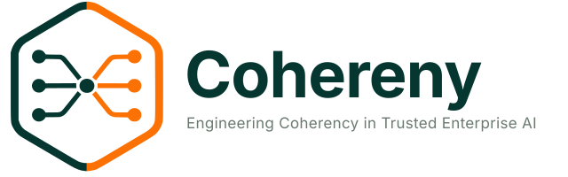

**SHAPE · ADAPT · LEARN · REPEAT**

## Version 4.40

> **Projekt:** cohereny.com
> **Status:** Pre-Release (vor 1.0)
> **Datum:** 2026-11-08
> **Autor:** Thomas Roth
> **Lizenz:** AGPLv3 + Commercial License

> **Zum Stand dieses Dokuments:** Das Whitepaper ist seit Juni 2026 mit dem Projekt gewachsen.
> Maßgeblich für den Implementierungsstand ist die Tabelle „What is built“ in der
> [README](https://github.com/cohereny/cohereny#what-is-built). Einzelne Abschnitte beschreiben die
> Ziel-Architektur oder einen früheren Stand und können hinter dem Code zurückliegen; die
> Überarbeitung läuft. Das Änderungsprotokoll ist Historie und bleibt, wie es war; ersetzt sind
> darin nur interne Verweise, die ein Leser nicht auflösen kann.
>
> **Ziel und Stand:** Cohereny ist ein Pre-Release. Das Whitepaper beschreibt das Ziel 1.0; was
> heute fehlt, trägt den Meilenstein, der es bringt (→ M5 … M8, Übersicht in §10).

**Änderungen v4.39 → v4.40 (2026-11-08) — CHY-250, CHY-230: Piloten abgekündigt, Ersetzen genau benannt:**
- **„Vor jedem Modellaufruf“ gilt für `/v1/complete` und Workflows** (arc42 ADR-018, dritter Nachtrag). Die LangGraph-Piloten rufen das Modell mit den Werten auf; sie sind abgekündigt und werden als Workflows auf den Runner umgestellt (arc42 ADR-028, Nachtrag 08.11.; CHY-172).
- **Nachgezogen:** Abstract, §4.2 (Stand, Payload-Daten), §13.2 (Cohereny-Mechanismen), Anhang A.1 (Art. 9, Art. 25).

**Änderungen v4.38 → v4.39 (2026-11-07) — CHY-200, CHY-153: Läufe abbrechen:**
- **§5.2, §5.3, §10 (M5), Anhang A.2 und A.5 (EU AI Act Art. 14(4)(e), BSI Kriterienkatalog KI):** Ein Workflow-Lauf lässt sich abbrechen — von der Person, die ihn gestartet hat, und ab `reviewer` von allen, die ihn sehen. Er endet als `cancelled`, weder Fehler noch Ablehnung; am Gate wird keine Entscheidung verbucht, eine Begründung ist freiwillig und wird mit Platzhaltern gespeichert (arc42 §6.9).
- **Pilotläufe (CHY-153):** Ein Abbruch am Freigabe-Gate wird nicht mehr als Ablehnung verbucht.

**Änderungen v4.37 → v4.38 (2026-11-07) — CHY-18: Muster-DSFA:**
- **§5.1, §5.3, §10 (M5), Anhang A (DSGVO Art. 35):** Die Muster-DSFA für das Arztbrief-Szenario steht als `DATA-PROTECTION-EXAMPLE.md` (deutsch `DATA-PROTECTION-EXAMPLE.de.md`) im Code-Repository. Sie hat die Vorlage am Fall geprüft; zwei Ungenauigkeiten sind dort berichtigt.

**Änderungen v4.36 → v4.37 (2026-11-07) — CHY-234: Läufe mit Platzhaltern:**
- **§4.2, §5.1, §5.3, §10 (M5), §12, §13.2, Anhang A (DSGVO Art. 17, 25, 32; BSI OPS.1.1.5):** Ein Workflow-Lauf wird nur mit Platzhaltern gespeichert, die Zuordnung zu den Werten je Lauf in der Anwendung verschlüsselt (arc42 ADR-018, zweiter Nachtrag; ADR-014, Nachtrag). Aufgelöst wird nur für die Person, die den Lauf gestartet hat, und ab `reviewer` für alle, die ihn sehen, jedes Mal protokolliert. Pilotläufe tragen die Werte bis zu ihrer Ablösung.
- **Gefunden und behoben (CHY-244):** Bei `/v1/complete` zeichnete der Trace die Antwort des Modells ungeprüft auf.

**Änderungen v4.35 → v4.36 (2026-11-06) — CHY-85, CHY-92: eigene Datenbankrollen, Lese-Isolation für Laufinhalte; Entscheidungen vom 06.11.:**
- **§2.2, §3.2, §3.3, §3.5, §8.1, §11.2, Anhang A (CRA, DORA, BSI ORP.4):** Wer einen Lauf sieht, setzt die Datenbank per Row-Level Security durch (arc42 ADR-047, CHY-92). Blöcke liest bisher jede angemeldete Person (→ M6, CHY-237), und Rollen gelten beim Schreiben installationsweit (CHY-243).
- **§3.7, §4.1, §4.3, §5.2, §8.6, §11.2, Anhang A (DSGVO Art. 32, CRA, DORA):** Die Anwendung läuft nicht mehr als Superuser (arc42 ADR-009, Nachtrag; CHY-85). Die Trigger halten gegen sie und ihre Datenbankrolle, nicht gegen die Eigentümerin der Tabellen.
- **§5.1, §5.2, §5.3, §5.4, §10, Anhang A (AI Act Art. 14, MaRisk, BSI KI):** Entschieden ist, die Prüftiefe nach Risiko abzustufen (CHY-223); `/v1/complete` folgt diesen Stufen (CHY-199). Beide → M6.
- **§4.2, §5.1, §5.3, §10, Anhang A (DSGVO Art. 17, 32, BSI OPS.1.1.5):** Lauf-Inhalte nur mit Platzhaltern → M5 (CHY-234, aus M7 vorgezogen), Art.-17-Suche in Lauf-Inhalten → M7 (CHY-239); Fristen für Audit-Log, Blöcke und Messungen → M7 (CHY-242).
- **§5.1, §5.3, Anhang A (DSGVO Art. 35, Healthcare):** Die Grundlage für die DSFA des Betreibers steht in `DATA-PROTECTION.md` (CHY-18); die Muster-DSFA für das Arztbrief-Szenario folgt.
- **§10:** M5 um CHY-113, CHY-170 und CHY-234 ergänzt, M6 um CHY-223, CHY-199 und CHY-237, M7 um CHY-238, CHY-239 und CHY-242.

**Änderungen v4.34 → v4.35 (2026-11-05) — CHY-63: PII-Redaction an der Grenze:**
- **Abstract, §4.2, §5.1, §5.3, §10 (M5, M7), §12, §13.2, Anhang A.1 (Art. 9, 17, 25):** Vor jedem Modellaufruf werden Bezeichner durch Platzhalter ersetzt, bei jedem Modell (arc42 ADR-018, Nachtrag). Modell, Gateway und Trace sehen sie nicht; die Antwort bekommt die Werte zurück. Erkennung Stufe 1: mitgelieferte Muster, Bezeichner des Aufrufers, Regeln des Bereichs als geprüfte Blöcke. Ersetzen am Eingang (CHY-234) und NER (CHY-235) → M7.
- **Berichtigt:** An vier Stellen standen die Aufbewahrungsfristen noch als offen (Abstract, §4.2, §5.1, §13.2) — beim Durchgang zu CHY-17 übersehen.

**Änderungen v4.33 → v4.34 (2026-11-05) — CHY-19: Restarbeiten Art. 17 erledigt:**
- **§4.2, §10 (M5), Anhang A.1 (Art. 17):** Restarbeiten nach Art. 17 ✅ — `UserPreferences` gibt es nicht, das Zusammenspiel mit den Fristen klärt arc42 ADR-046. PII-Redaction bleibt offen (CHY-63).

**Änderungen v4.32 → v4.33 (2026-11-05) — CHY-15: Kryptokonzept:**
- **§5.3, §10 (M5), Anhang A.1 und A.5 (DSGVO Art. 32, BSI CON.1):** Kryptokonzept für Betreiber ✅ als `CRYPTOGRAPHY.md` im Repository (arc42 ADR-014, entschieden). Ruhende Daten verschlüsselt der Betreiber; Lücken: JWKS bei Schlüsselwechsel (CHY-232), Geheimnisse maskieren (CHY-233), nur verschlüsselte Verbindungen (CHY-195).

**Änderungen v4.31 → v4.32 (2026-11-05) — CHY-17: Aufbewahrung:**
- **§4.2, §5.3, §10 (M5), §11.1, Anhang A.1 und A.5 (DSGVO Art. 17, BSI OPS.1.1.5):** Aufbewahrungsfristen ✅ (arc42 ADR-046). Die Inhalte eines Laufs werden nach Ablauf geleert, die Spur später gelöscht; Fristen je Geltungsbereich, über die Admin-API einstellbar und auditiert; der Löschlauf wird vom Betrieb angestoßen. Audit-Log, Blöcke und Messungen bekommen eine Frist mit CHY-85.

**Änderungen v4.30 → v4.31 (2026-11-05) — CHY-163, CHY-171: vier Augen, wo Daten den Ort wechseln:**
- **§3.4, §3.7:** Eine Routing-Regel mit einem Modell unterhalb `critical` und eine gelockerte Datenschutzregel gibt nur frei, wer sie nicht geschrieben hat — in jedem Geltungsbereich, im direkten Bereich werden sie eingereicht statt aktiv. Ausnahme ist der Einzelbetrieb, gekennzeichnet in Audit, Log und Antwort. Technische Konten zählen nicht als Person (arc42 ADR-045).
- **§5.3, §10 (M5), Anhang A (BSI ORP.4):** vier Augen bei Datenfluss-Bausteinen ✅ (CHY-163); die Autorisierung je Geltungsbereich bleibt offen (CHY-92).

**Änderungen v4.29 → v4.30 (2026-11-04) — CHY-189, CHY-229: Schnellstart, Einsicht am Gate:**
- **§10 (M5), Anhang A (BSI SYS.1.6):** Installation mit einem Befehl ✅ (CHY-189), mit lokalem Modell, Entwickler-Issuer und einem Beispiel mit Freigabe (arc42 v2.52).
- **§5.2, §5.4, §10:** Wer am `human_review`-Gate entscheidet, liest vorher die Ausgaben der Knoten ✅ (CHY-229). Bis dahin gab der Prüfer frei, ohne den Entwurf zu sehen.

**Änderungen v4.28 → v4.29 (2026-11-04) — CHY-192: `DEV_MODE` entfernt:**
- **§9, §10 (M5), Anhang A (DSGVO Art. 32, CRA Anhang I Teil I Nr. 2 Buchst. b):** `DEV_MODE` entfernt ✅. Jede Stufe prüft Tokens, eine Ausnahme gibt es nicht mehr. Entwicklung und CI holen Tokens beim lokalen Entwickler-Issuer (`scripts/dev_issuer.py`), den die API nur unter `ENVIRONMENT=dev` annimmt (arc42 v2.51 §8.1).

**Änderungen v4.27 → v4.28 (2026-11-03) — CHY-225: Weg zu 1.0 neu geordnet:**
- **§10:** Die Meilensteine laufen nacheinander, M5 vor M6, M7 und M7b. Was eine Frist hat oder seit der Veröffentlichung gilt, kommt in Q4/2026 parallel zu M5: Meldeprozess (CHY-16), Coordinated Vulnerability Disclosure (CHY-20), Kennzeichnung nach Art. 50(2) (CHY-118). M7b damit Q1/2027. `DEV_MODE` entfernen (CHY-192) und die Installation mit einem Befehl (CHY-189) nach M5, auch in den Regulatorik-Tabellen (DSGVO Art. 32, CRA Anhang I, BSI SYS.1.6); Anmeldung der Referenz-UI über den Identity Provider ✅ (CHYUI-9). Die Quartale sind Zusagen, nicht der knappste Plan.

**Änderungen v4.26 → v4.27 (2026-11-03) — CHY-202, CHY-93: python-jose ersetzt:**
- **§10, M7b:** `python-jose` ersetzt ✅. PyJWT prüft die Tokens, `exp`, `iss`, `aud` und `sub` sind Pflicht; die Token-Prüfung ist getestet (CHY-93).

**Änderungen v4.25 → v4.26 (2026-11-03) — CHY-181, CHY-220: Drift-Erkennung:**
- **Drift-Erkennung ist Ziel 1.0** (arc42 ADR-044): drei Ursachen — Modell, eigener Kontext, veränderte Eingaben —, vier Wege: Läufe bei Änderungen mit Probelauf vor der Freigabe, Nachtlauf nach Zeitplan (einstellbar, Vorgabe nächtlich), Signale aus dem Betrieb, ab M7 ein Messfühler mit Einbettungen. Jede Meldung beurteilt ein Mensch. „Auf Abruf statt nächtlich“ beschrieb die Referenzinstallation, nicht das Produkt; CHY-181 von „Nach 1.0“ nach M6. Neu angelegt: CHY-217 bis CHY-220.
- **Non-Goals präzisiert:** ausgeschlossen sind Einbettungen für Retrieval; als Messfühler ohne Index, Suche und Vektoren je Anfrage sind sie zulässig.
- **§8.5:** `BenchmarkRun` nennt die Art des Auslösers, `BenchmarkMeasurement` Wiederholung und Kontextstand (📋, CHY-68).
- **Nachgezogen:** §1.1, §1.2, §2.3, §5.2, §5.4, §5.5, §6.1, §7.4, §8.5, §10, §11.1, §11.2, §11.3, §13.1, §13.2, Anhang A.2 und A.4.

**Änderungen v4.24 → v4.25 (2026-11-02) — CHY-22: SBOM gebaut:**
- **§5 und Anhang A.3:** Anhang I Teil II Nr. 1 auf ✅. Jede Pipeline erzeugt eine CycloneDX-SBOM der Python-Abhängigkeiten, mit Lieferant je Komponente und gegen das Schema geprüft. Grenze: Auflösung zur Pipeline-Zeit, Lock-Datei → M8 (CHY-211). EVB-IT-Zeilen, Maßnahmenliste und §10 (M7b) nachgezogen.

**Änderungen v4.23 → v4.24 (2026-11-01) — CHY-197: Entscheidungen aus der Durchsicht:**
- **Ziel und heutiger Stand:** Das Whitepaper beschreibt das Ziel 1.0. Lücken werden nicht herabgestuft, sondern bekommen den Meilenstein, der sie schließt (→ M5 … M8), mit Ticket. §10 heißt jetzt „Weg zu 1.0“ und führt die Lücken je Meilenstein mit Quartal; die Tabelle M1/M2 und der Kasten mit internen Planungsdaten sind entfallen. Die Kernkapitel §2 bis §4 tragen ein Statuszeichen.
- **Regulatorik (§5, Anhang A):** Legende „✅ liefert die technische Grundlage … kein Eintrag bedeutet Konformität“; ⚠️ mit Meilenstein, wo SECURITY.md eine Lücke nennt (Secure by Default, Zugriffsschutz, Least Privilege, Sicherheitsupdates, Art. 32, Art. 14, MaRisk, BSI); CRA-Fundstellen nach Anhang I Teil I Nr. 2 Buchst. a–d und Teil II Nr. 1/5; Herstellerpflichten gelten ab der Veröffentlichung (Meldeprozess → M7b, CHY-16); Digital Omnibus mit Fundstelle VO (EU) 2026/1744; EVB-IT 2026 (März 2026). Zwei Tabellenzeilen mit überzähliger Spalte berichtigt.
- **§5.5 Vier Branchen:** Verbindlich ist keine der vier Vorgaben — das steht jetzt da, je Zeile mit Wortlaut (FDA–EMA periodisch, EASA Entwurf), und dazu, warum unverbindliche Leitlinien trotzdem zählen: Prüfer, Gerichte und Versicherer ziehen sie als Maßstab der Sorgfalt heran (CHY-156).
- **Konformitätswörter:** „DSGVO-konform“, „GDPR-konform“ und „Dokumentationskette für MDR-Konformität“ beschreiben jetzt, was gebaut ist (Löschweg nach Art. 17; wer wann was mit welchem Modell freigegeben hat).
- **Fine-Tuning:** Das Non-Goal heißt „kein Modell-Training als Produktfunktion“; geplant bleiben Datenexport und ein internes Validierungsmodell (→ M6, CHY-70), auf einer lokalen Laufzeit wie Ollama.
- **Referenz-Designs (§13)** nach ADR-041 (Datenklasse je Geltungsbereich, zwei Workflows statt `privacy_safe` je Knoten) und ADR-043 (Kalibrieranker messen Modelle vor dem Einsatz); Referenz-UI: Veröffentlichung → M8 (CHYUI-11); §8 als Kurzreferenz mit Verweis auf arc42 §5.6; interne Kennungen aus dem Änderungsprotokoll entfernt.
- **Schlussprüfung vor der Veröffentlichung:** §5.5 berichtigt — Aufsichtspflicht ist die Überwachung bisher nur in der Finanzwirtschaft (MaRisk AT 4.3.4 Tz. 5), die übrigen Texte sind unverbindlich; „Erfüllt“ in A.3 und §11.2 ersetzt; Vier Augen bei Blöcken einheitlich CHY-163 (→ M5); Chat-Oberfläche (v1.1) in §10; Meilensteine in §5.1 und §7.4 ergänzt.

**Änderungen v4.22 → v4.23 (2026-10-31) — CHY-197: Abgleich mit dem Code:**
- **Kopf bis §5** gegen den Code, die README und das heute abgeglichene arc42 (v2.44) geprüft. Was das Dokument als vorhanden beschrieb, ohne dass es gebaut ist, steht jetzt als geplant da: Adaption je Modell, Modell-Profile und Übersetzungsregeln, Klassifikator im Routing, Multimodalität (📋 Referenz-Design), Bootstrap-Templates, `GET /v1/adaptvault/export/dpo`.
- **Kontext-Repository und Komposition (§2.5–§2.7)** nach dem Gebauten: sechs Blocktypen nach Migration 021, Komposition fügt flach nach tief an und überschreibt nichts, Konflikt ist nur, was Blöcke erklären (Privacy-Ratchet, 409), Cache mit Generationszählern statt Sekundärindex, kompiliert beim ersten Abruf, auch ein Treffer liest PostgreSQL. Benchmark nach ADR-043: Kalibrieranker statt `prompt_benchmarks`, auf Abruf statt nächtlich, 🔧 statt 📋.
- **Mandantenfähigkeit (§3):** Rollen und Gruppen nach `kernel/roles.py` (`chy-<rolle>s`, fünf Rollen, installationsweit); Geltungsbereiche und Mitgliedschaften verwaltet Cohereny selbst, durchgesetzt werden sie noch nicht; Identity Provider: getestet mit Authentik; vier Augen bei Blöcken nicht erzwungen (SECURITY.md).
- **Datenschutz (§4, §5):** Löschung nach dem Gebauten (`POST /v1/admin/actors/{actor_ref}/anonymize`, `[anonym]`, kein Hash, kein Hard Delete), Payloads nicht erfasst; Audit-Log mit den echten Feldern und seiner Grenze gegenüber der Datenbankrolle. Human Oversight: nicht abschaltbar im Workflow-Runner, `/v1/complete` ohne Gate, Freigabe nach Regression geplant. Alte Tracker-Nummern durch CHY-Kennungen ersetzt, C5 auf n/a, Verweis auf §11.2.
- **§6 bis Anhang A:** Architekturbild als Ziel-Architektur mit dem Gebauten benannt, Redis in der Topologie; §7.1/§7.2 als geplant markiert, gebauter Ablauf darunter; Study-Workflow nach dem Graphen des Piloten (streng nacheinander, neun Knoten, gemeinsamer Schleifenzähler). §8 Datenmodelle nach dem Schema: Rollen, Geltungsbereiche, Workflow-Felder (`deprecated`, `source_node_id`/`target_node_id`, nicht ausgewertete Felder benannt), Blocktypen und -felder, Kalibrieranker, Benchmark nach Migration 028, Merge Requests entfallen, Audit-Log und Transparenznachweis mit den echten Feldern. Verzweigung: genommen wird jede zutreffende Kante, `execution_mode` wird nicht ausgewertet; `loop_limit_reached` und Sub-Workflow-Ausführung als nicht gebaut; Einbindung fremder Engines über `POST /v1/workflows/{workflow_id}/runs`.
- **§9 bis §13:** API-Oberflächen nach `api/v1/router.py`, Auth mit der Ausnahme `DEV_MODE`; Vergleichstabelle mit Legende und 🔧 für Teilgebautes; Langfuse optional; Banking- und Healthcare-Design ohne `privacy_safe`/`cloud_routing_allowed`, Actor-Pattern ausdrücklich nicht für Patientendaten.
- **Anhang A:** Löschung, TLS, Backup, Deployment, CVE-Prüfung, SBOM-Grundlage und Transparenznachweis nach dem Gebauten statt nach der Referenzinstallation; Lücken aus SECURITY.md eingetragen. Ob Secure by Default, Zugriffsschutz, Sicherheitsupdates und Least Privilege ✅ oder ⚠️ tragen, ist offen und in beiden Anhängen gleich geblieben.

**Änderungen v4.21 → v4.22 (2026-10-30) — CHY-188: dritter Lauf der Durchsicht:**
- **Hinweis zum Stand** oben eingefügt: maßgeblich ist die README, einzelne Abschnitte können hinter dem Code zurückliegen.
- **Rechtszitate berichtigt:** Anomalien erkennen ist Art. 14(4)(a) KI-VO, nicht Art. 14(3)(c), den es nicht gibt; Art. 9(9) (Minderjährige) durch Art. 9(2)(c) und Art. 72 ersetzt; Transparenzpflicht Art. 50 statt Art. 52 (Entwurfsnummer); Protokollierung steht in Art. 12 der DelVO (EU) 2024/1774, nicht in Art. 12 DORA (Backup). „Cloud-Verarbeitung ohne Einwilligung nicht erlaubt“ war falsch — Art. 9 Abs. 2 DSGVO kennt weitere Ausnahmen.
- **MaRisk:** RS 06/2026 (9. Novelle) ist seit 30.06.2026 in Kraft, der Modellabschnitt heißt AT 4.3.4; die Orientierungshilfe zu IKT-Risiken beim Einsatz von KI ist nicht verpflichtend und steht jetzt so da.
- **C5 und AIC4:** C5 als „n/a – nicht anwendbar“ statt ✅ unter einer Legende, die ✅ als „erfüllt“ erklärt; AIC4 als „liefert Nachweise“, denn erfüllt ist ein Kriterium erst, wenn ein Prüfer es feststellt. §5.1 hat eine Legende für die Statusspalte.
- **§11.4 neu gefasst:** sachliche Abgrenzung zu Gateway-Produkten ohne Positionierungsaussagen und ohne Behauptungen über das Fremdprodukt; der Ersetzungsrest im Namen ist weg.
- **Betrieb der Referenzinstallation** (Prometheus/Grafana, restic) steht nicht mehr als Cohereny-Eigenschaft in DORA- und BSI-Tabellen. „Stärkste verfügbare Implementierung — kein Gap“ gestrichen.
- **Study Workflow:** „Medizindaten“ und „Medizinische Fakten“ in §7.3 neutral, wie die Prompts seit CHY-188. Non-Goals-Tabelle repariert (eine Zeile hing im Zitat).

**Änderungen v4.20 → v4.21 (2026-10-30) — CHY-188: Durchsicht vor der Veröffentlichung:**
- **Aussagen an den Code angeglichen:** Abstract und §2.3 beschreiben die Adaptionsschicht als geplant, nicht als vorhanden; gebaut sind Kontext-Repository, Komposition und Routing. In den Vergleichs- und Regulatorik-Tabellen stehen Adaption und Nightly Benchmark auf 📋 bzw. ⚠️ statt ✅, die Berufung auf `runs.csv` als Monitoring-Nachweis entfällt. `SECURITY.md` ist vorhanden; der Art.-50-Hinweis ist in der UI gebaut (CHYUI-4), offen ist Art. 50(2) (CHY-118)
- **CRA:** „intern selbst betrieben, kein Markteintritt" trägt mit der Veröffentlichung nicht mehr. Cohereny behandelt sich als Hersteller; die Pflichten sind eingeplant
- **Kapitel 14** verweist auf README und Roadmap. Der Schritteplan vom Juli war überholt und lief neben der eigentlichen Planung her
- **Interna entfernt:** Verweise auf interne Dokumente, Termine und Werkzeuge, Gerätedaten der Referenzinstallation
- **Berichtigt:** „CC" (alter Produktname) → „Cohereny"; Open Source mit AGPLv3 statt „MIT-Lizenz"; „Live-PoC" aus der Überschrift der Referenz-Designs
- **Zweiter Lauf am selben Tag:** §1.2, §2.3 und §11 beschreiben Adaption, Nightly Benchmark und Feedback-Loop als geplant; CRA-Lücken als Herstellerpflicht statt „Best Practice"; „Cohereny" im Fließtext durchgehend groß

**Änderungen v4.19 → v4.20 (2026-10-29) — CHY-188: Schreibweise:**
- Der Produktname heißt im Text durchgehend „Cohereny". Klein bleibt er nur, wo er technisch ist (Domain `cohereny.com`, Repository, Dateinamen, Bezeichner wie `cohereny-ui`) oder zum Logo gehört.

**Änderungen v4.18 → v4.19 (2026-10-29) — CHY-188: Veröffentlichung vorbereitet:**
- **Lizenz AGPLv3 statt GPLv3.** Unter der GPLv3 muss, wer Cohereny verändert und nur als Dienst betreibt, nichts offenlegen; die AGPLv3 verlangt es (Abschnitt 13). Erst damit hat die kommerzielle Lizenz für Anbieter gehosteter Dienste einen Gegenstand
- **Für die Veröffentlichung bereinigt:** Hostnamen, Adressen und interne Domains des Referenz-Deployments durch Rollen ersetzt (Application-Server, DMZ-Host, Compute lokal, Compute Cloud). Ältere Änderungseinträge, die Hostnamen nannten, sind sinngleich umformuliert; das Token-Beispiel in §3 nennt eine Platzhalteradresse
- **Rechner, die Modelle ausführen, heißen nach ihrer Rolle, nicht nach dem Gerät:** *Compute lokal* (Ollama, Stufen `local-small` und `local-medium`) und *Compute Cloud* (Modelle per API: zwei über Ollama Cloud eingerichtet und nur für die Datenklasse `public` zugelassen, CHY-157; Claude vorgesehen, in den Diagrammen gestrichelt). Das Gerät wechselt, die Rolle bleibt. Messwerte nennen weiter das Gerät, auf dem gemessen wurde — ohne die Messbedingung sagt die Zahl nichts

**Änderungen v4.17 → v4.18 (2026-10-06) — Benchmark auf Ankern (arc42 ADR-043):**
- **§5.4:** Testfälle sind Kalibrieranker im Kontext-Repository; der Lauf geschieht zunächst **auf Abruf**, nach Zeitplan erst, wenn die Inferenz-Hardware nachts erreichbar ist (CHY-181). Umsetzung in drei Schritten (CHY-67, CHY-68, CHY-64)

**Änderungen v4.16 → v4.17 (2026-09-29) — CHY-65: ein Freigabeweg:**
- **§3.7 neu gefasst:** Freigegeben wird die Block-Version selbst, einen eigenen Merge-Request-Datensatz gibt es nicht (arc42 ADR-042). Die Scope-abhängige Strenge aus ADR-011 bleibt: streng in `org`/`team`/`workspace`, direkt in `project`/`sub_project`/`personal`, dazu der Promote-Pfad
- **Drei Zusagen zurückgenommen**, die das Kapitel bisher machte und die es nicht gibt: mehrere Blöcke in einer Freigabe, Kommentare je Feld, Zusammenfassen mehrerer Änderungen. Stehen jetzt ausdrücklich unter „bewusst nicht"
- Wettbewerbstabelle, Oberfläche author und die Zahl der Kontexte (vier) nachgezogen

**Änderungen v4.15 → v4.16 (2026-09-25) — CHY-166: eine Routing-Regel begrenzt die Antwortlänge:**
- **Jede Routing-Regel nennt `max_tokens`** — die längste Antwort, die sie erlaubt, und die Voreinstellung, wenn ein Aufrufer nichts angibt. Ein Aufrufer darf weniger verlangen, nie mehr. Bis dahin entschied das Modell allein, wann es aufhört: am 25.09. brauchte ein gedrosselter Raspberry Pi für „ping" fünf Minuten
- **Das Schema der Routing-Regel steht jetzt so da, wie der Code es liest** (`task_type`, `candidates`, `max_tokens` in `metadata`). Das bisher abgedruckte Schema mit `conditions`, `action` und `priority` gab es nie
- arc42 ADR-038, Nachtrag

**Änderungen v4.14 → v4.15 (2026-09-24) — CHY-160: die Datenklasse gehört dem Geltungsbereich:**
- **Ein Geltungsbereich erklärt, welche Daten in ihm liegen** (`public` bis `critical`), und kein Modell bekommt Daten über seiner Obergrenze — auch nicht als Rückfall. Wirksam ist die strengste Klasse auf dem Weg zur Wurzel; **wer nichts erklärt, bekommt `critical`**, und damit nichts in die Cloud (arc42 ADR-041)
- Bis dahin verglich keine der drei Schutzschichten die Klasse der Daten mit der des Modells. Folgenlos, solange jedes Modell lokal war — mit Ollama Cloud nicht mehr

**Änderungen v4.13 → v4.14 (2026-09-24) — CHY-145, CHY-157: der Runner routet:**
- **Ein Workflow-Knoten nennt sein Modell nicht mehr selbst.** `config["model"]` umging alles, was die Routing-Regeln leisten: Freigabe, Vererbung entlang des Geltungsbereichs, Privacy-Ratchet, Fallback-Kette. Der Runner löst jetzt nach `task_type` auf wie `/v1/complete`, und ein Rückfall steht im Audit mit Lauf und Knoten
- **`NodeClassification` und `ModelAssignment` sind aus dem Modell entfernt** — beide standen seit v2.x hier, und nichts davon existierte. `task_type` ist eine Pflichtspalte am `llm_call`, die Modellwahl eine Routing-Regel (ADR-038), die Datenklasse eine Eigenschaft des Geltungsbereichs (CHY-160)
- **Ollama Cloud ist der erste gehostete Kandidat** (`public`, kein AV-Vertrag). Vorgesehen ist Cloud zuerst, lokal als Rückfall — genau die Form, die eine erschöpfte Free-Plan-Quote braucht (CHY-159)

**Änderungen v4.12 → v4.13 (2026-09-08) — CHY-148: gegen den Quellbaum geprüft:**
- **Der C5-USP ist ersatzlos falsch gewesen und durch AIC4 ersetzt.** C5:2026 enthält auf 222 Seiten **ein** Vorkommen von „AI" als Wort — in einem Satz über Schwachstellenscanner. Kein KI-Register. „Audits ab 06/2027" steht im Katalog, meint aber die Umstellung der Berichtszeiträume: **eine echte Zahl, an die eine erfundene Anforderung gehängt war**
- **AIC4 verpflichtet ebenfalls niemanden** — „not regulatory in nature … voluntary" (BSI). Das neue Argument arbeitet deshalb nicht mit einer Pflicht, sondern mit **Deckungsgleichheit**: RE-02 (Protokollierung jeder Modellanfrage) und PF-04 (dokumentierte Modellwahl) fallen in Cohereny als Nebenprodukt an
- **Statuslegende ergänzt.** 94 Überschriften, bis v4.12 **null** Statuszeichen — der arc42 hat sie seit v1.x. Ohne sie liest sich ein Entwurf wie ein Betriebszustand
- **§5.4 Nightly Benchmark trägt jetzt 📋.** Der Absatz stand im Präsens, während vier Endpunkte mit 501 antworten und kein Scheduler existiert
- **Meilensteintabelle M3–M8 entfernt.** Sie führte M3 als „geplant", obwohl M3 am 21.08. mit 19 von 19 geschlossen wurde
- **Multimodale Workflows in der USP-Tabelle:** ✅ → 📋. `vision|multimodal|transcription` findet im Quellbaum nichts

**Änderungen v4.11 → v4.12 (2026-09-07) — CHY-134: `context_requirements`:**
- **Aus der Zusage wird eine Spalte.** `workflow_nodes.context_requirements` mit zwei CHECKs: nur auf `context_compose`, und nur komponierbare Blocktypen (ADR-037). `config["block_types"]` ist unspeicherbar — die alte Schreibweise wird abgelehnt statt ignoriert
- **`ContextRequirements` wird zum ersten Mal definiert.** Das Modell nannte die Klasse seit v2.x und beschrieb sie nie; im Schema stand nichts. Sie hat genau ein Feld, weil `compose` genau eines auswerten kann
- **Warum die Blocktyp-Liste in SQL steht:** Das Vokabular gehört dem repository-Kontext, den orchestration nicht importieren darf (ADR-030). Die Datenbank kennt beide Tabellen und ist der Durchsetzungspunkt ohne Umweg (arc42 ADR-040)
- **Erster von drei Schritten**, `config` zu leeren: `model` folgt in CHY-145, `prompt`/`system` in CHY-146. Ein Systemprompt in einer Knotenkonfiguration ist ein Baustein ohne Version, ohne Freigabe und ohne Ratchet

**Änderungen v4.10 → v4.11 (2026-09-07) — Rückfluss aus dem Buch (CHY-140, CHY-141):**
- **Das RAG-Non-Goal war eine Aussage über die Speicherung und wurde als Aussage über das Verfahren gelesen.** Präzisiert auf „kein Vektorspeicher, keine Ähnlichkeitssuche, kein Chunking, keine Einbettungen" — und die **Herkunft dessen, was in den Prompt gelangt, ausdrücklich davon ausgenommen**: sie ist ein Ziel, kein Non-Goal
- **Der Schwerpunkt liegt auf der Augmentierung, nicht auf dem Retrieval.** Art. 26 Abs. 4 spricht von *Eingabedaten* — das ist der fertige Prompt, nicht die Treffermenge. Wer zwanzig Treffer auf vier kürzt, weil das Fenster voll ist, entscheidet über die Repräsentativität; der Retriever tut es nicht
- **Begründet aus dem Verordnungstext, nicht aus Geschmack:** Art. 26 Abs. 4 trifft den Betreiber, Art. 12 verlangt Rückverfolgbarkeit, und **Art. 10 greift ausgerechnet nicht** — ein Retrieval-Korpus ist weder Trainings- noch Validierungs- noch Testdatensatz. Der Bestand, der die Antwort im Betrieb bestimmt, fällt aus dem Wortlaut
- **Knoten 1 des Study-Piloten hieß „Chunking und Embedding" mit `nomic-embed-text`.** Im Code steht ein Aufteilen nach Zeichenzahl mit 100 Zeichen Überlappung; `nomic` und `embed` finden unter `pilots/study/` nichts. Zwei Stellen desselben Dokuments widersprachen sich damit — die Non-Goals-Tabelle sagte „kein RAG", die Pilotbeschreibung beschrieb eines
- **`nomic-embed-text` läuft auf einem lokalen Compute-Host und wird von nichts benutzt.** Als Fußnote vermerkt statt entfernt: die Zeile beschreibt den Bestand, nicht die Nutzung

**Änderungen v4.9 → v4.10 (2026-09-04) — CHY-133: der Pflichtkern läuft:**
- **`context_compose` ist ausführbar.** Bis dahin erzwang der Validator drei Pflichtknoten, von denen das Deployment nur einen ausführen konnte — jeder gültige Workflow wäre am ersten Knoten gescheitert (arc42 ADR-034)
- **`context_requirements` ist als typisiertes Feld nicht umgesetzt** und im Modell jetzt so markiert. Es gibt keine Spalte und keinen Code; was der Executor liest, steht in `config`. Aufgenommen als CHY-134 — dieselbe Abweichung zwischen Modell und Schema wie `condition TEXT` vor CHY-130

**Änderungen v4.8 → v4.9 (2026-09-04) — CHY-131: Was ein Knoten sieht (ADR-033):**
- **`input_mapping` gilt für jeden Knotentyp**, nicht nur für `sub_workflow`. Das Feld stand seit Tag eins im Schema und wurde von nichts gelesen; dieselbe Abbildung für alle Knoten ist eine Regel weniger als eine zweite daneben
- **Ein Knoten sieht die Ausgabe seiner unmittelbaren Vorgänger, nach Herkunft getrennt.** Die Laufeingabe unter `run`, jeder Vorgänger unter seinem `node_ref`, das Mapping **obendrauf** statt anstelle. Kein gemeinsamer Namensraum — sonst überschreiben sich zwei Knoten still, und der Verlierer ist der, dessen Zeile zufällig als zweite zurückkam
- **Warum unmittelbare Vorgänger und nicht alles bisherige:** „Alles" macht den Lauf zu einem gemeinsamen Geltungsbereich, in dem ein Knoten unbemerkt von einem Wert abhängt, der drei Zweige entfernt entstand. Wer etwas von weiter oben braucht, bekommt eine **Kante** — dann steht der Datenweg im Bild
- **Bis dahin war der Pflichtkern aus ADR-004 nicht verbunden:** `context_compose` baute einen Kontext zusammen, den `llm_call` nicht empfangen konnte. Läufe liefen trotzdem durch und meldeten Erfolg

**Änderungen v4.7 → v4.8 (2026-09-04) — CHY-82: Die Bilder holen ADR-028 ein:**
- **§6.1 Komponentenübersicht:** Der **Workflow-Runner** steht jetzt im Kern. ADR-028 hat ihn am 11.08. beschlossen; das Bild kannte ihn drei Wochen lang nicht
- **Die LangGraph-Box heißt „Fremde Engine".** Sie steht im *Client Layer* und gehört dorthin: ADR-028 hat LangGraph aus dem **Kern** entfernt, §8.2.2 verlangt zugleich, dass Cohereny *in* einer fremden Engine als Knoten einsetzbar bleibt. Beides gilt, und der neue Name macht aus einer Abhängigkeit ein Beispiel
- **Abgrenzung gegen Agent-Frameworks korrigiert.** „Keine Tool-Orchestrierung, keine Agent-Loops" stimmt seit ADR-028 nicht mehr — Cohereny orchestriert, mit Schleifen und Join-Policies. Die Naht liegt woanders: ein Agent-Framework lässt **das Modell** entscheiden, was als Nächstes passiert; Cohereny führt einen Graphen aus, den ein Mensch erklärt und freigegeben hat. **Nicht die Menge an Steuerung unterscheidet die beiden, sondern wer sie festlegt** — und daran hängt die Nachvollziehbarkeit nach Art. 12 EU AI Act

**Änderungen v4.5 → v4.6 (2026-08-11) — CHY-81:**
- **§8.2 neu gefasst:** „Domäne: Workflow (DAG)" → „Workflow (gerichteter Graph)". Zyklen sind zulässig; die frühere Azyklizität war weder begründet noch implementiert und konnte den laufenden Study-Pilot nicht abbilden
- **Knotentypen an das Schema angeglichen:** `context_compose | llm_call | tool_call | fork_gateway | join_gateway | human_review` — `human_review` stand seit `001_initial` in der Datenbank, aber nicht im Whitepaper
- **`sub_workflow` neu**, `loop_limit` an der Kante neu, `human_review` um `review_role` / `review_timeout` / `on_timeout` ergänzt
- **§8.2.1 neu:** Workflow-Strukturen — Sequenz, Verzweigung mit Zusammenführung, Schleife mit Iterationsgrenze, Sub-Workflow; mit Diagrammen
- **§8.2.2 neu:** Einbindung in Camunda, SAP und andere Workflow-Engines. Cohereny als *ein* Schritt, der intern selbst einen Workflow mit erzwungenem Freigabeschritt ausführt — samt Begründung, warum das Austauschformat JSON bleibt, obwohl der BPMN-Import über XML läuft
- **§7.3:** Die zwei Zyklen des Study-Piloten als Gegentest zum Modell benannt; Iterationsgrenzen im Diagramm sichtbar gemacht
- **§9.1:** Endpunkte für Validierung, Ausführung, Sub-Workflow-Aufruf, veröffentlichtes JSON Schema und BPMN-Import ergänzt
- **§12:** Offener Punkt „Workflow-DAG-Semantik" aufgelöst (arc42 ADR-026/027/028)

**Änderungen v4.4 → v4.5 (2026-08-01):**
- **§2.3 erweitert:** Automated Adaptation Discovery + DPO-Flywheel als "Continuous Model Intelligence" (CHY-67–70, ADR-024)
- **§8.5 erweitert:** `PromptBenchmark` + `BenchmarkResult` Datenmodelle (Implementierung M6)
- **§10 Roadmap:** M6 und M7 mit CHY-67–70 konkretisiert
- **§11.2 Vergleichstabelle:** Neue Zeile "Selbstlernende Adaption (Benchmark → DPO)"

**Änderungen v4.3 → v4.4 (2026-07-31):**
- **Infra-Migration:** Stack vom Raspberry Pi 5 auf einen eigenen Application-Server umgezogen; Compute-Host umbenannt; alle Adressen aktualisiert
- **DNS:** interne Namen auf eine neue interne Domain umgestellt (alle Referenzen)
- **CI/CD:** Gitea Actions → GitLab CI (abgeschlossen)
- **Lizenz:** MIT (geplant) → GPLv3 + Commercial License (CHY-55 ✅ entschieden)
- **Domain:** cohereny.cloud → cohereny.com / cohereny.dev
- **Logo:** cohereny-brand SVG eingebunden (cohereny-logo-horizontal.svg)
- **§11.4 neu:** Abgrenzung zu Databricks AI Gateway / Mosaic AI (ADR-023, CHY-56)
- **Roadmap M8:** Lizenzentscheidung als ✅ erledigt markiert

**Änderungen v4.2 → v4.3 (Peer Review 2026-07-12):**
- **Abstract:** "Middleware-Schicht" → "Context Middleware" als kanonischer Begriff; "headless by default, mit optionaler Referenz-UI" als Attribut separiert
- **Non-Goals:** Neuer Abschnitt nach Abstract — explizite Abgrenzung zu Agent Frameworks, LLM-Gateways, Observability, RAG, Prompt IDE, Fine-Tuning, Inferenz-Engine

**Änderungen v4.1 → v4.2 (CTX-39):**
- **Pilot umbenannt:** jetzt „Study Workflow" (didaktische Zusammenfassung und Quiz-Generierung, ohne medizinischen Bezug)
- **§11.2 + §11.3:** BSI C5:2026 KI-Register als expliziter USP ergänzt — `ModelProfile` + `ContextRepository` = de facto KI-Register — ⚠️ **sachlich falsch, zurückgenommen in v4.13 (CHY-148):** C5 enthält keine KI-Anforderungen. Als Protokolleintrag stehen gelassen, weil ein rückwirkend umgeschriebenes Protokoll schlimmer ist als der Fehler, den es festhält
- **ADR-008 (ltree-Encoding):** Entscheidung konkretisiert — PostgreSQL `ltree`, Encoding `org_uuid.team_uuid.project_uuid`, `node_type` als separates Feld; Offene Schuld als erledigt markiert
- **§12 Offene Fragen:** ltree-Encoding-Eintrag auf ✅ erledigt gesetzt

**Änderungen v4.0 → v4.1:**
- **Neues Kapitel 2.8:** Multimodalität als modalitäts-agnostisches Architekturprinzip — Vision, Audio, Text und Multimodal durch dieselbe Adaptionsschicht; `ModelProfile`, `TranslationRule` und `CalibrationAnchor` modalitätsspezifisch konfigurierbar
- **Neues Kapitel 7.4:** Kamerabasiertes Aktivitäts-Monitoring als Referenz-Design — lokale Vision-Inferenz (Ollama), CalibrationAnchors mit Referenz-Frames, Human-in-the-Loop Feedback-Schleife, Healthcare-Übertragbarkeit (EU AI Act Art. 14)
- **Kapitel 11.2:** Vergleichstabelle um Zeile "Multimodale Workflows" erweitert — Cohereny als einziges Tool mit ✅

**Änderungen v3.1 → v4.0 (Major):**
- **Regulatorik vollständig aktualisiert (Faktencheck 07/2026):** Digital-Omnibus-Fristen (Anhang III → 02.12.2027, Anhang I → 02.08.2028, Art. 50 unverändert 02.08.2026), Kommissions-Leitlinien C(2025) 924 als Quelle der Middleware-Einordnung, Art.-25-Wertschöpfungskettenrisiko, CRA-Meldepflichten 11.09.2026, 9. MaRisk-Novelle/BAIT-Staffelung, BaFin-Orientierungshilfe KI 18.12.2025, Grundschutz++, C5:2026.
- **Neues Kapitel 5.5:** Drift-Monitoring als branchenübergreifendes regulatorisches Muster (FDA/EMA · BaFin · BSI C5 · EASA) — der stärkste Einzelbefund für die Buchthese.
- **Kapitel 13 ehrlich eingeordnet:** Referenz-Designs statt „Live-PoC validiert"; implementiert ist der Study Workflow (Studienhefte, keine Patientendaten).
- **Roadmap (Kap. 10) meilensteinbasiert** statt kalendarischer Gantt; Deployment-Diagramm korrigiert (UI läuft auf dem Application-Server, Port 3002, nicht in der DMZ).
- **Offene Fragen (Kap. 12) beantwortet** bzw. mit konkreten Empfehlungen versehen; neu identifizierte Fragen ergänzt.
- **DSGVO:** dritte Datenkategorie Payload-Daten + PII-Redaction; Lösch-Endpoint einheitlich `/erase` mit Salt-Pseudonymisierung.
- **Qualitätsnachweis:** A/B-Benchmark-Modus (`adaptation_gain`) als Beleg für Qualitätsziel Nr. 1.

**Änderungen v3.0 → v3.1:** Status auf PoC-Validierung aktualisiert; Kapitel 13 — abgeschlossene PoC-Schritte markiert (FastAPI 3-Stage, LangGraph, LiteLLM Routing, SSE Streaming + UI, OIDC), Event-Persistenz (Issue #42) als nächster Schritt ergänzt.

**Änderungen v2 → v3:** Agentic Workflow als Primär-Use-Case (2.5), komposierbare Kontext-Blöcke (2.6), globales Kontext-Repository mit Vererbung (3.5), Bootstrap-Templates (3.6), Merge Request Workflow für Kontext-Blöcke (3.7 — offene Designentscheidung), automatisierte Qualitätsmessung mit verpflichtendem Human Oversight (5.3 — offene Designentscheidung), Karpathy LLM-Wiki Pattern-Vergleich (11.1), neue Datenmodelle (8.5–8.6).

---

## Statuslegende

Der arc42 trägt diese Zeichen seit v1.x an seinen Bausteinen und Szenarien, dieses Dokument bis v4.12 an
**keiner** von 94 (CHY-148). Ohne sie liest sich ein Entwurf wie ein Betriebszustand —
§5.4 beschrieb den Nightly Benchmark im Präsens, während vier Endpunkte mit 501 antworteten.

| | Bedeutung |
|---|---|
| ✅ | **Implementiert und im Betrieb.** Im Quellbaum nachweisbar |
| 🔧 | **Teilweise** — ein Teil läuft, ein benannter Teil fehlt |
| 📋 | **Geplant oder Referenz-Design.** Existiert als Entwurf, nicht als Code |

Die Kernkapitel §2 bis §4 tragen ein Zeichen; ohne Zeichen bleiben nur Einordnung, Abgrenzung und
Konzept (§1, §3.1). Hinter 🔧 und 📋 steht der Meilenstein, in dem das Fehlende kommt (**→ M5** …
**M8**, Übersicht in §10 „Weg zu 1.0“), mit Ticket. Cohereny ist ein Pre-Release: Das Dokument
beschreibt das Ziel 1.0, das Zeichen den heutigen Stand.

Die einzelnen Tabellen führen eigene, lokal erklärte Zeichen (§5.2, §11.2) — die bleiben,
weil sie eine andere Frage beantworten als der Bauzustand eines Kapitels.

---

## Abstract

Cohereny ist eine selbst-gehostete **Context Middleware** für Multi-LLM-Workflows — headless by default; eine Referenz-UI gibt es als eigenes Repository, veröffentlicht wird sie mit M8 (CHYUI-11). Sie adressiert systematisch drei LLM-Qualitätsphänomene — Modell-Varianz, Model Drift und Prompt Sensitivity (zusammenfassend bekannt als "Model Drifting") — durch ein geteiltes, versioniertes Kontext-Repository, Routing je Modell und eine geplante Adaptionsschicht, die Prompts modell-spezifisch transformieren soll, ohne den eigentlichen Workflow-Code zu ändern.

Das Zielbild: Ein Prompt wird einmal geschrieben, Cohereny übersetzt ihn zur Laufzeit in die optimale Form für das jeweilige Zielmodell — basierend auf einem trainierbaren Kontext-Repository, das modell-spezifische Präferenzen, Stärken und Eigenheiten speichert. Gebaut sind Kontext-Repository, Komposition und Routing; die Übersetzung selbst ist geplant (§2.3).

**Primärer Use Case (v3):** Agentic Workflows, in denen mehrere Modelle mit unterschiedlichen Stärken sequenziell oder parallel zusammenarbeiten — und jeder Schritt seinen eigenen granularen Kontext benötigt. Cohereny ist die Schicht die diesen Kontext verwaltet, komponiert und qualitätssichert.

Cohereny ist von Anfang an für Teams und Organisationen konzipiert — mit geteiltem Kontext, rollenbasierter Governance, Vererbungshierarchie (Global → Team → Projekt), Revisionssicherheit und einer auf die DSGVO ausgelegten Datenhaltung (Löschweg nach Art. 17, Aufbewahrungsfristen und Platzhalter vor jedem Modellaufruf von `/v1/complete` und in Workflows gebaut). Das System ist vollständig headless: jede Funktion ist über eine dokumentierte API verfügbar.

---

## Non-Goals

Cohereny ist explizit **nicht**:

| Was | Warum nicht |
|---|---|
| **Agent Framework** (LangChain, LlamaIndex) | Keine Agent-Autonomie, keine Tool-Discovery, keine ReAct-Schleifen. Cohereny führt **erklärte Graphen** aus, keine Entscheidungen eines Modells über den nächsten Schritt — siehe die Korrektur unter der Tabelle |
| **LLM-Gateway / Router** (LiteLLM, OpenRouter) | Kein reines Request-Routing — Cohereny baut auf LiteLLM auf und fügt die Kontext-Dimension hinzu |
| **Observability-Plattform** (Langfuse, Helicone) | Keine primäre Logging- oder Tracing-Plattform — Cohereny nutzt Langfuse als Observability-Schicht |
| **Vektorspeicher und Retrieval-Maschinerie** | Kein Vektorspeicher, keine Ähnlichkeitssuche, kein Chunking, keine Einbettungen für Retrieval. Dafür gibt es pgvector und LlamaIndex; ein zweiter davon macht das Produkt schlechter. **Die Herkunft dessen, was in den Prompt gelangt, ist davon ausgenommen — sie steht unter den Zielen.** Ebenfalls ausgenommen: Einbettungen als Messfühler für Drift — ohne Index, ohne Suche, ohne Vektoren je Anfrage (arc42 ADR-044) |
| **Prompt IDE** | Keine grafische Prompt-Entwicklungsumgebung |
| **Fine-Tuning-Plattform** | Kein Modell-Training als Produktfunktion — Cohereny lernt auf Regel-Ebene, nicht auf Gewichts-Ebene. Geplant sind der Export von Trainingsdaten (Bring Your Own Model) und ein internes Validierungsmodell, das die Adaptionen prüft (§2.3, → M6, CHY-70) |
| **KI-Modell / Inferenz-Engine** | Cohereny führt keine eigene Inferenz durch |

> **Korrektur (04.09.2026, CHY-82):** Die erste Zeile lautete „Keine Tool-Orchestrierung, keine
> Agent-Loops — Cohereny ist die Adaptionsschicht *unter* dem Agent". Das stimmt seit **ADR-028**
> nicht mehr: Cohereny hat einen eigenen Workflow-Runner (CHY-127) mit Schleifen, Iterationsgrenzen je
> Kante und Join-Policies. Orchestrierung findet also statt.
>
> Die Abgrenzung bleibt trotzdem richtig, nur an einer anderen Naht. Ein Agent-Framework lässt
> **das Modell** entscheiden, was als Nächstes passiert; Cohereny führt einen Graphen aus, den
> ein Mensch erklärt und freigegeben hat. Der Unterschied ist nicht die Menge an Steuerung,
> sondern **wer sie festlegt** — und daran hängt, dass ein Lauf im Nachhinein nachvollziehbar
> ist (Art. 12 EU AI Act).

> **Präzisierung (07.09.2026, CHY-140):** Die Zeile lautete „Vector-Datenbank / RAG-System —
> kein Retrieval-Augmented Generation Stack". Das war eine Aussage über die **Speicherung**,
> wurde aber als Aussage über das **Verfahren** gelesen — und traf damit auch die Frage mit,
> welche Abschnitte in einen Prompt geraten sind.
>
> Diese zweite Frage ist die regulatorisch harte, und sie gehört auf die Zielseite:
>
> - **Artikel 26 Absatz 4 KI-VO** trifft den Betreiber: soweit die Eingabedaten seiner Kontrolle
>   unterliegen, sorgt er dafür, dass sie „der Zweckbestimmung entsprechen und ausreichend
>   repräsentativ sind". Bei Retrieval bestimmt ein Programm die Eingabedaten **je Anfrage neu**.
>   Wer die Auswahl nicht aufzeichnet, kann diese Pflicht weder erfüllen noch im Streitfall
>   widerlegen — und aufzeichnen kann sie nur, wer im Ablauf sitzt
> - **Artikel 12** verlangt Rückverfolgbarkeit. Der Prompt genügt dafür nicht: derselbe Prompt
>   liefert bei einem anderen Korpusstand eine andere Antwort
> - **Artikel 10 greift nicht** — er gilt für Trainings-, Validierungs- und Testdatensätze, und
>   ein Retrieval-Korpus ist keines von dreien. Ausgerechnet der Bestand, der die Antwort im
>   Betrieb bestimmt, fällt aus dem Wortlaut
>
> **Der Schwerpunkt liegt auf dem Zusammenbauen, nicht auf dem Suchen.** Artikel 26 Absatz 4
> spricht von *Eingabedaten* — das ist der fertige Prompt, nicht die Treffermenge. Ob sie
> „ausreichend repräsentativ" sind, entscheidet der Schritt, der zwanzig Treffer auf vier
> kürzt, weil das Kontextfenster voll ist. Und diese Kürzung ist **stumm**: Der weggefallene
> Abschnitt hinterlässt weder in der Antwort noch beim Retriever eine Spur.
>
> Für die eigenen Bausteine leistet Cohereny das bereits — `block_versions` sagt, welche
> Fassung in den Prompt ging. Zugeliefertes Material ist die einzige Quelle ohne
> Herkunftsangabe. Vorgesehen ist ein eigener Knotentyp, der das Retrieval nicht ausführt, sondern
> entgegennimmt, plus ein Vermerk für jeden Bestandteil, der den Zusammenbau nicht überlebt
> (CHY-140, offen; arc42 ADR-036).
>
> Beides gilt gleichzeitig: Cohereny läuft **ohne** fremde Engine und ist **in** einer fremden
> Engine als Knoten einsetzbar (§8.2.2). Die LangGraph-Box in §6.1 steht deshalb im Client
> Layer und heißt jetzt „Fremde Engine".

---

## 1. Problemstellung

### 1.1 Die drei LLM-Qualitätsphänomene

Wer mit mehreren Sprachmodellen arbeitet, begegnet drei konzeptionell verschiedenen Problemen, die
in der Praxis oft verwechselt werden. Die korrekte Abgrenzung ist der Ausgangspunkt für jede
belastbare Lösung:

| Phänomen | Bezeichnung | Ursache | Bewertung |
|---|---|---|---|
| KI 1 ≠ KI 2 | **Modell-Differenz / Modell-Varianz** | Verschiedene Architekturen und Trainingsdaten — verschiedene "Persönlichkeiten" | Normal und **gewollt** |
| KI 1 (Januar) ≠ KI 1 (Juni) | **Model Drift (LLM Drift)** | Provider-Updates, Patches oder Fine-Tuning durch den Anbieter | **Ungewollt** aus Nutzersicht |
| Prompt A ≠ Prompt B (gleiche KI) | **Prompt Sensitivity** | Minimale Formulierungsänderungen führen zu anderen Ergebnissen — Eigenschaft des Modells | Inhärent, **managebar** |

**Praxis-Beispiele:**

- *Modell-Varianz:* Ihr wechselt von Claude zu Mistral — der gleiche Prompt liefert strukturell andere
  Antworten. Das ist nicht Qualitätsverlust, sondern unterschiedliche Modell-Persönlichkeit.
  Die geplante Adaptionsschicht soll den Kontext automatisch modell-spezifisch übersetzen (§2.3).

- *Model Drift:* Euer Mistral-7B-Workflow funktionierte im Januar einwandfrei — nach einem
  Provider-Update im Juni liefert er andere Ausgaben ohne dass ihr etwas geändert habt.
  Erkennen soll das die Drift-Erkennung (arc42 ADR-044): der Benchmark gegen Kalibrieranker nach Zeitplan und bei jeder Änderung, dazu Signale aus dem Betrieb und ab M7 ein Messfühler; jede Meldung prüft ein Mensch. Gebaut sind Anker und Messtabellen, der Rest folgt mit M6 und M7 (CHY-68, CHY-181, CHY-217 bis CHY-219).

- *Prompt Sensitivity:* "Fasse zusammen:" liefert eine Stichpunktliste, "Bitte fasse zusammen:"
  liefert Fließtext — beim gleichen Modell, gleicher Version. Cohereny ersetzt instabile
  Formulierungen durch erprobte, versionierte und geprüfte Bausteine aus dem Kontext-Repository.

> **Hinweis:** Der Begriff "Model Drifting" wird im Marketing als eingängiger Oberbegriff für
> alle drei Phänomene verwendet. In technischen Dokumenten und im Code wird die präzise Taxonomie
> bevorzugt. Siehe Glossar (Arc42, Abschnitt 12).

### 1.2 Cohereny adressiert alle drei systematisch

Das ist der entscheidende Punkt: Cohereny ist nicht auf eines der drei Phänomene spezialisiert,
sondern adressiert alle drei durch drei aufeinander abgestimmte Mechanismen:

| Phänomen | Lösungsmechanismus |
|---|---|
| **Modell-Varianz** | Kontext-Repository (gebaut) + Adaptionsschicht (geplant) — modell-spezifische Übersetzungsregeln, beide KIs "sprechen dieselbe Sprache" im Workflow |
| **Model Drift** | Drift-Erkennung (🔧: Anker und Messtabellen stehen; Läufe, Zeitplan, Läufe bei Änderungen und Signale aus dem Betrieb folgen mit M6, ein Messfühler mit M7; arc42 ADR-044) — Erkennung von Verhaltensänderungen gegen Kalibrieranker, nach Zeitplan, bei jeder Änderung und als Probelauf vor der Freigabe; ob die Anker noch zum Betrieb passen, melden Signale aus dem Betrieb und der Messfühler. Ein Lauf mit Regression wird als `review_needed` markiert, freigeben muss ein Mensch (geplant, CHY-64) |
| **Prompt Sensitivity** | Kuriertes Kontext-Repository — versionierte, geprüfte Bausteine ersetzen instabile Wortlaute; modell-spezifische Formulierungsregeln kommen mit der Adaptionsschicht (geplant, §2.3) |

### 1.3 Multi-LLM Workflows und Agentic Pipelines

Moderne Agentic Workflows nutzen mehrere Modelle mit unterschiedlichen Stärken. Alle drei Phänomene multiplizieren sich: In einem Workflow mit fünf Schritten und fünf unterschiedlichen Modellen gibt es fünf Prompt-Kontexte die separat optimiert werden müssen — und jeder ist anfällig für Modell-Varianz, Model Drift und Prompt Sensitivity gleichzeitig.

- **Kleine, schnelle Modelle** (phi3:mini, gemma3:1b) für einfache Klassifikation und Routing
- **Mittlere Modelle** (Mistral 7B, Llama 3.1 8B) für Zusammenfassungen und strukturierte Extraktion
- **Große Modelle** (Claude, GPT-4, Llama 70B) für komplexe Reasoning-Aufgaben
- **Spezialisierte Modelle** für Medizin, Code, Recht

Jedes Modell in jedem Workflow-Schritt braucht anders formulierte Prompts — was zu einer Explosion von modell-spezifischen Prompt-Varianten führt. Cohereny löst dieses Problem durch granularen, step-spezifischen Kontext (siehe Abschnitt 2.5).

### 1.4 Datenschutz und Souveränität

Nicht alle Daten dürfen in die Cloud. Medizinische Dokumente, Finanzunterlagen, persönliche Daten — diese müssen lokal verarbeitet werden. Gleichzeitig sind lokale Modelle für manche Aufgaben weniger leistungsfähig als Cloud-Modelle.

Ein intelligentes Routing-System muss beide Anforderungen erfüllen: Datenschutz wo nötig, Qualität wo möglich.

### 1.5 Vom Einzeltool zur Team-Plattform

Bestehende Lösungsansätze (siehe Abschnitt 11) sind fast ausschließlich auf Einzelnutzer ausgelegt. In der Praxis arbeiten aber Teams an gemeinsamen Domänen — ein Team das medizinische Inhalte verarbeitet, ein Team das Rechtstexte bearbeitet, ein Team das Code-Reviews automatisiert. Jedes gewonnene Wissen über "welcher Prompt funktioniert bei welchem Modell" sollte dem ganzen Team zugutekommen, nicht in einer einzelnen Person isoliert bleiben.

Das erfordert von Anfang an: Mandantenfähigkeit, Rollen, Governance, Vererbungshierarchie und einen Umgang mit den daraus entstehenden regulatorischen Pflichten.

---

## 2. Cohereny — Kernkonzepte

### 2.1 Architekturgrundsatz: API-First, Headless Core (✅)

Cohereny ist als headless System konzipiert. Das Kernsystem exponiert ausschließlich eine dokumentierte REST-API — keine Geschäftslogik lebt exklusiv in einem UI.

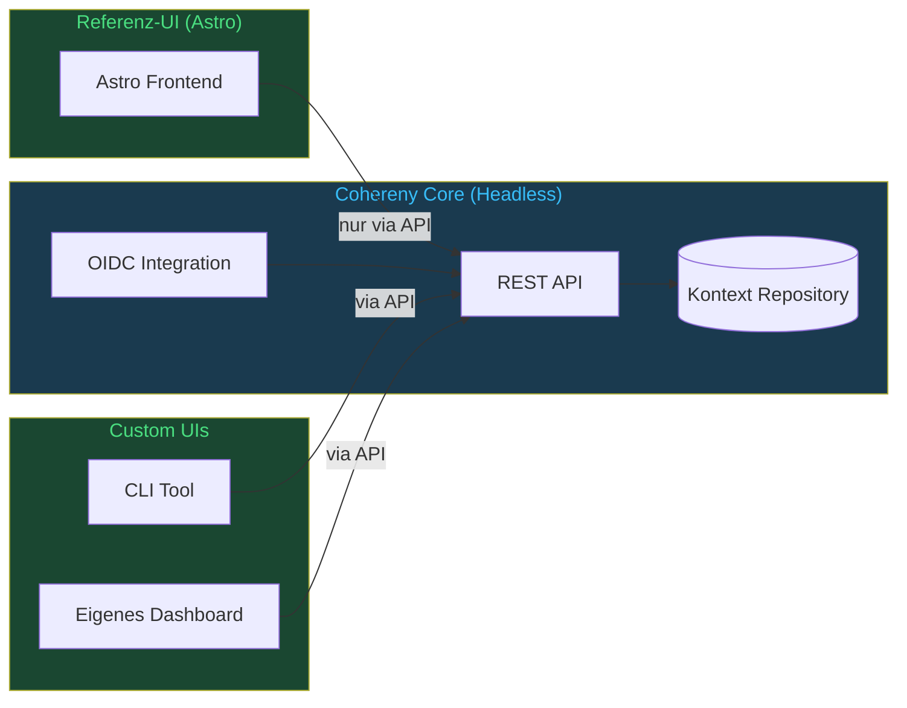

**Konsequenz:** Jede Funktion die die Referenz-UI benötigt, muss zuerst als API-Endpunkt existieren. Es gibt keinen privilegierten Zugriffspfad am UI vorbei. Die mitgelieferte CLI `cc` ist kein API-Client, sondern ein Betriebswerkzeug: Sie startet Piloten lokal und setzt mit `cc actor set-role` eine Rolle direkt in der Datenbank — den Weg für den ersten Admin, bevor jemand die API aufrufen kann.

### 2.2 Das Kontext-Repository (🔧 → M6)

> **Stand 01.11.2026:** Blöcke, Prüf-Lebenszyklus und Geltungsbereiche sind gebaut; Modell-Profile, Übersetzungsregeln und die Training-Pipeline kommen mit M6 (CHY-204, CHY-70).

Das Kontext-Repository ist das Herzstück von Cohereny. Es speichert versionierte, geprüfte Kontext-Blöcke (§2.6):

- **Prompt-Material:** Systemprompts, Fach- und Projektwissen, Tool-Schemata, Beispiele (`system_prompt`, `user_context`, `tool_schema`, `example_io`) — sie werden komponiert
- **Routing-Regeln** (`routing_rule`): welche Modelle eine Aufgabe bearbeiten, in welcher Reihenfolge und mit welcher Antwortlänge (ADR-038)
- **Kalibrieranker** (`calibration_anchor`): Testfälle des Benchmarks mit Referenzantwort, eingefrorenem Rohprompt und Validatoren (ADR-043)

Geplant sind Modell-Profile und Übersetzungsregeln für die Adaptionsschicht (§2.3). Messwerte des Benchmarks stehen nicht im Repository, sondern in eigenen Tabellen (`benchmark_runs`, `benchmark_measurements`). Das Diagramm zeigt das Zielbild; Modell-Profile, Übersetzungsregeln und die Training-Pipeline sind geplant (📋).

Jedes Element gehört zu einem Geltungsbereich — Organisation, Team, Projekt und weitere (siehe Abschnitt 3). Wer einen Lauf sieht, folgt dem Geltungsbereich: wer ihn gestartet hat, die Mitglieder des Bereichs und der Bereiche darüber, `admin` — durchgesetzt von der Datenbank (arc42 ADR-047, CHY-92). Blöcke liest bisher jede angemeldete Person (→ M6, CHY-237), und Rollen gelten beim Schreiben für die ganze Installation (CHY-243, SECURITY.md).

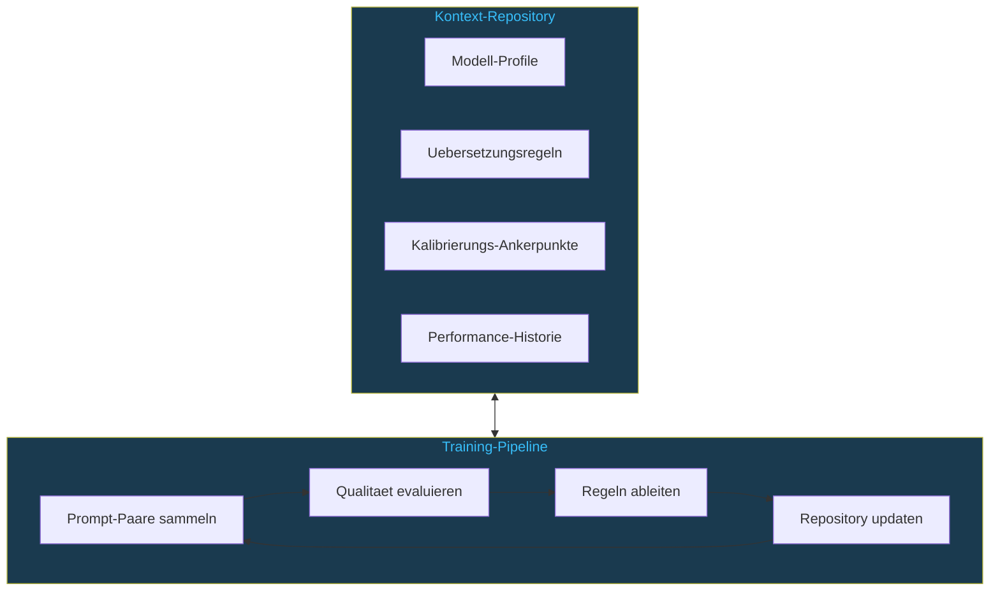

### 2.3 Die Adaptionsschicht (📋 → M6, CHY-204)

Die Adaptionsschicht soll eingehende Prompts zur Laufzeit transformieren. Sie ist entworfen, aber noch nicht gebaut:

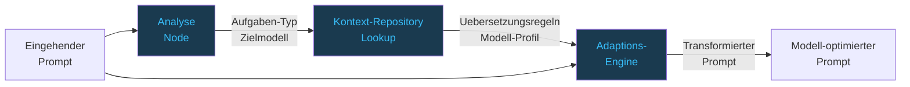

**Manuelle vs. automatische Adaption**

Vorgesehen ist, dass zunächst menschliche Experten Übersetzungsregeln im Kontext-Repository pflegen — das trägt, skaliert aber nicht. Bei wachsender Modell- und Domänenanzahl übersteigt der Pflegeaufwand manueller Regeln die verfügbare Zeit.

**AdaptVault: Versioniertes Adaption-Repository (M6 — CHY-67–69)**

Ab M6 ergänzt Cohereny eine automatisierte Entdeckungsschicht: das **AdaptVault**. Es ist ein versioniertes, benchmark-getriebenes Repository, das persistiert *welche Prompts für welches Modell in welcher Domäne funktionieren* — und wie sich das über Zeit entwickelt. `PromptAdaptation`-Einträge sollen append-only, niemals gelöscht und vollständig auditierbar sein wie die Blöcke des Kontext-Repositorys (ADR-009); die Testfälle sind seit ADR-043 Kalibrieranker und damit selbst versionierte Blöcke. Die Adaptionshistorie ist damit genauso revisionssicher wie das Kontext-Repository selbst.

Testfälle sind seit ADR-043 Kalibrieranker im Kontext-Repository statt einer eigenen Tabelle `prompt_benchmarks`; gemessen wird nach Zeitplan, bei Änderungen und auf Abruf (§5.4). Vorgesehen ist: Modelle mit Score unter Schwellwert erhalten automatisch generierte Prompt-Varianten (Chain-of-Thought, Format-Hint, Kontext-Erweiterung). Erfolgreiche Varianten werden direkt in `prompt_adaptations` übernommen:

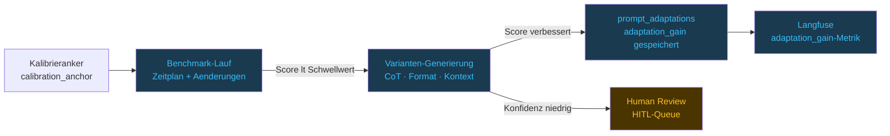

Der `adaptation_gain` — die gemessene Score-Verbesserung durch eine Adaption — ist das quantitative Kernergebnis: ohne diesen Nachweis bleibt Adaption ein qualitatives Versprechen, mit ihm wird sie zur messbaren Systemeigenschaft.

**AdaptVault als Leuchtturm-Feature**

AdaptVault ist das erste Feature von Cohereny das aktiv aus dem eigenen Betrieb lernt. Die Kombination aus versioniertem Repository, quantitativem `adaptation_gain` und HITL-Validierung macht es für datenschutzsensible Branchen attraktiv: keine Daten verlassen das System, kein Black-Box-Lernen, vollständiger Audit-Trail.

**DPO-Flywheel: Continuous Model Intelligence (→ M6, CHY-70)**

Aus den akkumulierten (Prompt, gewählt, abgelehnt)-Paaren im AdaptVault entsteht ein Trainingsdatensatz für Direct Preference Optimization (DPO). DPO benötigt keine exakten Gold-Labels — nur ranked pairs, die beim Multi-Modell-Vergleich natürlich anfallen. Als Bootstrapping-Basis stehen hochwertige öffentliche Datensätze zur Verfügung (`Intel/orca_dpo_pairs`, `HuggingFaceH4/ultrafeedback_binarized`, `Anthropic/hh-rlhf`); domänenspezifische Paare aus dem eigenen Benchmark-Betrieb verfeinern den Pool anschließend iterativ.

Das Resultat ist ein Flywheel: Je länger Cohereny für eine Domäne eingesetzt wird, desto mehr hochwertige ranked pairs entstehen, desto besser kann ein feinabgestimmtes Basis-Modell auf die spezifischen Formulierungsanforderungen dieser Domäne angepasst werden.

Dies ist das Kern-Differenzierungsmerkmal gegenüber statischen LLM-Gateways: Cohereny ist nicht nur ein Durchleitungssystem — es lernt systematisch, welche Formulierungen für welches Modell in welcher Domäne funktionieren. **Was A/B-Testing für Web-UX ist, ist das AdaptVault für Prompt Engineering:** aus intuitivem Handwerk wird messbarer, iterierbarer Prozess.

**AdaptVault als auslieferbares Modul** — das Flywheel entsteht bereits mit dem Repository: versionierte Adaptionen, quantitative Scores, vollständiger Audit-Trail. Das fine-getunte Modell ist optional. Cohereny verfolgt dabei zwei Dimensionen:

- **Intern — Validierungsmodell (→ M6, CHY-70):** Ein feinabgestimmtes Modell (Arbeitsname `cohereny-phi3-dpo:v1`) soll auf einer lokalen Laufzeit wie Ollama laufen und über dasselbe LiteLLM-Gateway geroutet werden wie alle anderen Modelle. Es soll intern die Frage beantworten: "Sind unsere Adaptionen gut genug, dass ein finegetuntes Modell messbar besser wird?" — kein Kundenprodukt, sondern internes Qualitätsinstrument.

- **Kunden-Feature — Bring Your Own Model:** `GET /v1/adaptvault/export/dpo` soll die eigenen validierten ranked pairs als JSONL liefern (HuggingFace-kompatibel), filterbar nach Domäne, Score und Validierungsstatus. Der Kunde entscheidet selbst ob, wann und mit welchem Basis-Modell er trainiert. Wartungsaufwand bleibt beim Kunden — Cohereny liefert Daten, keine Modelle.

### 2.4 Intelligentes Routing (🔧 → M6)

> **Stand 01.11.2026:** Routing-Regeln als geprüfte Blöcke und Datenklassen je Geltungsbereich sind gebaut; die Adaptionsschicht hinter dem Routing kommt mit M6 (CHY-204). Das Bild zeigt das Ziel.

Cohereny entscheidet, welches Modell eine Aufgabe bearbeitet — nicht über einen Klassifikator, sondern nach freigegebenen Routing-Regeln: Der Aufrufer nennt den Aufgabentyp (`task_type`); die Regel des tiefsten Geltungsbereichs, der eine für diesen Typ hat, nennt die Kandidaten in Reihenfolge und die längste erlaubte Antwort (ADR-038). Kein Kandidat bekommt Daten über seiner Obergrenze: wirksam ist die strengste Datenklasse der Kette, ohne Angabe `critical` (ADR-041). Das Diagramm zeigt das Zielbild; die Kanten stehen für Beispiel-Regeln je `task_type`, die Adaptionsschicht darin ist geplant (📋 → M6, CHY-204):

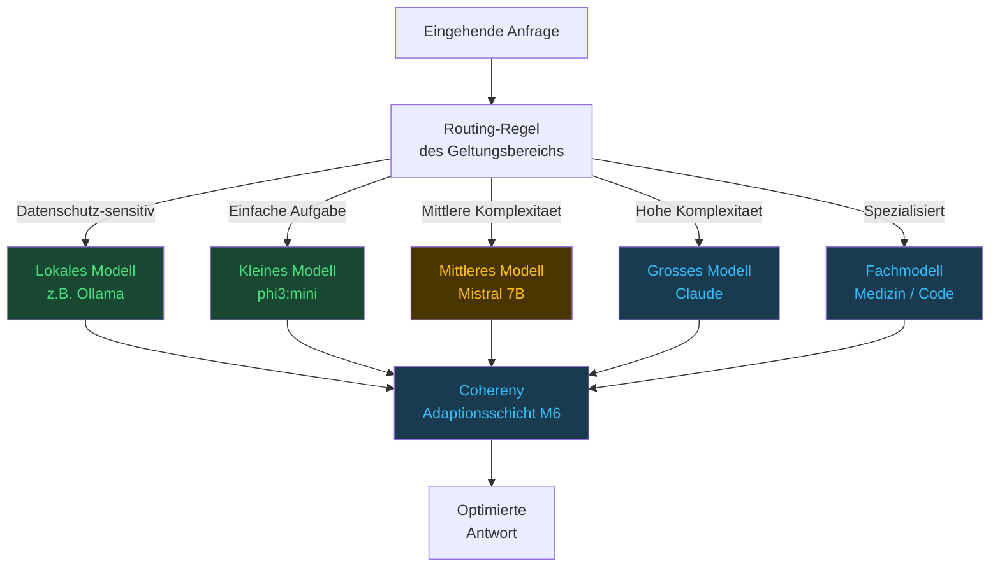

### 2.5 Agentic Context: Granularer Kontext pro Workflow-Step (🔧 → M6)

> **Stand 01.11.2026:** Die Komposition je Workflow-Step ist gebaut; die Auswahl der Bausteine je Modell kommt mit M6 (CHY-204).

**Kernkonzept v3:** Agentic Workflows sind der Primär-Use-Case von Cohereny. Ein Workflow besteht aus mehreren Steps, jeder Step nutzt potenziell ein anderes Modell — und jeder Step benötigt seinen eigenen granularen Kontext.

Das Problem bei naiver Implementierung: Entweder wird der gesamte Kontext des ganzen Workflows an jeden Step übergeben (Token-Verschwendung, Rauschen), oder jeder Step bekommt gar keinen Kontext (alle drei LLM-Qualitätsphänomene bleiben ungelöst).

Cohereny löst dies durch step-spezifische Kontext-Komposition: Für jeden Step wird aus dem Repository der Kontext zusammengestellt, den dieser Step anfordert: die Blöcke der Geltungsbereichskette, eingeschränkt auf die Blocktypen aus `context_requirements` des Knotens (ADR-040). Eine Auswahl je Zielmodell ist geplant (Adaptionsschicht, §2.3); bis dahin bekommt jedes Modell für denselben Step denselben Kontext. Das Diagramm zeigt das Zielbild mit modell-spezifischem Kontext.

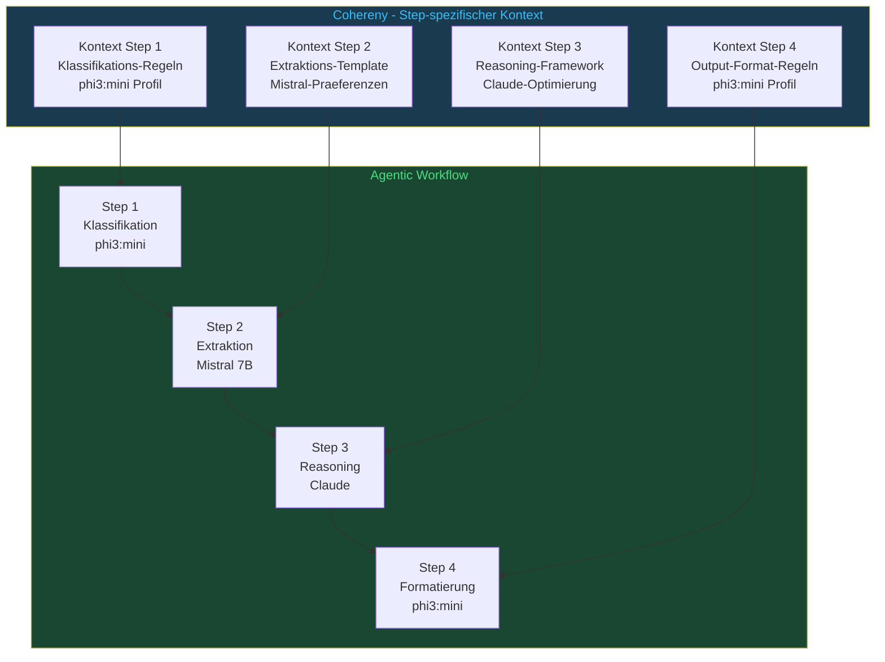

**Vorteile gegenüber globalem Kontext:**
- Minimale Token-Nutzung: Jeder Step erhält nur was er braucht
- Modell-spezifische Optimierung (geplant, §2.3): phi3:mini und Claude sollen fundamental unterschiedliche Kontexte bekommen
- Nachvollziehbarkeit: Jeder Step-Kontext ist versioniert und auditierbar
- Wiederverwendbarkeit: Kontext-Blöcke können über Workflows hinweg geteilt werden

### 2.6 Komponierbare Kontext-Blöcke und Konflikt-Erkennung (✅)

Kontext wird nicht als monolithisches Dokument verwaltet, sondern als Sammlung diskreter, komponierbarer **Kontext-Blöcke**. Ein Block ist die kleinste versionierbare Einheit im Repository.

**Block-Typen:**
- `system_prompt` — Anweisungen an das Modell (Rolle, Verhalten, Sprache)
- `user_context` — Fach- und Projektwissen
- `tool_schema` — JSON-Schema für Function Calling
- `example_io` — Few-Shot-Beispiele (Eingabe → erwartete Ausgabe)
- `routing_rule` — welche Modelle eine Aufgabe bearbeiten; Konfiguration, wird nie komponiert (ADR-037)
- `calibration_anchor` — Testfall des Benchmarks mit Referenzantwort; wird nie komponiert (ADR-043)

Komponiert werden nur die ersten vier. Modell-Profile, Übersetzungsregeln und Prompt-Templates als eigene Typen gehören zur geplanten Adaptionsschicht (§2.3).

Beim Komponieren eines Step-Kontexts werden Blöcke aus verschiedenen Scopes zusammengeführt (Global → Team → Projekt). Überschrieben wird dabei nichts: Die Blöcke der ganzen Kette werden flach nach tief aneinandergereiht, ein tieferer Block steht im Text nur später. Ein Widerspruch zwischen zwei Texten ist nicht maschinell erkennbar — als Konflikt gilt deshalb nur, was Blöcke erklären: welche Regel sie betreffen (`governance_key`) und in welche Richtung (`privacy_impact`, ADR-017).

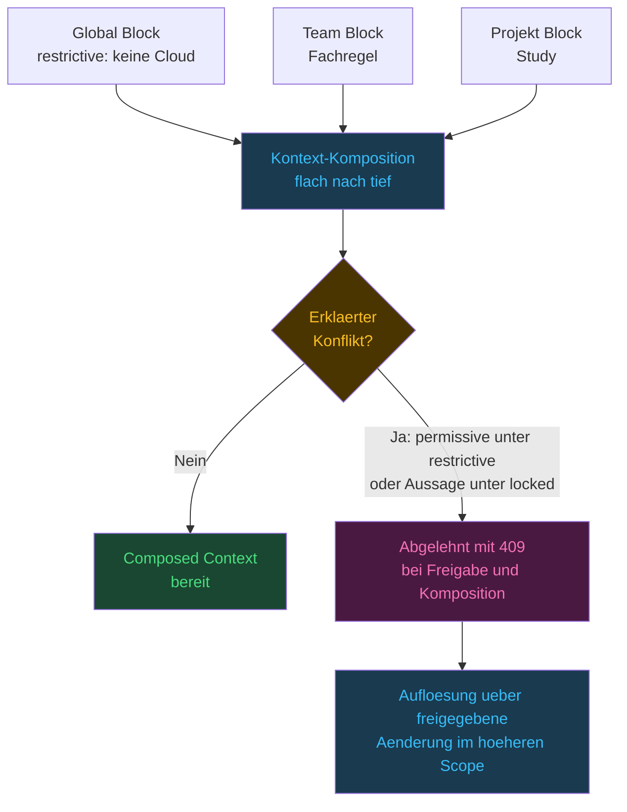

**Konfliktregeln (ADR-017, CHY-62):**
1. Komponiert wird die ganze Kette, flach nach tief; nichts wird überschrieben, ein tieferer Block steht nur später im Text
2. Konflikt ist nur, was Blöcke erklären: Ein `permissive`-Block unter einem `restrictive`-Vorfahren mit demselben `governance_key` und jede erneute Aussage unter einem `locked`-Vorfahren werden abgelehnt — bei der Freigabe und erneut beim Komponieren (409)
3. Bei Routing-Regeln gilt die des tiefsten Scopes, der für den Aufgabentyp eine hat (ADR-038)
4. Aufgelöst wird über eine freigegebene Änderung im höheren Scope (§3.7); ein `force_override` gibt es nicht

---

### 2.7 Performance: Compiled Context als vorkompilierter Lese-Spiegel (✅)

Die Kompositions-Engine soll zur Laufzeit nicht bei jedem Aufruf Blöcke abfragen, zusammensetzen und auf Konflikte prüfen — das wäre bei einer 9-Node-Agenten-Pipeline mit parallelen LLM-Calls zu langsam. (Die einzige Ausnahme ist der Cache-Miss: dann kompiliert der Read-Path einmalig aus PostgreSQL und schreibt das Ergebnis zurück in den Cache — ADR-010.)

**Das Compiled Context Pattern (ADR-010):**

PostgreSQL ist der revisionssichere Append-Only-Datenspeicher. Redis ist der vorkompilierte Lese-Spiegel.

Kompiliert wird beim ersten Abruf, nicht im Voraus — einen Background-Task, der nach einer Aktivierung vorkompiliert, gibt es nicht. Das Ergebnis liegt als flaches Key-Value in Redis, eine Stunde lang (`CACHE_TTL_SECONDS`):

```
Key:   cc:compiled:{workflow_id}:{node_ref}:{scope_id}:{model_id}:{block_types}:{gen}
Value: { scope_id, workflow_id, node_ref, model_id, blocks, block_versions, scope_generations, compiled_at }
```

Wenn `/v1/compose` oder `/v1/complete` aufgerufen wird, liest die API die Vorfahrenkette des Geltungsbereichs aus PostgreSQL und die Generationen der Scopes aus Redis — beide gehen in den Key ein — und dann den kompilierten Kontext mit einem Redis-GET. Bei einem Treffer entfallen Blockabfrage und Komposition; `/v1/complete` liest außerdem die Routing-Regeln, bevor der Request an LiteLLM geht.

**Scope-basierte Cache-Invalidierung:**

Da die Scope-Hierarchie im `scope_path` abgebildet ist, lässt sich Invalidierung präzise steuern: Jeder Scope hat einen Generationszähler (`cc:scope_gen:{scope_id}`), der steigt, sobald ein Block des Scopes `active` wird oder es nicht mehr ist. Weil die Zähler aller Scopes der Kette im Key stehen, wird ein alter Eintrag nach einer Änderung nie mehr angefragt und läuft per TTL aus — kein Sekundärindex, kein DEL, kein SCAN (ADR-010, Fortschreibung v2.0).

```
Globaler Block ändert sich  →  INCR cc:scope_gen:{global_id}   (alle Keys darunter veralten)
Nur Projekt-Block           →  INCR cc:scope_gen:{project_id}  (nur Keys des Projekts)
```

**Ergebnis:** Auch komplexe agentic Pipelines mit vielen parallelen Steps und unterschiedlichen Modellen laufen ohne spürbaren Overhead durch den Kontext-Layer.

---

### 2.8 Multimodalität: Modalitäts-agnostische Architektur (📋 Referenz-Design, nach 1.0, CHY-206)

> **Nichts davon ist gebaut:** Cohereny verarbeitet heute Text. Vision-, Audio- und multimodale Eingaben, `ModelProfile` und `TranslationRule` gibt es im Quellbaum nicht; der Abschnitt beschreibt das Zielbild (arc42 §8.8).

Cohereny ist nicht auf Text-LLMs beschränkt. Die drei Kernmechanismen — Adaptionsschicht, Kontext-Repository und Governance — sind modalitäts-agnostisch und funktionieren für alle Eingabe- und Ausgabetypen:

| Modalität | Eingabe | Typische Modelle | Beispiel-Use-Case |
|---|---|---|---|
| **Text** | Prompt / Dokument | GPT-4, Claude, Mistral, phi3 | Arztbrief, Banking Due Diligence, Zusammenfassung |
| **Audio** | Audiodatei / Sprachaufnahme | Whisper, Parakeet | Transkription, Hörbuch-Generierung, Gesprächsprotokoll |
| **Vision** | Bild / Video-Frame | moondream, llava | Aktivitäts-Monitoring, Dokumenten-Scan, Qualitätskontrolle |
| **Multimodal** | Kombination beliebig | LLaVA, GPT-4V | Bild + Diagnosetext, Video + Bericht |

**Das entscheidende Prinzip:** Der Workflow-Entwickler schreibt einen einheitlichen Workflow — Cohereny übersetzt den Kontext zur Laufzeit in die optimale Form für das jeweilige Zielmodell, unabhängig davon ob es ein Text-, Vision- oder Audio-Modell ist. `ModelProfile` und `TranslationRule` im Kontext-Repository sind typ-spezifisch definiert — dieselben Mechanismen, andere Inhalte.

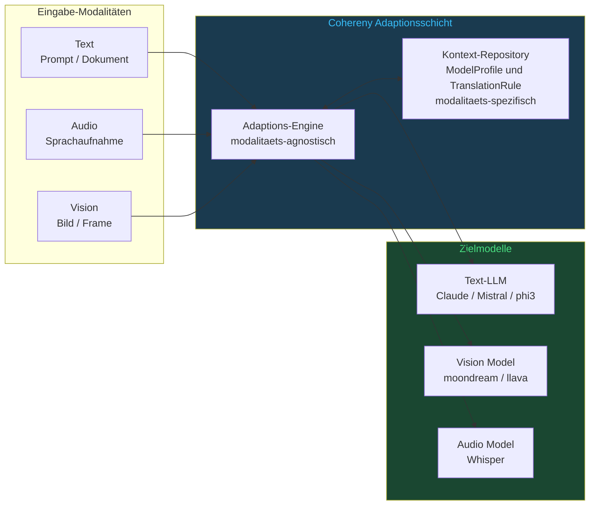

**Datenschutz gilt modalitäts-übergreifend:** Welche Modelle Daten bekommen dürfen, entscheidet die Datenklasse des Geltungsbereichs (ADR-041), nicht die Modalität und kein Merkmal des Knotens. Kameradaten, Sprachaufnahmen und medizinische Dokumente gehören in einen Geltungsbereich der Klasse `critical` — ohne Angabe ohnehin die Vorgabe —, und damit kommen nur Modelle mit der Obergrenze `critical` in Frage; in der mitgelieferten Konfiguration sind das die lokalen.

**Neue Kontext-Block-Inhalte für Vision-Modelle:**
- `ModelProfile` mit visuellen Stärken (Objekterkennung, Klassifikation, Szenen-Beschreibung)
- `TranslationRule` für Prompt-Struktur je Vision-Modell (moondream, llava und GPT-4V benötigen fundamental unterschiedliche Prompt-Formate)
- `CalibrationAnchor` mit Referenz-Frames als Baseline für visuelle Klassifikation

**Erweiterbarkeit:** Ein neues Vision- oder Audio-Modell kann ohne Änderung am Workflow-Code integriert werden — nur ein neues `ModelProfile` und zugehörige `TranslationRule` im Kontext-Repository sind erforderlich (Qualitätsziel Q9, Arc42 §10).

---

## 3. Mandantenfähigkeit und Team-Kontext

### 3.1 Geteilter Kontext als Kernfeature

Statt jedem Nutzer ein isoliertes Kontext-Repository zu geben, teilen sich Teams ein gemeinsames Repository. Wenn ein Team-Mitglied einen guten Baustein findet, profitiert das gesamte Team, sobald er freigegeben ist — im Team-Scope durch einen Reviewer (§3.7).

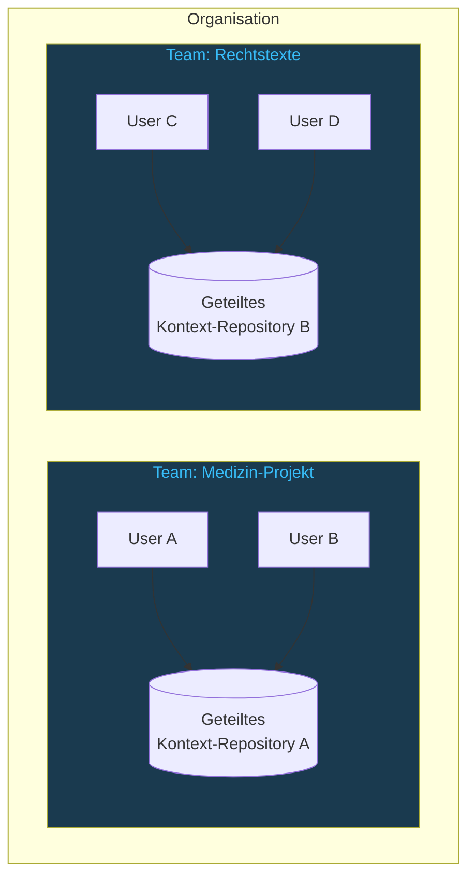

### 3.2 Identität über bestehenden Identity Provider (✅)

Cohereny führt keine eigene Benutzerverwaltung. Identität und Rolle kommen aus einem bestehenden OIDC-Provider. Getestet ist Authentik, und der Code erwartet dessen Aufbau: je API-Oberfläche eine Anwendung mit eigenem Issuer unterhalb von `OIDC_BASE_URL`, die Signaturschlüssel unter `<issuer>/jwks/` (ADR-031). Andere Provider wie Keycloak oder Azure AD sind nicht erprobt. Geltungsbereiche und Mitgliedschaften verwaltet Cohereny dagegen selbst (§3.5).

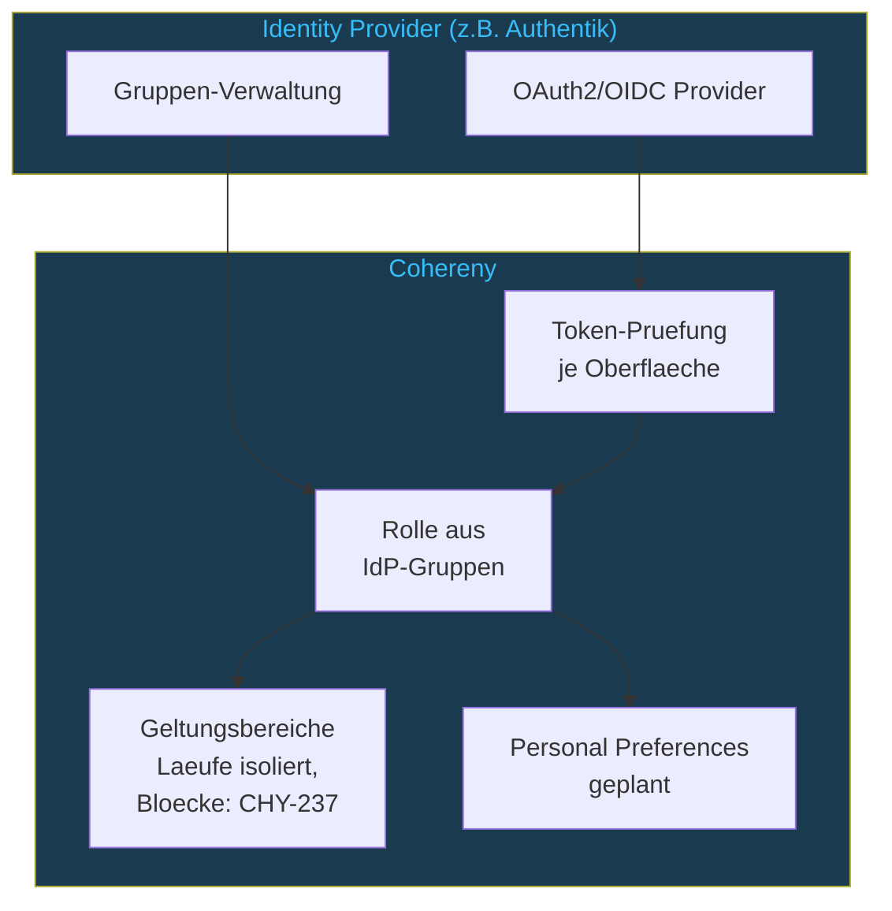

Mit jeder Anfrage erhält Cohereny ein Bearer-Token mit Claims:

```json
{
  "sub": "jdoe",
  "groups": ["chy-admins"],
  "email": "jdoe@example.com"
}
```

Aus den Gruppen leitet Cohereny bei jeder Anfrage die Rolle ab (§3.3); `actors.role` hält davon eine Kopie, die nur stehen bleibt, wenn ein Token keinen `groups`-Claim trägt. Team-Zugehörigkeit kommt dagegen nicht aus dem Identity Provider: Mitgliedschaften in Geltungsbereichen pflegt Cohereny selbst (`POST /v1/scopes/{scope_id}/members`), und durchgesetzt werden sie für Laufinhalte (arc42 ADR-047), für Blöcke ab M6 (CHY-237). Die eigene Actor-ID, die man dafür braucht, nennt `GET /v1/me`.

### 3.3 Rollen-Hierarchie (✅)

> **Stand 06.11.2026:** Die Rollen gelten installationsweit; welche Läufe jemand sieht, entscheidet die Mitgliedschaft (CHY-92). Blöcke folgen mit M6 (CHY-237), Schreiben je Bereich mit CHY-243 (SECURITY.md).

Rollen werden aus IdP-Gruppen abgeleitet. Die Zuordnung steht einmal im Code (`kernel/roles.py`): fünf Rollen, nach Rang geordnet, jede mit der Gruppe `chy-<rolle>s`. Wer in mehreren Gruppen ist, bekommt die höchste Rolle, wer in keiner ist, `consumer`.

```python
GROUP_PREFIX = "chy-"

class Role(StrEnum):
    """The five roles, least privileged first. Order is meaning."""

    CONSUMER = "consumer"        # read
    CONTRIBUTOR = "contributor"  # create, edit and submit blocks
    REVIEWER = "reviewer"        # approve, reject, retire
    ARCHITECT = "architect"      # scope structure
    ADMIN = "admin"              # actor anonymisation, other actors' audit trail

GROUP_ROLE_MAP = {f"{GROUP_PREFIX}{role.value}s": role.value for role in Role}
```

| Rolle | Berechtigung |
|---|---|
| **admin** | Mitgliedschaften in Geltungsbereichen vergeben, Actors anonymisieren (Art. 17 DSGVO), das gesamte Audit-Log lesen |
| **architect** | Geltungsbereiche anlegen |
| **reviewer** | Blöcke freigeben, ablehnen und zurückziehen; Workflows aktivieren; `human_review`-Gates entscheiden; die Audit-Spur eines Objekts und Benchmark-Läufe lesen |
| **contributor** | Blöcke anlegen, bearbeiten, einreichen und per Promote in einen strengen Scope übernehmen — auch Routing-Regeln und Kalibrieranker; Workflows anlegen und starten. In direkten Scopes ist ein Block mit dem Schreiben aktiv (§3.7) |
| **consumer** | Lesen, Kontext komponieren, Completions anfordern |

Jede Rolle schließt die darunter ein. Die Rollen gelten für die ganze Installation, nicht je Geltungsbereich; welche Läufe jemand sieht, entscheidet die Mitgliedschaft im Bereich (arc42 ADR-047, SECURITY.md).

### 3.4 Review-Workflow für Kontext-Beiträge (✅)

> **Stand 05.11.2026:** Vier Augen sind für Datenfluss-Bausteine erzwungen (CHY-163, arc42 ADR-045); für anderes Material werden Autor und Freigebende aufgezeichnet. Benachrichtigungen der Reviewer kommen mit M7 (CHYUI-2).

In strengen Geltungsbereichen (org, team, workspace) wird ein Beitrag erst durch einen Reviewer aktiv; in direkten (project, sub_project, personal) mit dem Schreiben, im Audit als `direct` vermerkt (§3.7). **Ausgenommen sind Datenfluss-Bausteine** — eine Routing-Regel mit einem Modell unterhalb `critical` und ein Baustein, der eine Datenschutzregel lockert: Sie gibt in jedem Geltungsbereich nur frei, wer sie nicht geschrieben hat. Darf in einer Installation nur eine Person freigeben, gibt sie ihren eigenen frei, und Audit, Log und Antwort sagen, dass niemand Zweites geprüft hat (SECURITY.md):

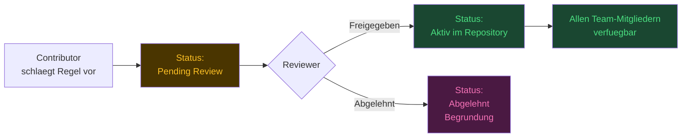

### 3.5 Dynamische Scope-Hierarchie via `scope_path` (✅)

**Kernkonzept v4 (aktualisiert 2026-06-29):** Die Scope-Hierarchie ist nicht auf drei feste Ebenen beschränkt. Alle Scope-Knoten (Organisation, Team, Workspace, Projekt, Sub-Projekt) werden einheitlich über einen hierarchischen `scope_path` modelliert.

**Scope-Typen:**
- **org** — Organisations-Root, als Mandanten-Grenze gedacht; durchgesetzt wird sie für Laufinhalte (arc42 ADR-047), für Blöcke ab M6 (CHY-237)
- **team** — Team innerhalb einer Organisation
- **workspace** — teamübergreifender Container, z.B. "Alle Projekte für Kunde XY" (Vertrieb + Legal + IT gemeinsam)
- **project** — Projekt innerhalb eines Teams oder Workspace
- **sub_project** — Granularere Untergliederung eines Projekts
- **personal** — persönliche Overrides eines Actors (DSGVO-relevanter Bereich)

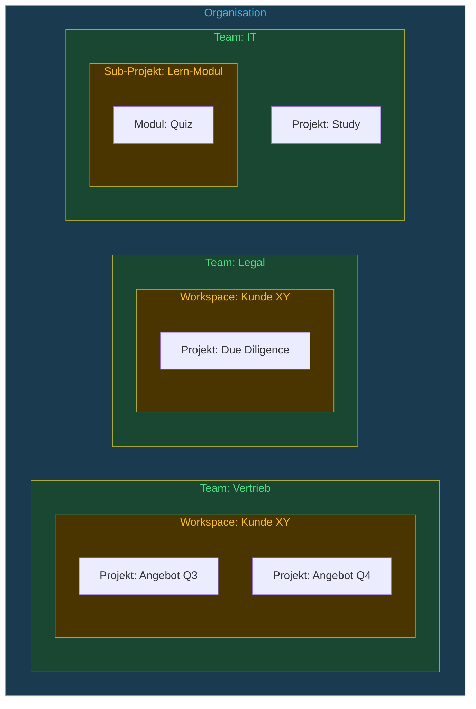

**Vererbung via Prefix-Matching:**
Ein ContextBlock hängt an einem Geltungsbereich (`scope_id`). Dessen `scope_path` ist ein ltree-Pfad mit Labels aus Typ und ID (`org_<uuid>.team_<uuid>`, ADR-008); in die Komposition eines Geltungsbereichs gehen die Blöcke aller Vorfahren ein — ein Block des Vertriebsteams also in alle Workspaces und Projekte darunter. Überschrieben wird dabei nichts (§2.6); ein `force_override` gibt es nicht.

**Vererbungsregeln:**
- Tiefere Scopes ergänzen höhere: Ihre Blöcke stehen im komponierten Text später; bei Routing-Regeln gilt die des tiefsten Scopes (ADR-038)
- Eine Privacy-Regel darf ein tieferer Scope verschärfen, nicht lockern; unter einem `locked`-Block darf er sie nicht neu aussprechen (Privacy-Ratchet, ADR-017)
- Ein zurückgezogener Block (`deprecated`) fehlt nur in seinem Scope und darunter; übergeordnete Scopes bleiben unberührt
- Die Tiefe ist frei; die sechs Scope-Typen legt ein CHECK im Schema fest, ein neuer Typ braucht eine Migration

### 3.6 Bootstrap-Templates für neue Teams und Projekte (📋 nach 1.0, CHY-209)

Wenn ein neues Team oder Projekt startet, ist das Repository leer — das Cold-Start-Problem. Bootstrap-Templates lösen dieses Problem durch vorkuratierte Starter-Sets.

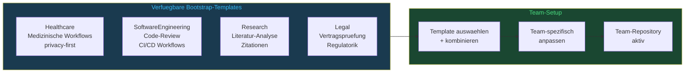

**Template-Inhalt (Beispiel: Healthcare):**
- Datenklasse `critical` für den Geltungsbereich (ADR-041) — ohne Angabe ohnehin die Vorgabe
- Routing-Regeln: medizinische Aufgaben nur an Modelle mit Obergrenze `critical`
- Übersetzungsregeln für Symptom-Beschreibungen, Diagnosen, Medikamente (mit der Adaptionsschicht, §2.3)
- Kalibrieranker für häufige medizinische Tasks
- Systemprompts und Beispiele (`system_prompt`, `example_io`) für Anamnese, Zusammenfassung, Differentialdiagnose

Vorgesehen ist, dass Templates von der Community gepflegt und versioniert werden — als Blöcke im Global-Repository, verbessert über die Freigabe (3.7).

### 3.7 Freigabe von Kontext-Blöcken (✅)

Eine Änderung an einem Kontext-Block wirkt erst, wenn sie freigegeben ist. Freigegeben wird die **Block-Version selbst**: jede Änderung erzeugt eine neue Version, und eine Version durchläuft `draft → pending_review → active` — von der Datenbank erzwungen, mit Freigabe durch einen Reviewer und begründeter Ablehnung. Einen eigenen Merge-Request-Datensatz daneben gibt es nicht (ADR-042): ein zweiter Weg, einen Block zu ändern, wäre eine zweite Quelle für dieselbe Wahrheit. Autor und Reviewer werden beide aufgezeichnet. Zwei verschiedene Personen verlangt Cohereny dort, wo eine Freigabe entscheidet, wohin Daten gehen (arc42 ADR-045): bei einer Routing-Regel mit einem Modell unterhalb `critical` und bei einer gelockerten Datenschutzregel. Wer in dieser Runde eine Version geschrieben hat — angelegt, neu gefasst oder als Entwurf bearbeitet —, gibt sie nicht frei. Prompt-Material kann sein Autor weiter selbst freigeben; das ist gewollt, vier Augen für jeden Systemprompt würden zum Ritual. Im Workflow-Runner verlangen die `four_eyes`-Gates zwei Personen.

**Scope-abhängige Governance (ADR-011):**

Nicht jeder Prompt-Edit braucht eine formale Freigabe. Die Strenge ergibt sich aus dem Scope-Typ:

| Scope-Typ | Governance-Modus | Begründung |
|---|---|---|
| `org`, `team` | **Streng** — Freigabe durch einen Reviewer Pflicht | Änderungen betreffen alle Nutzer dieses Scopes |
| `workspace` | **Streng** (fest, nicht einstellbar) | Teamübergreifend, oft sicherheitsrelevant |
| `project`, `sub_project`, `personal` | **Direkt** — die Version wird sofort `active`, im Audit als `direct` vermerkt | Explorativer Bereich, nur lokale Wirkung |

**Promote-Pfad:** Ein Fachexperte prototypt frei im `project`-Scope. Ist ein Prompt bewährt, kopiert ein ausdrücklicher „Promote"-Schritt den Block als Entwurf in den übergeordneten strengen Scope — dort durchläuft er die volle Freigabe.

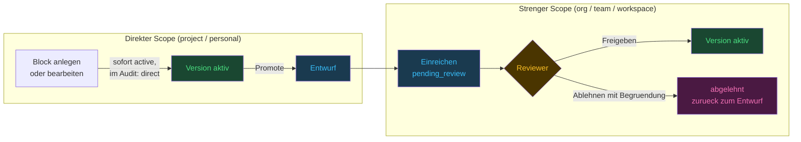

**Was die Freigabe heute leistet:**
- Unterschied zwischen zwei Versionen eines Blocks — die Versionsgeschichte ist vollständig erhalten
- Konflikterkennung vor der Aktivierung: Privacy-Ratchet (ADR-017) und die Prüfungen vor der Aktivierung, etwa für Routing-Regeln (ADR-041)
- Jede Freigabe und jede Ablehnung im Audit-Log, mit Person und Zeit — das Log nimmt nur Einfügungen an (Trigger, Migration 011), auch von der Datenbankrolle der Anwendung, die weder Superuser noch Eigentümerin ist (CHY-85, SECURITY.md)

**Was sie bewusst nicht leistet** (ADR-042, verworfen für jetzt): mehrere Blöcke als eine gemeinsam freigegebene Einheit, Kommentar-Threads je Feld, Zusammenfassen mehrerer Änderungen zu einer Version. Das lässt sich später auf den Lebenszyklus setzen, sobald ein Fall es verlangt.

---

## 4. Revisionssicherheit und Datenschutz

### 4.1 Append-Only Historie (✅)

> **Stand 06.11.2026:** Die Trigger schützen gegen Fehler der Anwendung und gegen ihre Datenbankrolle: Die Anwendung ist weder Superuser noch Eigentümerin der Tabellen und startet nicht mit mehr Rechten (CHY-85). Wer die Zugangsdaten der Eigentümerin besitzt, kann einen Trigger abschalten (SECURITY.md).

Jede Änderung an einem eingereichten oder aktiven Kontext-Block — Prompt-Material, Routing-Regel oder Kalibrieranker — erzeugt eine neue Version (`cc_supersede_block`). Gelöscht wird nicht, nur zurückgezogen (`deprecated`); alte Versionen bleiben als Historie erhalten. Ein Entwurf (`draft`) wird an Ort und Stelle bearbeitet, und Statuswechsel sind Updates derselben Zeile, erlaubt nur nach der Übergangstabelle im Trigger (Migration 013, 016).

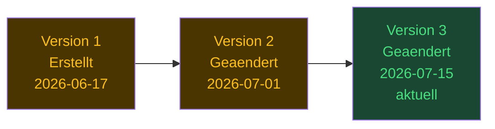

Im Code ist das keine Basisklasse, sondern Spalten — in `context_blocks`:

```
block_id               stabiler Bezeichner über alle Versionen
version                1, 2, 3 … (eindeutig zusammen mit block_id)
superseded_by_version  NULL = aktuell, n = ersetzt durch Version n
status                 draft | pending_review | active | rejected | deprecated
author_id              Verweis auf den Actor, nicht auf die Person
created_at
```

Der Änderungsgrund (`change_reason`) steht im Audit-Eintrag der neuen Version (`block.superseded`), nicht in der Zeile.

### 4.2 Das Actor-Pattern: Trennung von Personenbezug und Fachdaten (🔧 → M5)

> **Stand 08.11.2026:** Die Anonymisierung nach Art. 17 ist gebaut, ebenso die Aufbewahrungsfristen: Die Inhalte eines Laufs werden nach Ablauf geleert, seine Spur später gelöscht (arc42 ADR-046, CHY-17). Die Restarbeiten nach Art. 17 sind erledigt (CHY-19). Vor jedem Modellaufruf von `/v1/complete` und in Workflows werden Bezeichner durch Platzhalter ersetzt (arc42 ADR-018, CHY-63), und Workflow-Läufe werden nur mit Platzhaltern gespeichert; die Zuordnung zu den Werten ist je Lauf verschlüsselt (CHY-234). Die LangGraph-Piloten ersetzen nicht; sie sind abgekündigt (CHY-172).

Revisionssicherheit steht in einer Spannung zum DSGVO-Löschrecht: Fachliche Historie soll erhalten bleiben, personenbezogene Daten müssen aber löschbar oder anonymisierbar sein.

```
actors
  id             interne, stabile Referenz — bleibt bei der Anonymisierung
  idp_sub        Subject des Identity Providers; NULL nach Anonymisierung
  display_name   "[anonym]" nach Anonymisierung
  role           admin | architect | reviewer | contributor | consumer
  is_anonymized, anonymized_at
```

Den Anlass hält der Audit-Eintrag fest (`actor.anonymized`, `legal_basis: GDPR Art. 17`), nicht die Zeile.

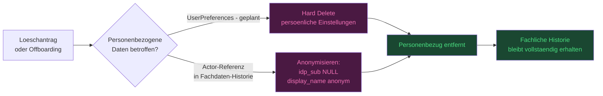

| Kategorie | Beispiele | Löschverhalten |
|---|---|---|
| Fachdaten | Translation Rules, Model Profiles, Calibration Anchors | Niemals löschen, nur versionieren. Personenbezug nur über Actor-Referenz |
| Personendaten | Actor-Stammdaten (`idp_sub`, `display_name`); geplant: User Preferences | Pseudonymisierung über `POST /v1/admin/actors/{actor_ref}/anonymize`; einen Hard Delete gibt es nicht. Blöcke im `personal`-Scope werden wie alle Blöcke nur versioniert, nie gelöscht — wie mit Personenbezug in ihrem Inhalt umzugehen ist, ist offen |
| **Payload-Daten (neu v4.0)** | `pilot_runs.result_json`/`events_json`, `workflow_runs.input_data`/`result`, `node_executions.input_data`/`output_data`, `benchmark_measurements.output`, `audit_log.payload`, Langfuse-Traces | Können Personenbezug **im Inhalt** tragen, den keine Actor-Anonymisierung erreicht. Gebaut: Aufbewahrungsfristen (arc42 ADR-046, CHY-17) und Platzhalter vor jedem Modellaufruf von `/v1/complete` und in Workflows (arc42 ADR-018, CHY-63) — Modell, Gateway und Trace sehen die Bezeichner nicht; gespeichert werden Workflow-Läufe nur mit Platzhaltern, die Zuordnung je Lauf verschlüsselt (CHY-234). Die abgekündigten Piloten senden die Werte an das Modell und tragen sie bis zu ihrer Ablösung (CHY-172) |

Für Actor-Löschungen gilt Pseudonymisierung ohne Hash: `POST /v1/admin/actors/{actor_ref}/anonymize` (Rolle `admin`, CHY-34) setzt `idp_sub = NULL` und `display_name = "[anonym]"`, markiert `is_anonymized` mit Zeitpunkt und schreibt einen Audit-Eintrag (`actor.anonymized`); die Actor-ID bleibt, damit Audit-Log und Fachhistorie konsistent bleiben. Der Aufruf ist idempotent, der letzte Admin ist geschützt.

### 4.3 Audit Log (✅)

Zusätzlich zur Versionierung der Fachdaten protokolliert ein separates Audit-Log jede Zustandsänderung: Blöcke (neu versioniert, eingereicht, freigegeben, abgelehnt, zurückgezogen, per Promote übernommen; das Anlegen eines Entwurfs bisher nicht → M5, CHY-171), Geltungsbereiche und Mitgliedschaften, Workflows und Läufe samt Freigabeentscheidungen, Rollenwechsel, Anonymisierungen und Rückfälle im Routing. Lesende Aufrufe und einzelne Completions protokolliert es nicht; die stehen im Tracing (Langfuse, optional).

```
audit_log
  id
  actor_id     Verweis auf den Actor (NULL bei Systemaktionen)
  action       z. B. "block.approved", "actor.anonymized", "routing.fell_back"
  target_ref   z. B. "block:<uuid>"
  payload      JSONB, etwa from_status/to_status, Version, Autor und Freigebender
  created_at   clock_timestamp() — Reihenfolge auch innerhalb einer Transaktion
```

Das Log nimmt nur Einfügungen an: Trigger lehnen `UPDATE`, `DELETE` und `TRUNCATE` ab (Migration 011). Das schützt gegen Fehler der Anwendung und gegen ihre Datenbankrolle, die keine Tabelle besitzt und keinen Trigger abschalten darf (CHY-85). Gegen die Zugangsdaten der Eigentümerin schützt es nicht, und keine Hash-Kette würde eine Änderung mit ihnen zeigen (SECURITY.md).

---

## 5. Regulatorische Einordnung

> **Hinweis:** Diese Einordnung ist eine technisch-konzeptionelle Einschätzung und erhebt **keinen Anspruch auf Vollständigkeit**. Sie deckt die wichtigsten für Cohereny relevanten Regulatoriken ab — je nach Branche, Deployment-Kontext und Anwendungsfall können weitere Regulierungen gelten. Die Einordnung ist als Ausgangspunkt für die Abstimmung mit dem Betreiber gedacht, nicht als abschließende rechtliche Bewertung. Bei kommerziellem Einsatz oder Hochrisiko-Anwendungsfällen wird die Konsultation eines Fachanwalts für IT-Recht empfohlen. Vollständige Einzelanalysen mit Artikel-Mapping: **Anhang A**.

### 5.1 Übersicht Regulatoriken und Geltungsbereich

> **Statusspalte:** ✅ Cohereny liefert die technische Grundlage · ⚠️ teilweise — Lücke im Produkt oder der Betreiber ergänzt · ❌ nicht abgedeckt · **→ M5** Meilenstein, in dem die Lücke geschlossen wird (§10). Das Zeichen zeigt den heutigen Stand. Kein Eintrag bedeutet Zertifizierung oder Konformität.

| Regulierung | Geltungsbereich für Cohereny | Status | Kritische Lücken |
|---|---|---|---|
| **DSGVO** (EU 2016/679) | ✅ Voll anwendbar — Cohereny verarbeitet personenbezogene Daten via Actor-Pattern **und in Payloads** (§4.2) | ⚠️ | Löschung über `POST /v1/admin/actors/{actor_ref}/anonymize` gebaut (CHY-34); Payloads vergehen nach ihrer Frist (CHY-17 ✅) und erreichen Modell, Gateway und Trace nur mit Platzhaltern (CHY-63 ✅, arc42 ADR-018); Workflow-Läufe nur mit Platzhaltern gespeichert (CHY-234 ✅), Namen ohne Liste → M7 (CHY-235); DPIA-Grundlage für Betreiber ✅ (`DATA-PROTECTION.md`), Muster-DSFA für das Arztbrief-Szenario ✅ (`DATA-PROTECTION-EXAMPLE.md`, CHY-18) |
| **EU AI Act** (2024/1689, i. d. F. VO (EU) 2026/1744) | ⚠️ Cohereny selbst wahrscheinlich kein KI-System (Komm.-Leitlinien C(2025) 924); Deployer-Pflichten beim Betreiber; **Art.-25-Risiko:** Gesamtsystem Cohereny+LLM ist ein KI-System | ⚠️ | Art.-50-Hinweis in der Referenz-UI (Veröffentlichung → M8, CHYUI-11); Kennzeichnung nach Art. 50(2) → M7b (CHY-118); Anhang III ab 02.12.2027, Anhang I ab 02.08.2028; "Instructions for Use" nach 1.0 (CHY-203) |
| **CRA** (2024/2847) | ✅ Anwendbar — Cohereny behandelt sich mit der Veröffentlichung als Hersteller; Art.-14-Meldepflichten seit **11.09.2026** (24h/72h/14d, ENISA), volle Anwendung ab 11.12.2027 | ⚠️ | `SECURITY.md` ✅; CVE-Prüfung in CI (pip-audit, GitLab Container Scanning; nur meldend, CHY-75, CHY-198); SBOM ✅ (CHY-22); Unterstützungszeitraum (CHY-149), Patch-SLA (CHY-12), Meldeprozess (CHY-16) → M7b; die Pflichten gelten ab der Veröffentlichung |
| **DORA** (EU 2022/2554) | ⚠️ Kapitel II vollständig bei Finanzinstitut-Betreibern; Art. 28–44 nicht | ⚠️ | Incident-Handling-Konzept → M7b (CHY-16); Business Continuity Plan als Betreiber-Checkliste nach 1.0 (CHY-8) |
| **MaRisk AT 4.3.4** (RS 06/2026, 9. Novelle, in Kraft seit 30.06.2026 — AT 7.2 enthält keine IT-Anforderungen mehr; BAIT für DORA-Institute seit 17.01.2025 aufgehoben) | ⚠️ Finanzinstitut-Betreiber mit automatisierten Modellen | ⚠️ | Regelmäßige Analyse der Modellergebnisse über Benchmark-Läufe → M6 (CHY-68); formales Pre-Deployment-Assessment (Betreiber-Checkliste nach 1.0, CHY-9) |
| **BaFin Orientierungshilfe KI** (18.12.2025) | ⚠️ Kreditinstitute und Versicherungen (unverbindlich) — adressiert **explizit Model Drift und den Lebenszyklus inkl. Stilllegung** | ⚠️ | Drift-Erkennung: Benchmark-Läufe → M6 (CHY-68); Decommissioning: Model-Sunset-Workflow → M6 (arc42 ADR-020, CHY-158) |
| **BSI C5:2026** (07.04.2026, v1.0.1) | ⚠️ **Enthält keine KI-Anforderungen.** Nachgemessen am Volltext (222 S.): `AI` als Wort **1×** — in einem Satz über KI-gestützte Schwachstellenscanner; `machine learning`, `training data`, `registry` je **0×**. „Audits ab 06/2027" steht im Katalog, meint aber die Umstellung der Berichtszeiträume (Typ-1 → Typ-2), nicht einen KI-Termin. Gilt ohnehin nur für Cloud-Dienste, **nicht** für On-Premise | n/a | Keine — die Zeile behauptete bis v4.12 das Gegenteil (CHY-148) |
| **BSI AIC4** (2021) | ⚠️ **Hier stehen die KI-Kriterien.** Erweiterung des C5 für Cloud-Dienste mit ML; **freiwillig, nicht regulatorisch** (BSI, abgerufen 08.09.2026). Betrifft Cloud-Anbieter, nicht On-Premise-Cohereny | ⚠️ | Cohereny liefert Nachweise zu RE-02 (Protokollierung von Modellanfragen) und PF-04 (dokumentierte Modellwahl); ob ein Kriterium erfüllt ist, stellt ein Prüfer fest — siehe §11.2 |
| **BSI IT-Grundschutz** (Ed. 2023; Übergang zu **Grundschutz++** seit 04/2026 — maschinenlesbar via OSCAL/JSON, Übergang bis ~2029) | ⚠️ Behörden-Betreiber | ⚠️ | Kryptokonzept CON.1 (ADR-014); Grundschutz++-Mapping künftig automatisierbar |
| **BSI Kriterienkatalog KI** (Juni 2025) | ⚠️ Bundesverwaltung (empfehlend) | ⚠️ | Prompt-Injection-Schutz aus Dokumenten: Zaun und Musterprüfung gebaut (ADR-039), verdrahtet nur im Banking-Piloten; `/v1/complete` und Workflow-Runner prüfen zugelieferten Text nicht (→ M7b, CHY-5); `/v1/complete` ohne Freigabe-Gate (→ M6, CHY-199) |
| **EVB-IT 2026** (Open Source als Standard, veröffentlicht 03/2026) | ⚠️ Öffentliche Beschaffung | ✅ | Cohereny ist Open Source (AGPLv3); SBOM, das die Muster vorsehen: CycloneDX in jeder Pipeline (CHY-22) |
| **MDR** (EU 2017/745) + **IEC 62304** | ❌ Nur bei SaMD-Klassifizierung — Entscheidung steht aus | ❌ | SaMD-Entscheidung zuerst (nach 1.0, CHY-4); dann SDP/RTM/SOUP |
| **Gematik ePA** | ❌ Nur bei expliziter ePA-Integration | ❌ | FHIR R4, VAU, gematik IDP |
| **ISO 13485:2016** | ❌ Nur bei SaMD + Zertifizierungsabsicht | ❌ | Externe Zertifizierung erforderlich |
| **PCI-DSS v4.0.1** | ❌ Nur bei CHD-Verarbeitung | n/a | — |
| **NIS2** (EU 2022/2555) | ⚠️ Keine direkte Cohereny-Pflicht; indirekt über Betreiber in NIS2-Sektoren | ⚠️ | Indirekte Relevanz bei KRITIS-Betreibern |


### 5.2 Architekturelle Stärken (regulatorisch)

Mehrere Cohereny-Kernfeatures adressieren regulatorische Anforderungen direkt — ohne dass diese Features nachträglich für Compliance-Zwecke ergänzt werden mussten:

| Feature | Regulatorische Wirkung |
|---|---|
| **Pflichtknoten `human_review` im Workflow-Runner** | EU AI Act Art. 14(3)(a): technisch erzwungen, nicht abschaltbar — kein Workflow ohne ihn aktivierbar, kein Pfad von einem `llm_call` endet ohne ihn, `four_eyes`-Gates verlangen zwei Personen; was entschieden wird, ist vorher einsehbar (CHY-229), und ein Lauf lässt sich jederzeit abbrechen (Art. 14(4)(e), CHY-200). Gilt für Workflows: `/v1/complete` liefert Modellantworten ohne Gate (→ M6, CHY-199); die Freigabe nach einer Regression → M6 (CHY-64) |
| **Drift-Erkennung** (🔧: Anker und Messtabellen gebaut; Läufe, Zeitplan, Läufe bei Änderungen, Signale aus dem Betrieb und Freigabe → M6, Messfühler → M7; CHY-68, CHY-181, CHY-217, CHY-218, CHY-219, CHY-64) | EU AI Act Art. 9(2)(c), Art. 14(4)(a) und Art. 72; MaRisk AT 4.3.4 Tz. 5 (regelmäßige Analyse der Modellergebnisse); DORA Art. 10 Detektion |
| **Actor-Pattern** | DSGVO Art. 25 (Privacy by Design); Löschrecht ohne Fachhistorie-Verlust |
| **Append-Only Audit Trail** (gegen Fehler der Anwendung und gegen ihre Datenbankrolle, CHY-85) | DSGVO Art. 30 (VVT); DelVO (EU) 2024/1774 Art. 12 (Protokollierung, RTS zu DORA); MaRisk AT 4.3.4 (Modell-Governance) |
| **OIDC mandatory in prod** | DORA Art. 9; DSGVO Art. 32; BSI IT-Grundschutz ORP.4 |
| **Self-hosted, kein Call-Home** | BSI C5 nicht anwendbar (kein Cloud-Dienst); Datensouveränität für öffentlichen Sektor |
| **Open Source** | EVB-IT 2026 (Open Source als Standard); BSI AIC4 Auditierbarkeit |

### 5.3 Kritische Lücken — Abstimmungsbedarf Architektur

Die folgenden Punkte erfordern entweder eine Architekturentscheidung oder konkrete Implementierung. Die Liste ist Grundlage für die Priorisierungs-Abstimmung mit dem Betreiber:

> **Legende:** 🔵 Issue angelegt, technische Umsetzung geplant | 🔘 Organisatorische Aufgabe — Betreiber-Verantwortung, nicht durch Cohereny lösbar

| Lücke | Betrifft | Aufwand | Status |
|---|---|---|---|
| SBOM-Generierung (`cyclonedx-bom` in CI) | CRA Herstellerpflicht, DORA, BSI IT-Grundschutz | 30 Min | ✅ CHY-22 |
| CVE-Prüfung in CI (pip-audit, GitLab Container Scanning) | CRA Herstellerpflicht, DORA, BSI IT-Grundschutz | 30 Min | ✅ meldend (CHY-75); blockierend und mit dem Basis-Image des Dockerfiles: CHY-198 |
| `SECURITY.md` + CVD-Prozess | CRA (Herstellerpflicht), DORA | 1 Std | ✅ `SECURITY.md` |
| Art. 17 DSGVO Löschung (`POST /v1/admin/actors/{actor_ref}/anonymize`) | DSGVO Art. 17 | 1–2 Tage | ✅ CHY-34; Payloads: Frist (CHY-17), Platzhalter vor dem Modell (CHY-63) und in gespeicherten Workflow-Läufen (CHY-234); Löschersuchen je Person in Lauf-Inhalten → M7 (CHY-239) |
| DPIA vor Einsatz mit echten Patientendaten | DSGVO Art. 35 | extern / 1 Woche | 🔘 Betreiber; Grundlage `DATA-PROTECTION.md` ✅, Muster-DSFA ✅ (CHY-18) |
| Aufbewahrungsfristen / Retention Policy | DSGVO Art. 5(1)(e), DORA Art. 12 | Konfiguration | ✅ CHY-17 (arc42 ADR-046); Audit-Log, Blöcke, Messungen → M7 (CHY-242) |
| Incident-Reporting-Workflow | DORA Art. 17–23, CRA Art. 14 | 1 Woche | 🔵 → M7b, CHY-16 (Herstellerpflicht nach CRA) |
| Kryptokonzept (at-rest-Verschlüsselung) | BSI IT-Grundschutz CON.1, CRA Anhang I | 1 Tag | ✅ CHY-15 (`CRYPTOGRAPHY.md`); Verschlüsselung ruhender Daten beim Betreiber |
| Prompt-Injection-Schutz aus Dokumenten: Zaun und Musterprüfung gebaut (ADR-039), verdrahtet nur im Banking-Piloten | BSI Kriterienkatalog KI (Juni 2025) | unklar | 🔧 CHY-135 ✅; CHY-5 → M7b |
| SaMD-Entscheidung (Arztbrief-Szenario, §13.2) | MDR, IEC 62304 — schaltet gesamten Compliance-Pfad | Strategisch | 🔘 nach 1.0, CHY-4 |
| PII-Redaction vor dem LLM (Payload-Daten, §4.2) | DSGVO Art. 17/25 | 1 Tag | ✅ CHY-63 und CHY-234 (arc42 ADR-018): an der Grenze und am Eingang; NER → M7 (CHY-235) |
| Art.-50-Hinweis + TransparencyRecord | EU AI Act Art. 50 | 0,5 Tage | 🔧 Hinweis in der Referenz-UI (Veröffentlichung → M8, CHYUI-11); TransparencyRecord für Workflow-Läufe und `/v1/complete` → M7b (CHY-201); Art. 50(2) → M7b (CHY-118) |
| Model-Sunset-Workflow | BaFin-OH Lebenszyklus/Stilllegung | 1–2 Tage | 🔵 → M6, CHY-158 (arc42 ADR-020) |
| `/v1/complete` ohne Freigabe-Gate — entschieden: erlaubt nur, wo die Prüfstufe des Bereichs keine Freigabe vor der Ausgabe verlangt | EU AI Act Art. 14 | mit CHY-223 | 🔵 → M6, CHY-199 über CHY-223 |
| Abbruch von Workflow-Läufen | EU AI Act Art. 14(4)(e) | 1–2 Tage | ✅ CHY-200; am Pilot-Gate ✅ CHY-153 |
| Autorisierung je Geltungsbereich: Laufinhalte lesen, Blöcke lesen, schreiben | DORA Art. 9, BSI ORP.4, CRA | unklar | Laufinhalte ✅ CHY-92 (arc42 ADR-047); Blöcke 🔵 → M6, CHY-237; Schreiben 🔵 CHY-243 |
| Vier Augen bei Datenfluss-Bausteinen | DORA Art. 9, BSI ORP.4, CRA | 1 Tag | ✅ CHY-163 (arc42 ADR-045) |
| Eigene Datenbankrolle statt Superuser | DSGVO Art. 32, CRA | 1–2 Tage | ✅ CHY-85 (arc42 ADR-009) |

### 5.4 Automatisierte Qualitätsmessung und verpflichtendes Human Oversight (🔧 → M6)

**Benchmark (🔧 teilweise: Anker, Validatoren und Messtabellen gebaut, CHY-67; Läufe, Zeitplan und Läufe bei Änderungen → M6, CHY-68, CHY-181, CHY-217; Report und Freigabe → M6, CHY-64; Messfühler → M7, CHY-219):** Vorgesehen ist, dass Cohereny Drift automatisch erkennt und ein Mensch sie beurteilt (arc42 ADR-044). Benchmark-Läufe für alle registrierten Modelle laufen **nach Zeitplan** (einstellbar, Vorgabe nächtlich), **bei jeder Änderung** an Blöcken, Routing-Regeln, Ankern oder Modellen und als **Probelauf vor der Freigabe** einer Blockversion; dazu auf Abruf. Ein Modell, das zum geplanten Zeitpunkt nicht erreichbar ist, wird als nicht erreichbar gespeichert, nie als Verschlechterung. Die Testfälle sind **Kalibrieranker im Kontext-Repository**: versionierte, freigegebene Blöcke mit Gold-Referenz, eingefrorenem Rohprompt und Validatoren (arc42 ADR-043). Jeder Anker wird mehrfach gemessen, die Baseline ist eine Spanne, und jede Messung nennt den Kontextstand, den sie gemessen hat — so kommt eine Verschlechterung mit ihrer Ursache. Das Ergebnis wäre ein Report, der aufzeigt, ob die Qualität eines Modells gegenüber seiner Baseline gestiegen, gleich geblieben oder gefallen ist — und wie viel die Adaption gegenüber dem Rohprompt bringt (ADR-019). Ob die Anker selbst noch zum Betrieb passen, misst der Benchmark nicht. Dafür beobachtet Cohereny den Betrieb: die Ablehnungsquote am Gate und die Validatoren an echten Ausgaben (CHY-218), ab M7 ein Messfühler, der die Eingaben des Betriebs mit denen der Anker vergleicht (📋, CHY-219). Bewerten können beide nicht, und in den Score gehen sie nicht ein; jede Meldung endet bei einem Menschen.

> **Stand 31.10.2026:** Lesen ist gebaut — `GET /v1/benchmarks` und `GET /v1/benchmarks/{run_id}` zeigen Läufe und Messungen (CHY-67). Einen Lauf starten (`POST /v1/benchmarks/run`, CHY-68), Report und Freigabe (`/report`, `/approve`, CHY-64) antworten mit **501 Not Implemented** und einem Ticketverweis (ADR-029); einen Scheduler gibt es nicht. Am 08.09.2026 antworteten alle vier damaligen Endpunkte mit 501, während dieser Absatz bis v4.12 im Präsens stand; der arc42 führte den Benchmark schon damals als 📋 (heute §5.5, 🔧). Das ist der Befund, aus dem die Statuslegende oben entstanden ist (CHY-148).

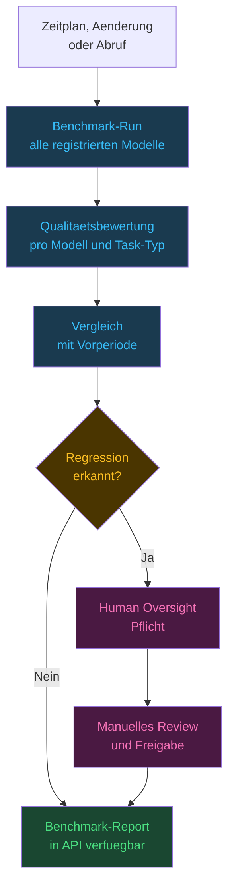

**Human Oversight ist nicht abschaltbar — gebaut ist es im Workflow-Runner.** Der Validator aktiviert keinen Workflow ohne `human_review`-Knoten, kein Pfad von einem `llm_call` endet ohne ihn, der Lauf hält dort an, bis ein Mensch entscheidet, und `four_eyes`-Gates verlangen zwei verschiedene Personen; konfigurierbar ist das nicht. Wer entscheidet, liest vorher, was die Knoten erzeugt haben (CHY-229). `/v1/complete` liefert Modellantworten ohne Gate (→ M6, CHY-199). Entschieden ist, die Prüftiefe nach Risiko abzustufen: `sample` (die Ausgabe geht sofort hinaus, ein Anteil wird nachträglich geprüft), `approver`, `four_eyes`; es gilt das Strengere aus Datenklasse und Risikoklasse, abgeschaltet wird sie nie, und `/v1/complete` bleibt nur, wo `sample` zulässig ist (→ M6, CHY-223). Für den Benchmark ist vorgesehen, dass eine erkannte Regression erst weitergilt, wenn ein Mensch bestätigt, dass sie bekannt und akzeptiert ist oder untersucht wird (CHY-64). Rationale: AI Act Art. 14 fordert menschliche Aufsicht bei Hochrisiko-Systemen; Cohereny implementiert dies als nicht abschaltbaren Sicherheits-Anker.

**Qualitätsmessung: Dreistufige Validator-Pyramide (ADR-006)**

> **Präzisiert durch ADR-043:** Bewertet wird deterministisch. Gebaut sind JSON Schema, Regex, Länge (als Zeichengrenzen), Pflicht- und Verbotsbegriffe und ROUGE-L (`contexts/learning/validators.py`); der Score ist der Mittelwert der gesetzten Validatoren. Abweichung zur Baseline, TF-IDF und Jaccard sind nicht gebaut, und der LLM-Judge (Layer 3) gehört nicht zum Benchmark.

Lokale Modelle sind als Judge für andere lokale Modelle ungeeignet — sie bevorzugen strukturierte Formatierung gegenüber semantischer Korrektheit und erkennen inhaltliche Regressionen nicht zuverlässig. Cloud-Modelle als Judge verursachen bei großen Dokumenten prohibitive Nachtkosten. Die Lösung ist eine Pyramide deterministischer Validatoren mit LLM-Judge nur als allerletzte Instanz:

**Layer 1 — Deterministische Validatoren** (kostenlos, schnell, präzise):
- **JSON Schema** — strukturelle Korrektheit strukturierter Artefakte (z.B. `quiz.json`: Pflichtfelder, Typen, Anzahl Optionen)
- **Regex** — Formatvorgaben (Markdown-Heading-Tiefe, Listenstruktur, Nummerierung)
- **Längen-Checks** — Mindestlänge pro Artefakt-Typ, relative Abweichung ±N% zur CalibrationAnchor-Baseline
- **Keyword-Coverage** — klassisches NLP (Set-Overlap, TF-IDF): Anteil der Fach-Keywords aus dem Input-Dokument der im Output vorkommt

**Layer 2 — CalibrationAnchor-Vergleich** (scope-spezifisch, kein LLM):
- Strukturelle Ähnlichkeit zur gespeicherten Gold-Referenz (ROUGE-L, Jaccard)
- CalibrationAnchors werden manuell gepflegt und sind versioniert im Kontext-Repository

**Layer 3 — LLM-Judge** (nur bei Ambiguität aus Layer 1+2):
- Kleines lokales Modell für Routine-Grenzfälle
- Cloud-Modell (Claude Sonnet) **ausschließlich** bei kritischer Regression + automatischer Human-Freigabe-Pflicht (ADR-004)

Ein Artefakt besteht den Benchmark wenn alle Layer-1-Validatoren erfolgreich sind. Layer 2 und 3 werden nur bei Layer-1-Warnungen oder Regressionen ausgelöst.

**A/B-Adaptions-Benchmark (neu v4.0, 📋):** Zusätzlich zum Drift-Modus ist ein `ab_adaptation`-Modus vorgesehen: je CalibrationAnchor zwei Messungen — eingefrorener Rohprompt (`raw`) gegen Composed Context (`composed`) — und das Delta als **`adaptation_gain`** (eine Teilmenge genügt: 1 Anchor je task_type). Modus und Varianten stehen im Schema (Migration 028), die Läufe → M6 (CHY-68, CHY-64). Damit soll Qualitätsziel Nr. 1 („Adaption verbessert Output messbar“) nicht behauptet, sondern bei jedem Lauf gemessen werden (arc42 ADR-019, ADR-043).

---

### 5.5 Drift-Monitoring als branchenübergreifendes regulatorisches Muster (neu v4.0)

Zwischen 2021 und 2026 haben Stellen aus vier Branchen in dieselbe Richtung gewiesen: **Überwachung von KI-Systemen im Betrieb statt einmaliger Abnahme.** Aufsichtspflicht ist das bisher nur in der Finanzwirtschaft: Die MaRisk (Rundschreiben zu § 25a KWG) verlangt in AT 4.3.4 Tz. 5, die Qualität der Modellergebnisse regelmäßig zu analysieren. Die übrigen Texte sind unverbindliche Leitprinzipien, ein freiwilliger Katalog und ein Entwurf. Folgenlos sind auch sie nicht: Prüfer, Gerichte und Versicherer ziehen solche Leitlinien als Maßstab für die übliche Sorgfalt heran — wer abweicht und dann einen Schaden hat, muss die Abweichung begründen können.

| Regime | Branche | Datum | Kernforderung |
|---|---|---|---|
| FDA–EMA gemeinsame AI-Prinzipien | Pharma/Life Sciences | 14.01.2026 | Lebenszyklus-Management: geplantes Monitoring und periodische Neubewertung (unverbindliche Leitprinzipien, Grundlage künftiger Leitlinien) |
| MaRisk AT 4.3.4 und BaFin-Orientierungshilfe KI | Finanzwirtschaft | 30.06.2026 / 18.12.2025 | MaRisk Tz. 5: Qualität der Modellergebnisse regelmäßig analysieren (für Kreditinstitute maßgeblich); Orientierungshilfe: Model Drift und Lebenszyklus inkl. Stilllegung (nicht verpflichtend) |
| BSI AIC4 | Cloud/IT | 2021 | Lebenszyklus von Entwicklung bis Betrieb; RE-02 Protokollierung jeder Modellanfrage, PF-04 dokumentierte Modellwahl, PF-07 fortlaufende Verbesserung. **Freiwillig** |
| EASA NPA 2025-07 (RMT.0742) — Entwurf, nicht in Kraft | Luftfahrt | 2025/2026 | vorgeschlagen: „Continuous assurance" statt punktueller Zertifizierung |

Die Drift-Erkennung (§5.4, arc42 ADR-044) mit Freigabe nach einer Regression und auditierbarer Historie **soll** dieses Muster als Architektur umsetzen; gebaut sind Anker und Messtabellen, Läufe, Zeitplan und Freigabe → M6 (CHY-68, CHY-181, CHY-64), der Messfühler → M7 (CHY-219). Das ist der stärkste Einzelbefund dieses Kapitels: ein Architekturmuster, vier Stellen — Drift-Monitoring wird vom Nice-to-have zur erkennbaren Erwartung quer durch die Branchen, auch wo sie noch nicht verbindlich ist.

---

## 6. Systemarchitektur

> **Zum Verhältnis der Dokumente:** Dieses Kapitel beschreibt die Architektur *fachlich* —
> welche Bausteine es gibt und warum. Wie der Code geschnitten ist, steht in
> `cohereny-arc42.md` §5.7: vier Bounded Contexts (repository, orchestration, learning,
> pilots — `governance` entfiel mit ADR-042) über einem gemeinsamen Kern, als modularer Monolith (ADR-030). Die
> veröffentlichte Oberfläche ist davon unabhängig nach Konsumenten geschnitten (ADR-031,
> §9.1) — zwei Achsen, die sich kreuzen dürfen.

### 6.1 Komponentenübersicht

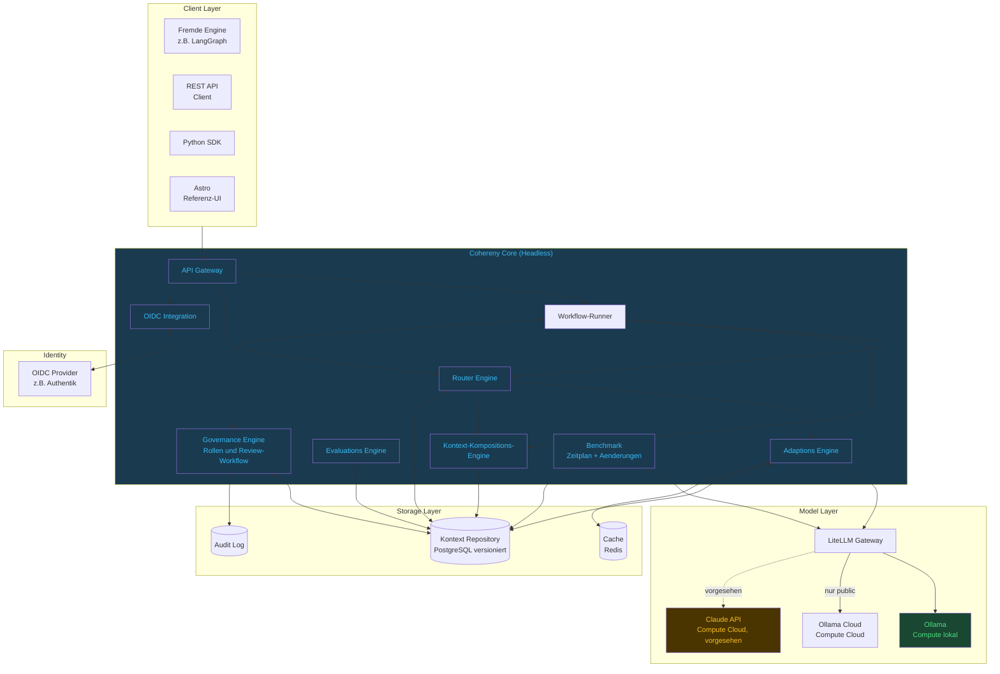

Das Bild zeigt die Ziel-Architektur. Gebaut sind API Gateway mit OIDC je Oberfläche, Workflow-Runner, Router Engine, Kompositions-Engine und der Freigabeweg der Blöcke (als Block-Lebenszyklus im Kontext `repository`, ADR-042), von der Evaluations-Engine die Validatoren der Kalibrieranker (CHY-67). Geplant (📋) sind Adaptions-Engine, Benchmark-Läufe (CHY-68) und das Python SDK; bis zur Adaptions-Engine gehen Modellaufrufe direkt an LiteLLM.

### 6.2 Referenz-Deployment-Topologie

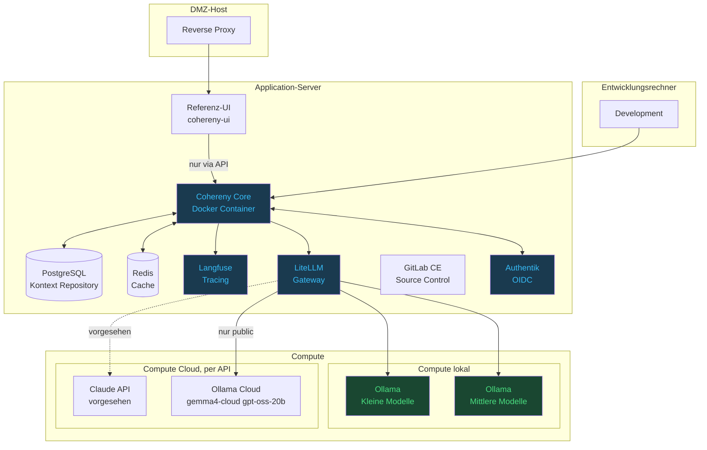

---

## 7. Kernworkflows

### 7.1 Prompt-Adaptions-Workflow (🔧 → M6)

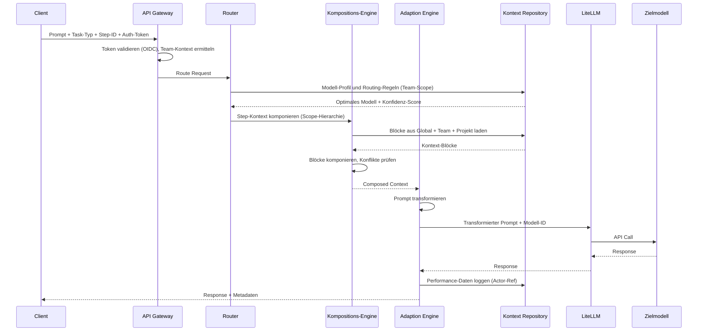

> **Gebaut ist der Ablauf ohne Adaptions-Engine** (`POST /v1/complete`): Token prüfen; die Routing-Regel des angegebenen Geltungsbereichs nach `task_type` auflösen und jeden Kandidaten gegen dessen Datenklasse prüfen (ADR-038, ADR-041); die Blöcke der Geltungsbereichskette komponieren; das Modell über LiteLLM aufrufen und bei einem Ausfall den nächsten Kandidaten nehmen. Einen Konfidenz-Score, eine Prompt-Transformation und Performance-Daten im Repository gibt es nicht; der Geltungsbereich kommt aus dem Aufruf, nicht aus dem Token. Rückfälle stehen im Audit-Log, der Aufruf selbst im Trace (Langfuse, optional).

### 7.2 Governance-Workflow: Neue Übersetzungsregel (📋 → M6)

```mermaid
sequenceDiagram
    participant U as Contributor
    participant API as Cohereny API
    participant GOV as Governance Engine
    participant MOD as Reviewer
    participant CR as Kontext Repository

    U->>API: Neue Übersetzungsregel vorschlagen
    API->>GOV: Rolle prüfen (Contributor erlaubt?)
    GOV->>CR: Speichern als pending_review
    MOD->>API: Ausstehende Freigaben abfragen
    MOD->>API: Diff ansehen + Freigabe/Ablehnung
    alt Freigegeben
        API->>CR: Status active (eingereichte Version)
        CR->>CR: Alle Team-Mitglieder können nutzen
    else Abgelehnt
        API->>CR: Status rejected + Begründung
    end
```

> **Gebaut ist derselbe Weg für jeden Block:** Entwurf, Einreichen, Freigabe oder Ablehnung mit Begründung durch einen Reviewer in strengen Geltungsbereichen; in direkten wird ein Block mit dem Schreiben aktiv (ADR-011/042). Übersetzungsregeln als eigener Blocktyp kommen mit M6 (CHY-204); den gebauten Freigabeweg zeigt arc42 §6.2.

### 7.3 Study Workflow

```mermaid
flowchart TD
    PDF[Studienheft PDF\nStudy Materials] --> ING[Node 1\nDocument Ingest\nChunking nach Zeichenzahl]
    ING --> SUM[Node 2\nZusammenfassung\nKleines Modell lokal]
    SUM --> FACT[Node 3\nFakten-Extraktion\nMittleres Modell lokal]
    FACT --> MIND[Node 4\nMindmap-Generierung\nStrukturierter Output]
    MIND --> AUDIO[Node 5\nHoerbuch-Skript\nMittleres Modell lokal]
    AUDIO --> CHECK1{Node 6\nAbdeckungs-Check\nLernstoff abgedeckt?}
    CHECK1 -->|Gaps gefunden| GAP[Node 7\nGap-Analyse\nWas fehlt?]
    GAP -->|loop_limit: 3| SUM
    CHECK1 -->|Vollstaendig| QUIZ[Node 8\nLernfragen generieren]
    QUIZ --> EVAL{Node 9\nWissenspruefung\nLernziel erreicht?}
    EVAL -->|Nein · loop_limit: 2| QUIZ
    EVAL -->|Ja| OUT[Lernmaterial\nfertig]

    classDef good fill:#1a4731,color:#4ade80
    classDef warn fill:#4a3500,color:#fbbf24
    classDef cloud fill:#1a3a4f,color:#38bdf8
    classDef danger fill:#4a1942,color:#f472b6

    class ING,FACT cloud
    class SUM,AUDIO warn
    class MIND,QUIZ good
    class CHECK1,EVAL danger
    class OUT good
```

> **Dieser Workflow ist der Gegentest zum Modell aus §8.2.** Er enthält **zwei Zyklen** —
> `Gap-Analyse → Zusammenfassung` (Grenze 3) und `Lernziel-Prüfung → Lernfragen` (Grenze 2, im Code mit der ersten über einen gemeinsamen Zähler verrechnet) —
> und ließe sich in einem azyklischen Modell nicht darstellen. Die Grenzen existieren seit der
> ersten Fassung, stehen aber bis heute als Konstanten in der Konfigurationsdatei des Piloten
> (`MAX_QUALITY_ITERATIONS`, `MAX_QUIZ_ITERATIONS`) statt als Eigenschaft der Kante. Genau diese
> Verlagerung ist der Inhalt von ADR-026: Was der Pilot im Code löst, wird zum Pflichtfeld der
> Definition und vom Validator geprüft.
>
> Weil beide Schleifen in denselben Zähler laufen, endet die Quiz-Schleife erst, wenn beide zusammen fünf Durchläufe erreicht haben — je nach Verlauf der ersten nach einem bis vier Rücksprüngen. Eine Grenze je Kante schließt genau das aus.
>
> **Hinweis zur Benennung:** Node 6 prüft seit CHY-23 die Abdeckung gegen die `question_bank` (Funktion `node_coverage_check`); im Graphen und in der Zeitmessung heißt der Knoten weiterhin `quality_check`.

**Modell-Zuordnung im Lern-Workflow:**

> **Stand 2026-06-26 — validiert durch Benchmark auf MBA M2 24GB.**
> Llama 13B/8B erwiesen sich als zu langsam (Pi 4) bzw. qualitativ überholt.
> gemma4:e4b (~21 tok/s, 358ms Ladezeit) ist das beste lokale Modell für mittlere Aufgaben.

| Node | Aufgabe | Modell | Wo | Begründung |
|---|---|---|---|---|
| 1 Ingest | Chunking nach Zeichenzahl, 100 Zeichen Überlappung | — kein Modell | — | Lerndaten bleiben lokal |
| 2 Zusammenfassung | Fließtext zusammenfassen | phi3:mini | `local-small` | Schnell, ausreichend für Zusammenfassung |
| 3 Fakten-Extraktion | Fakten | gemma4:e4b | `local-medium` | Beste Qualität lokal, Lerndaten bleiben lokal |
| 4 Mindmap | Strukturierter Output | phi3:mini | `local-small` | Einfache Struktur, schnell |
| 5 Hörbuch | Kreativer, natürlicher Text | gemma4:e4b | `local-medium` | Vollständig lokal — Claude API optional nachrüstbar |
| 6 Qualitäts-Check | Abdeckung prüfen | gemma4:e4b | `local-medium` | Reasoning lokal, Lerndaten bleiben lokal |
| 7 Gap-Analyse | Was fehlt? | gemma4:e4b | `local-medium` | Reasoning lokal, Lerndaten bleiben lokal |
| 8 Lernfragen | Fragen generieren | phi3:mini | `local-small` | Ausreichend für strukturierte Fragen |
| 9 Wissensprüfung | Antworten evaluieren | gemma4:e4b | `local-medium` | Vollständig lokal — Claude API optional nachrüstbar |

**LiteLLM Routing-Ebenen:**
```
local-small  → Ollama            (phi3:mini, nomic-embed-text*)   Compute lokal
local-medium → Ollama            (gemma4:e4b, ~21 tok/s)          Compute lokal
cloud        → Claude API        optional, jederzeit nachrüstbar  Compute Cloud
```

> \* `nomic-embed-text` steht in der Modellliste (`router/routing-config.yaml`), wird aber von keinem Piloten benutzt (CHY-141).


### 7.4 Kamerabasiertes Aktivitäts-Monitoring (📋 Referenz-Design, nach 1.0, CHY-206)

Ein kamerabasiertes Monitoring-System demonstriert wie Cohereny multimodale Workflows mit lokaler Vision-Inferenz, Human-in-the-Loop Training und Routing nach Datenklasse verknüpft.

> **Übertragbarkeit auf Healthcare (EU AI Act Hochrisiko):** Das Muster ist direkt auf medizinische Szenarien anwendbar — Sturzerkennung, Nachtmonitoring bei Demenz, kontaktlose Atemfrequenz-Messung. Bei Healthcare-Einsatz greifen EU AI Act Art. 14 Human Oversight (hardcoded), DSGVO Art. 9 (Gesundheitsdaten ausschließlich lokal), SaMD-Entscheidung (CHY-4) und DPIA (CHY-18).

```mermaid
sequenceDiagram
    participant CAM as Kamera-Event
    participant FE as Frame-Extraktion
    participant VI as Vision Inference
    participant CC as Cohereny
    participant HR as Human Review
    participant AL as Audit-Trail

    CAM->>FE: Bewegungsereignis (lokal)
    FE->>VI: Frame-Set via ffmpeg
    VI->>CC: Klassifikation + Konfidenz
    CC->>CC: CalibrationAnchor-Lookup
    alt Konfidenz >= Schwellwert
        CC->>AL: Klassifikation + Actor-Ref
    else Konfidenz < Schwellwert oder Healthcare
        CC->>HR: Human Review Pflicht
        HR->>CC: Bestätigt oder korrigiert
        CC->>CC: CalibrationAnchor Update
        CC->>AL: Review + Korrektur + Actor-Ref
    end
```

**Cohereny-Mechanismen:**

| Mechanismus | Wirkung |
|---|---|
| **Datenklasse** | Der Geltungsbereich der Kameradaten trägt `critical` (ohne Angabe ohnehin die Vorgabe); damit kommen nur Modelle mit der Obergrenze `critical` in Frage — in der mitgelieferten Konfiguration die lokalen (ADR-041) |
| **CalibrationAnchors** | Visuelle Referenz-Frames als Baseline; Abweichungen werden als Anomalie markiert |
| **TranslationRule Vision** | Modell-spezifische Prompt-Struktur — moondream und llava:7b benötigen fundamental unterschiedliche Formate |
| **Human-in-the-Loop** | Bei unbekannten Mustern: Frame anzeigen, Klassifikation bestätigen oder korrigieren → neuer CalibrationAnchor |
| **Benchmark nach Zeitplan und bei Änderungen** (→ M6) | Accuracy-Tracking pro Klasse; Regression-Alert wenn Erkennungsrate fällt |
| **Human Oversight (hardcoded)** | Bei Healthcare-Anwendungen: jeder kritische Alert erfordert menschliche Bestätigung — EU AI Act Art. 14, nicht deaktivierbar |

**Infrastruktur (lokal, ohne Cloud-Zwang):**
- Vision-Inferenz auf Consumer Hardware (Raspberry Pi 5 16 GB oder MacBook Air M2)
- Ollama mit moondream:1.8b (~1.1 GB, optimiert für Edge-Inferenz)
- Frame-Extraktion via ffmpeg; kein zusätzlicher Dienst
- Vollständiger Audit-Trail: Actor-Ref, Klassifikation, Zeitstempel, Korrektur

---

## 8. Datenmodelle (Kurzreferenz)

Maßgeblich sind arc42 §5.6 und das Schema (`migrations/`, `contexts/*/schema.py`, `kernel/schema.py`). Hier die Kurzreferenz der Entitäten nach den sechs Domänen, abgeglichen am 31.10.2026; eine knappe Übersicht ersetzt sie mit M7 (CHY-207).

### 8.1 Domäne: Identity & Scope

```python
# Einheitliche Scope-Hierarchie — ersetzt separate Org/Team/Project-Tabellen
class ScopeNodeType(str, Enum):
    ORG = "org"
    TEAM = "team"
    WORKSPACE = "workspace"      # teamübergreifend (z.B. "Kunde XY")
    PROJECT = "project"
    SUB_PROJECT = "sub_project"
    PERSONAL = "personal"

class ScopeNode(BaseModel):
    id: UUID
    name: str
    description: Optional[str]
    node_type: ScopeNodeType
    scope_path: str              # ltree, z.B. "org_<uuid>.team_<uuid>" (ADR-008)
    parent_id: Optional[UUID]
    privacy_level: Optional[Literal["public", "internal", "confidential", "critical"]]
                                 # wirksam: die strengste der Kette, ohne Angabe critical (ADR-041)
    created_by: Optional[UUID]
    created_at: datetime

class Actor(BaseModel):          # DSGVO-sichere Personenreferenz
    id: UUID                     # actor_ref
    idp_sub: Optional[str]       # None nach Anonymisierung (und bei lokalen Actors)
    display_name: str            # "[anonym]" nach Anonymisierung
    role: Role                   # consumer | contributor | reviewer | architect | admin
    is_anonymized: bool
    anonymized_at: Optional[datetime]
    created_at: datetime

class ScopeMembership(BaseModel):   # gibt Laufinhalte frei (arc42 ADR-047); Blöcke → CHY-237
    scope_id: UUID
    actor_id: UUID
    role: Role                   # consumer | contributor | reviewer | architect | admin
    granted_by: Optional[UUID]
    granted_at: datetime

class UserPreferences(BaseModel):  # 📋 nicht gebaut — Hard Delete bei DSGVO-Anfrage
    actor_ref: UUID
    response_verbosity: str
    preferred_language: str
    personal_overrides: Dict[str, Any]
```

### 8.2 Domäne: Workflow (gerichteter Graph)

> **Neu gefasst in v4.6.** Bis v4.5 hieß dieser Abschnitt „Workflow (DAG)". Die Azyklizität war
> weder begründet noch implementiert und konnte den seit Juni 2026 laufenden Study-Pilot nicht
> abbilden — er enthält zwei Rückschleifen. Begründung und Konsequenzen: arc42 ADR-026.
> Die Strukturen sind in **§8.2.1** grafisch dargestellt.

```python
class WorkflowDefinition(BaseModel):  # Append-Only versioniert
    id: UUID                     # eine Zeile je Version; stabile workflow_id und
                                 # workflow_version an Knoten und Kanten geplant (CHY-127)
    version: int
    superseded_by_version: Optional[int]  # None = aktuell
    name: str
    scope_id: UUID               # FK auf ScopeNode; Pfad hängt am ScopeNode (ltree)
    risk_classification: Dict[str, Any]   # freies JSON-Objekt, gespeichert, nicht ausgewertet
    status: Literal["draft", "active", "deprecated"]
    created_by: Optional[UUID]
    created_at: datetime

class WorkflowRiskClassification(BaseModel):  # 📋 geplant — heute ohne Wirkung
    risk_category: Literal["high_risk", "limited_risk", "minimal_risk"]
    requires_human_oversight: bool
    data_categories: List[str]   # ["medical", "financial", "personal", ...]
    privacy_level: Literal["public", "internal", "confidential", "critical"]

class WorkflowNode(BaseModel):
    id: UUID
    workflow_id: UUID
    node_ref: str                # sprechender Bezeichner, eindeutig je Workflow
    name: str
    node_type: Literal[
        "context_compose", "llm_call", "tool_call",
        "fork_gateway", "join_gateway", "human_review",
        "sub_workflow",          # neu v4.6
    ]
    # Nur für node_type = "llm_call" (Spalte seit Migration 023, CHY-145),
    # dort Pflicht: der Schlüssel, nach dem die Routing-Regeln des
    # Geltungsbereichs aufgelöst werden. Der Knoten nennt kein Modell --
    # welches Modell eine Aufgabe bearbeitet, ist eine freigegebene
    # Routing-Regel (ADR-038), und `config["model"]` ist unspeicherbar.
    task_type: str
    # Nur für node_type = "context_compose" (Spalte seit Migration 022,
    # CHY-134). Zwei CHECKs: nur auf diesem Knotentyp, und nur
    # komponierbare Blocktypen (ADR-037). Weglassen heißt "alles, was
    # der Geltungsbereich hergibt" -- die leere Liste ist unspeicherbar,
    # weil der Store sie als "kein Filter" liest.
    context_requirements: Optional[ContextRequirements]
    # Nur für node_type = "join_gateway":
    join_policy: Optional[Literal["wait_all", "wait_any", "first_wins"]]
    # Nur für node_type = "human_review":
    review_role: Optional[Literal["approver", "four_eyes"]]
    review_timeout: Optional[timedelta]          # gespeichert, noch nicht ausgewertet: ein Gate wartet heute unbegrenzt
    on_timeout: Optional[Literal["reject", "escalate"]]   # nie "approve"
    # Nur für node_type = "sub_workflow":
    target_workflow_id: Optional[UUID]
    target_workflow_version: Optional[int]       # gepinnt, kein "immer aktuell"
    # Für JEDEN Knotentyp (ADR-033): wählt aus dem, was der Knoten
    # ohnehin sieht, benannte Werte aus -- {"prompt": "fetch.text"}
    input_mapping: Optional[Dict[str, Any]]
    output_mapping: Optional[Dict[str, Any]]   # gespeichert, nicht ausgewertet (Sub-Workflow-Aufruf, Ausführung 📋)

class ContextRequirements(BaseModel):
    # Bis CHY-134 nur ein Name: die Klasse wurde referenziert und nirgends
    # definiert, im Schema stand nichts. Jetzt beides, und mit genau einem
    # Feld -- `required_tags`/`exclude_tags` aus arc42 §5.6 filtern nirgends
    # (CHY-147), und ein Feld, das niemand auswertet, ist die Zusage ohne
    # Deckung, die dieses Ticket entfernt hat.
    block_types: List[str]       # mindestens einer, nur komponierbare Typen

# `NodeClassification` und `ModelAssignment` standen hier bis v4.13 und
# existierten nirgends im Quellbaum (CHY-145):
#   - task_type ist jetzt eine Spalte am Knoten (s. o.)
#   - privacy_level gehört an den Geltungsbereich, nicht an den Knoten
#     (entschieden 24.09.2026, CHY-160)
#   - complexity, data_sensitivity, requires_local liest nichts
#   - model_assignment ist durch Routing-Regeln ersetzt (ADR-038): eine
#     Entscheidung mit Freigabe, Vererbung und Privacy-Ratchet statt eines
#     Feldes, das jeder Autor eines Workflows setzen konnte
#   - prompt_template_block_id wird durch CHY-146 abgelöst

class WorkflowConnection(BaseModel):  # Kante im Graph
    id: UUID
    workflow_id: UUID
    source_node_id: UUID
    target_node_id: UUID
    condition: Optional[Dict[str, Any]]  # None = bedingungslos
    label: Optional[str]
    execution_mode: Literal["sequential", "parallel"]
    loop_limit: Optional[int]            # neu v4.6 — Pflicht auf jeder Rückkante,
                                         # None nur auf Vorwärtskanten (ADR-026)
```

#### 8.2.1 Workflow-Strukturen

Vier Strukturen lassen sich aus diesen Bausteinen bilden. Die ersten beiden waren im Modell
vorgesehen, die letzten beiden kommen in v4.6 hinzu — obwohl beide bereits gebraucht werden.

**Sequenz.** Der Regelfall: Kanten ohne `condition`, `execution_mode: sequential`.

**Verzweigung und Parallelisierung.** Mehrere ausgehende Kanten mit `condition` bilden eine Verzweigung: Genommen wird jede, deren Bedingung zutrifft — ein exklusives Oder entsteht, wenn sich die Bedingungen ausschließen. Eine Kante mit dem Label `default` greift nur, wenn keine zutrifft; ohne sie endet der Lauf mit einem Fehler. Mehrere Kanten ohne Bedingung bilden ein AND; ein `join_gateway` führt die Zweige nach seiner `join_policy` wieder zusammen. Die Zweige laufen heute nacheinander; `execution_mode` wird gespeichert, aber noch nicht ausgewertet.

```mermaid
graph LR
    C["llm_call\nklassifizieren"] --> F{{"fork_gateway"}}
    F -->|"execution_mode: parallel"| P1["llm_call\nZusammenfassung"]
    F -->|"execution_mode: parallel"| P2["tool_call\nKennzahlen ziehen"]
    P1 --> J{{"join_gateway\njoin_policy: wait_all"}}
    P2 --> J
    J --> HR["human_review"]

    classDef good fill:#1a4731,color:#4ade80
    classDef cloud fill:#1a3a4f,color:#38bdf8
    class HR good
    class C,P1,P2,F,J cloud
```

**Schleife — neu.** Verfeinern bis die Abdeckung reicht, neu formulieren bis das Prüfkriterium
hält, ein Werkzeug erneut aufrufen wenn die Antwort unvollständig war: Rückkopplung ist das
verbreitetste Muster in LLM-Workflows. Ohne Zyklus lässt es sich nur durch Abrollen darstellen —
dieselbe Teilkette *n*-mal kopiert, mit der Iterationszahl fest in der Graphstruktur.

Jede Rückkante trägt deshalb verpflichtend `loop_limit`. Der Grund ist wirtschaftlich, nicht
ästhetisch: Eine Schleife ohne Abbruchbedingung ist hier kein hängender Prozess, sondern
**unbegrenzte Kosten gegenüber einem Dritten** — jede Runde ist ein bezahlter Inferenzaufruf.

```mermaid
graph LR
    S["llm_call\nzusammenfassen"] --> V["llm_call\nAbdeckung prüfen"]
    V -->|"Abdeckung ausreichend"| HR["human_review"]
    V -->|"Lücken gefunden\nloop_limit: 3"| S

    classDef good fill:#1a4731,color:#4ade80
    classDef warn fill:#4a3500,color:#fbbf24
    classDef cloud fill:#1a3a4f,color:#38bdf8
    class HR good
    class V warn
    class S cloud
```

Ist die Grenze erreicht, bricht der Run **nicht** ab — die Rückkante wird nicht mehr genommen, und er läuft auf dem regulären Pfad weiter. Ein Vermerk `loop_limit_reached` im Audit-Trail soll im Nachhinein unterscheidbar machen, ob ein Ergebnis das Prüfkriterium bestanden hat oder ob nur das Budget aufgebraucht war — genau diese Unterscheidung ist die Grundlage der Entscheidung eines Freigebenden (EU AI Act Art. 14). Gebaut ist er noch nicht: Der Runner erkennt die erschöpfte Kante, protokolliert sie aber nicht.

**Sub-Workflow — neu** (Schema und Validator ✅, Ausführung 📋). Ein Knoten, der eine andere Workflow-Definition in gepinnter Version
aufruft. Der aufgerufene Workflow ist vollwertig: eigener Endpunkt, eigene Version, eigener
Audit-Trail — und damit **selbst an den Pflichtkern gebunden**.
Ausführen kann der Runner ihn noch nicht: Für `sub_workflow` ist kein Executor registriert, ein Lauf, der ihn erreicht, endet mit `failed`.

```mermaid
graph TB
    subgraph OUTER["Aufrufender Workflow — kredit_pruefung v4"]
        direction LR
        A["llm_call\nUnterlagen lesen"] --> SW["sub_workflow\ntarget: drift_check v7"]
        SW --> HRO["human_review\nKreditanalyst"]
    end

    SW -.->|"input_mapping ↓\noutput_mapping ↑"| I1

    subgraph INNER["Aufgerufener Workflow — drift_check v7 · eigener Endpunkt, eigene Version, eigener Audit-Trail"]
        direction LR
        I1["context_compose"] --> I2["llm_call"]
        I2 --> I3["human_review"]
    end

    classDef good fill:#1a4731,color:#4ade80
    classDef cloud fill:#1a3a4f,color:#38bdf8
    class HRO,I1,I2,I3 good
    class A,SW cloud
```

Dasselbe Prinzip — ein Workflow als einzelner Schritt — trägt die Einbindung in fremde Workflow-Engines (§8.2.2); dort startet die fremde Engine den Lauf über die API. Rekursion ist
ausgeschlossen: Zyklen sind *innerhalb* eines Workflows erlaubt, *zwischen* Workflows nicht — dort
gäbe es keine Kante, an der eine Iterationsgrenze hängen könnte.

#### 8.2.2 Einbindung in Camunda, SAP und andere Workflow-Engines

Im Enterprise-Umfeld existiert die Orchestrierung meist schon — Camunda, SAP Workflow, eine
BPMN-Engine im Hause. Cohereny tritt dort nicht als Konkurrent auf, sondern als **ein Schritt**:
ein `serviceTask`, der über `POST /v1/workflows/{workflow_id}/runs` einen Cohereny-Workflow startet und dessen Ergebnis über `GET /v1/workflows/runs/{run_id}` abholt; der Lauf hält am `human_review` an, bis ein Mensch entschieden hat.

Der entscheidende Punkt ist, was in diesem Schritt passiert. Cohereny führt aus dem Aufruf heraus
**selbst einen Workflow aus** — mindestens Modell-Routing, Inferenz und Freigabe. Das ist keine
Doppelung der fremden Engine, sondern die Bedingung dafür, dass die Freigabepflicht überhaupt
durchsetzbar bleibt:

> Ein Freigabeschritt, der in Camunda modelliert ist, lässt sich im Modeler löschen. Ein Freigabeschritt, der in einem Cohereny-Workflow liegt, nicht — der Validator nimmt einen Workflow ohne ihn gar nicht erst an. Erzwingen lässt sich nur, was durch Cohereny hindurchmuss (ADR-004): `/v1/complete` liefert Modellantworten ohne Freigabe, die Pflicht greift nur, wenn die fremde Engine einen Workflow-Lauf startet.

Wie viele Schritte dieser innere Workflow hat, ist frei konfigurierbar; **dass** er die drei
Pflichtknoten enthält, ist es nicht.

**Zum Austauschformat:** BPMN 2.0 *ist* XML, und ein Import aus einer bestehenden Modellierung soll deshalb über XML laufen — gebaut ist er nicht. Das native Format von Cohereny bleibt trotzdem JSON — die Validator-Regeln (Pflichtknoten, Iterationsgrenze, Freigabe nach dem letzten Inferenzaufruf, keine Zyklen zwischen Sub-Workflows) sind sämtlich Graphanalyse und in keinem Schemasprachen-Standard ausdrückbar, weder XSD noch JSON Schema. Das JSON Schema der Modelle steht in den erzeugten Contracts (`openapi.yaml`, `contracts/`); die eigentliche Prüfung ist Code mit Tests. Die vollständige Abwägung — einschließlich der Frage, warum kein XSLT — steht in arc42 ADR-027.

### 8.3 Domäne: Context Repository

```python
class ContextBlockType(str, Enum):
    SYSTEM_PROMPT = "system_prompt"
    USER_CONTEXT = "user_context"
    TOOL_SCHEMA = "tool_schema"
    EXAMPLE_IO = "example_io"
    CALIBRATION_ANCHOR = "calibration_anchor"   # Testfall des Benchmarks, nie komponiert (ADR-043)
    ROUTING_RULE = "routing_rule"               # Konfiguration, nie komponiert (ADR-037)
# model_profile, translation_rule, prompt_template: 📋 geplant (Adaptionsschicht)

class ContextBlock(BaseModel):   # Append-Only versioniert; Veröffentlichtes unveränderlich (Migration 013/016)
    id: UUID                     # technischer Row-Key
    block_id: UUID               # stabile logische ID über alle Versionen
    version: int                 # eindeutig zusammen mit block_id
    superseded_by_version: Optional[int]   # None = aktuell
    block_type: ContextBlockType
    scope_id: UUID               # Geltungsbereich; der Pfad hängt am ScopeNode
    tags: List[str]              # thematische Zuordnung
    content: str                 # Prompt-Material; bei routing_rule die Begründung,
                                 # bei calibration_anchor die Referenzantwort
    metadata: Dict[str, Any]     # erweiterbar; bei routing_rule und calibration_anchor
                                 # die maschinenlesbare Regel bzw. der Testfall
    governance_key: Optional[str]                     # Privacy-Ratchet (ADR-017)
    privacy_impact: Optional[Literal["restrictive", "permissive"]]
    locked: bool
    status: Literal["draft", "pending_review", "active", "rejected", "deprecated"]
    author_id: Optional[UUID]
    created_at: datetime
# change_reason steht im Audit-Eintrag der neuen Version, nicht in der Zeile

# Typ-spezifische content-Strukturen:

# block_type = "translation_rule" — lernfähig
class TranslationRuleContent(BaseModel):   # 📋 geplant — kein Blocktyp `translation_rule`
    source_model_id: str
    target_model_id: str
    task_type: str
    transformation_flags: Dict[str, bool]
    prompt_template: str
    confidence_score: float      # steigt durch Lern-Loop
    sample_count: int
    avg_quality_improvement: float
    learned_from_anchors: List[UUID]  # welche CalibrationAnchors diese Regel erzeugt haben

# block_type = "routing_rule" — die Regel steht in `metadata`, nicht in `content`
# (ADR-038). `content` trägt die Begründung, für den Reviewer.
class RoutingRuleMetadata(BaseModel):
    task_type: str           # welche Aufgabe diese Regel entscheidet
    candidates: List[str]    # bestes zuerst; ein Rückfall darf nicht absteigen (ADR-017)
    max_tokens: int          # längste Antwort: Voreinstellung und Obergrenze (CHY-166)
# Bedingungen auf Schritt-Eigenschaften (frühere Entwürfe: conditions/action/
# priority) sind nicht umgesetzt. Die Datenklasse kommt vom Geltungsbereich (ADR-041).

# block_type = "calibration_anchor" — Testfall des Benchmarks (ADR-043)
# content: die Referenzantwort; der Testfall steht in metadata:
class CalibrationAnchorMetadata(BaseModel):
    task_type: str
    input: str
    raw_prompt: str                    # eingefrorener, unadaptierter Prompt (ADR-019)
    validators: Validators             # json_schema, regex, length, required_terms,
                                       # forbidden_terms, rouge_l (ADR-006 Stufe 1+2)
    models: Optional[List[str]]        # nur gegen diese Modelle messen
# Messergebnisse stehen nicht im Anker, sondern in benchmark_measurements (§8.5)

class ComposedContext(BaseModel):
    scope_id: UUID
    workflow_id: Optional[UUID]
    node_ref: Optional[str]
    model_id: Optional[str]          # nur Teil des Cache-Schlüssels
    blocks: List[ComposedBlock]      # flach nach tief, nichts überschrieben
    block_versions: Dict[str, int]   # block_id → version: was tatsächlich drin war
    scope_generations: Dict[str, int]
    compiled_at: datetime
```

### 8.4 Domäne: Feedback & Lern-Loop (📋 geplant → M6, CHY-40)

> Nicht gebaut: `feedback_events` und `learning_proposals` stehen seit Migration 001 mit anderem Zuschnitt und ohne Leser, die Endpunkte antworten 501. `ExecutionLog` gibt es nicht — ausgeführte Knoten stehen in `node_executions`, Modellaufrufe im Trace.

```python
class ExecutionLog(BaseModel):   # ein LLM-Call; Rohdaten in Langfuse
    id: UUID
    workflow_id: UUID
    node_id: UUID
    model_id: str
    prompt_used: str
    quality_score: Optional[float]
    success: bool
    langfuse_trace_id: str       # Pointer auf vollständigen Trace
    executed_at: datetime

class FeedbackEvent(BaseModel):  # explizite Rückmeldung
    id: UUID
    execution_log_id: UUID
    feedback_type: Literal["positive", "negative", "correction"]
    alternative_prompt: Optional[str]   # Prompt B wenn A scheiterte
    quality_improvement: Optional[float]
    actor_ref: UUID
    timestamp: datetime

class LearningProposal(BaseModel):  # auto-generiert, braucht Freigabe
    id: UUID
    triggered_by_feedback_id: Optional[UUID]
    triggered_by_benchmark_id: Optional[UUID]
    proposal_type: Literal["new_translation_rule", "update_translation_rule", "update_routing_rule"]
    current_block_id: UUID
    proposed_content: Dict[str, Any]
    confidence: float
    status: Literal["pending_review", "approved", "rejected"]
    reviewed_by_ref: Optional[UUID]
    reviewed_at: Optional[datetime]
```

### 8.5 Domäne: Qualität & Benchmark

```python
# ── Benchmark (ADR-043, Migration 028) ────────────────────────────────────────

class BenchmarkRun(BaseModel):               # benchmark_runs
    id: UUID
    mode: Literal["drift", "ab_adaptation"]
    status: Literal["running", "complete", "failed"]
    trigger: Literal["schedule", "change", "probe", "manual"]  # 📋 CHY-68: Auslöser (ADR-044)
    triggered_by: Optional[UUID]             # Person bei Abruf; None bei Zeitplan und Änderung
    review_needed: bool                      # setzt der Lauf; Freigabe 📋 CHY-64
    started_at: datetime
    finished_at: Optional[datetime]

class BenchmarkMeasurement(BaseModel):       # benchmark_measurements, nur anfügbar
    run_id: UUID
    anchor_block_id: UUID
    anchor_version: int                      # gemessen wird eine Anker-Version
    model: str
    variant: Literal["composed", "raw"]
    repetition: int                          # 📋 CHY-68: Wiederholung im Lauf (ADR-044)
    block_versions: Optional[Dict[str, int]] # 📋 CHY-68: Kontextstand bei composed, None bei raw
    outcome: Literal["measured", "unreachable", "refused", "error"]
    score: Optional[float]                   # 0–1, genau dann gesetzt, wenn measured
    scores: Dict[str, Any]
    output: Optional[str]
    latency_ms: Optional[int]
    tokens_in: Optional[int]
    tokens_out: Optional[int]

# Report und Freigabe nach einer Regression: 📋 geplant (CHY-64)

# ── AdaptVault (📋 geplant, arc42 ADR-024) ───────────────────────────────────
# Eigene Benchmark-Einträge (PromptBenchmark, BenchmarkResultEntry) entfallen mit
# ADR-043: Testfälle sind Kalibrieranker im Repository, Messungen stehen oben.

class PromptAdaptation(BaseModel):           # 📋 CHY-69 — erfolgreiche Variante, schließt Kreis zu §2.3
    id: UUID
    anchor_block_id: UUID                    # Testfall (ADR-043)
    model: str
    variant_strategy: Literal["cot", "format_hint", "context_extension", "meta_prompt"]
    adapted_prompt: str
    adaptation_gain: float                   # (Score mit Adaption) - (Score ohne)
    auto_approved: bool                      # True wenn gain > Schwellwert und konsistent
    created_at: datetime

class DPOTrainingPair(BaseModel):            # 📋 CHY-70 — Export aus benchmark_measurements
    prompt: str
    chosen: str                              # bestes Output (score > 0.8 + validated)
    rejected: str                            # schlechtestes Output desselben Ankers
    domain: str
    source_anchor_block_id: UUID
    source_run_id: UUID
```

### 8.6 Domäne: Governance & Compliance

```python
# MergeRequest entfällt — ADR-042, Migration 025. Freigegeben wird die Block-Version selbst (§3.7).

class AuditLogEntry(BaseModel):  # nur anfügbar: UPDATE, DELETE, TRUNCATE lösen einen Fehler aus (Migration 011);
                                 # auch gegen die Datenbankrolle der Anwendung (CHY-85)
    id: UUID
    actor_id: Optional[UUID]     # Verweis auf den Actor, None bei Systemaktionen
    action: str                  # z. B. block.approved, actor.anonymized, routing.fell_back
    target_ref: Optional[str]    # "<typ>:<id>"
    payload: Dict[str, Any]
    created_at: datetime         # clock_timestamp(): Reihenfolge innerhalb einer Transaktion bleibt (026)

class TransparencyRecord(BaseModel):  # EU AI Act Art. 50; heute nur für Pilotläufe (Migration 005, 015)
    id: UUID
    pilot_run_id: UUID                # RESTRICT: ein Nachweis verschwindet nicht mit seinem Lauf
    user_informed: bool
    model_used: str
    model_disclosure: str
    created_at: datetime

# Benchmark-Lauf und -Messung: siehe §8.5 (Migration 028); Report und Freigabe 📋 CHY-64
```

---

## 9. API-Design — Prinzipien

Bis v4.6 zählte dieser Abschnitt alle Endpunkte auf. Er war damit eine von **drei**
Fassungen derselben API: gegenüber `arc42 §5.7` und dem Code wichen 15 versprochene
Endpunkte ab, die es nicht gab, und 14 laufende fehlten — darunter der gesamte
Freigabe-Lebenszyklus eines Blocks. Der DSGVO-Löschpfad trug in den drei Fassungen drei
verschiedene Namen.

> **Die vollständige und aktuelle Oberfläche steht in `cohereny/openapi.yaml`.** Sie wird
> aus der Anwendung erzeugt und von CI gegen sie geprüft (ADR-029); jede geplante Operation
> trägt `x-cohereny-status: planned` samt Ticket und antwortet 501. Eine Aufzählung in
> Prosa hat keine Aufgabe, die diese Datei nicht besser erfüllt — sie hatte nur die
> Eigenschaft, unbemerkt falsch werden zu können.

Was hier bleibt, sind die Festlegungen, die das Verhalten der API begründen und sich nicht
aus der Spezifikation ablesen lassen.

### 9.1 Vier Oberflächen statt einer (ADR-031)

Cohereny ist Middleware: die Referenz-UI ist ein Konsument, ein MCP-Server soll einer
werden, eine Kundenintegration ebenfalls. Keiner soll von Operationen abhängen, die er
nicht braucht.

| Oberfläche | Audience | Für wen | Enthält |
|---|---|---|---|
| **serve** | `cohereny.serve` | Integration, MCP | `complete`, `compose`, `route` |
| **author** | `cohereny.author` | Menschen, UI | Blöcke (samt Freigabe), Scopes, Workflows samt Läufen und Freigabe, Pilotläufe; Feedback (geplant) |
| **observe** | `cohereny.observe` | Dashboards, Benchmarks | Audit-Log, Benchmarks, Fragenkatalog |
| **admin** | `cohereny.admin` | Betrieb | Akteure, Anonymisierung |

Rollen sagen *wer darf was*; die Audience sagt *wofür dieses Token ausgestellt wurde*. Zwei
Fragen, zwei Mechanismen — ein Token der Oberfläche `author` kann einen Admin-Endpunkt
nicht ansprechen, statt erst an der Rollenprüfung zu scheitern.

### 9.2 Festlegungen, die gelten

- **Alles unter `/v1/`.** Authentifizierung über OIDC Bearer Token, getestet mit Authentik (arc42 §4 E4; Audience je Oberfläche, ADR-031). Ohne Ausnahme: Einen Schalter, der die Authentifizierung abschaltet, gibt es seit CHY-192 nicht mehr; für Entwicklung und CI stellt ein lokaler Entwickler-Issuer die Tokens aus (SECURITY.md)
- **Geplant heißt 501, nicht 200.** Eine Operation, die Erfolg meldet und nichts tut, ist
  schädlicher als eine fehlende: sie begründet Vertrauen, das sie nicht trägt
- **Fehler sind Teil des Contracts** dort, wo der Fehler *die* Wirkung ist — der
  Blocklebenszyklus antwortet 409, und das ist die Aussage des Freigabe-Gates, keine Panne
- **Der Stream ist ein Stream.** `GET /v1/pilots/runs/{id}/stream` ist `text/event-stream`
- **In Produktion wird kein Schema ausgeliefert.** `openapi_url` folgt `docs_url`
- **Öffentliche Bundles kommen als statische Dateien**, nicht über FastAPI (📋 → M7, CHY-25). Ein Bundle ist ein öffentlich lesbarer Export freigegebener Kontext-Blöcke eines Geltungsbereichs, den ein Assistent ohne Token abrufen kann; die zugehörige ADR-007 wird mit CHY-25 geschrieben

### 9.3 Phasengrenze

- **Phase 1 — Context Store:** alles außer `/v1/complete`
- **Phase 2 — Completion Proxy:** `POST /v1/complete`

Beide Phasen sind gebaut; Modelle ruft daneben auch der Workflow-Runner auf (`POST /v1/workflows/{workflow_id}/runs`).

---

## 10. Weg zu 1.0

> Cohereny ist ein Pre-Release. Was bis 1.0 fehlt, steht hier je Meilenstein — mit dem Ticket,
> unter dem es läuft (die Kennungen erklärt die README; der Tracker selbst ist nicht öffentlich).
> Termine als Quartal; die Roadmap auf cohereny.com zeigt dieselben Phasen. Abgeschlossene
> Meilensteine (bis M4: Kontext-Repository, Domänenschnitt, Komposition und Runner) stehen nicht
> mehr hier. Die Quartale sind Zusagen, nicht der knappste Plan. Die Meilensteine laufen nacheinander;
> was eine Frist hat oder seit der Veröffentlichung gilt, kommt parallel zu M5 in Q4/2026.
> Stand 03.11.2026.

| Meilenstein | Quartal | Schließt unter anderem |
|---|---|---|
| **M5 — Governance & Datenschutz** | Q4/2026 | Lese-Isolation für Laufinhalte ✅ (CHY-92), vier Augen bei Datenfluss-Bausteinen ✅ (CHY-163), eigene Datenbankrollen ✅ (CHY-85), Migrationen nur vorwärts (CHY-113), Zurückziehen in direkten Bereichen (CHY-170); Abbruch von Workflow-Läufen ✅ (CHY-200); PII-Redaction ✅ (CHY-63), Lauf-Inhalte nur mit Platzhaltern ✅ (CHY-234), Aufbewahrungsfristen ✅ (CHY-17), Restarbeiten Art. 17 ✅ (CHY-19), Kryptokonzept ✅ (CHY-15), Log-Konzept (CHY-6), DPIA-Grundlage für Betreiber und Muster-DSFA ✅ (CHY-18); Validatoren im Runner (CHY-175); `DEV_MODE` entfernt ✅ (CHY-192), Installation mit einem Befehl ✅ (CHY-189), Einsicht in die Ausgaben am Gate ✅ (CHY-229) |
| **M6 — Benchmark & Nachweis** | Q1/2027 | Benchmark-Läufe mit Wiederholungen und Drift gegen eine Baseline-Spanne (CHY-68), nach Zeitplan (CHY-181) und bei Änderungen mit Probelauf vor der Freigabe (CHY-217), Signale aus dem Betrieb (CHY-218); A/B-Modus, `adaptation_gain` und Freigabe nach einer Regression (CHY-64); Adaptions-Engine mit Modell-Profilen und Übersetzungsregeln (CHY-204), Varianten-Erzeugung (CHY-69), DPO-Pipeline und internes Validierungsmodell (CHY-70); Model Sunset (CHY-158), Feedback-Protokoll (ADR-021, CHY-40); Banking-Pilot auf den eigenen Runner (CHY-172); Prüftiefe nach Risiko, `/v1/complete` nur, wo sie es zulässt (CHY-223, CHY-199); Lese-Isolation für Blöcke, Compose und Route (CHY-237) |
| **M7 — Integration & UI** | Q1/2027 | Referenz-UI: Freigabe im Browser (CHYUI-3), Tests (CHYUI-8), Anmeldung über den Identity Provider ✅ (CHYUI-9), Benachrichtigungen (CHYUI-2); öffentliche Bundles (CHY-25); Datenmodell-Übersicht statt Kurzreferenz in §8 (CHY-207); englische Fassung von Whitepaper und arc42 (CHY-66); Messfühler für Drift mit Einbettungen (CHY-219); Art.-17-Suche in Lauf-Inhalten (CHY-239), NER für Namen ohne Liste (CHY-235); strikte Eingaben je Workflow (CHY-238); Fristen für Audit-Log, Blöcke und Messungen (CHY-242) |
| **M7b — Produktsicherheit & CRA** | Q1/2027, Fristsachen Q4/2026 | Meldeprozess nach CRA Art. 14 (CHY-16, Q4/2026), Coordinated Vulnerability Disclosure (CHY-20, Q4/2026), Unterstützungszeitraum (CHY-149), Patch-SLA (CHY-12), SBOM ✅ (CHY-22); Kennzeichnung nach Art. 50(2) (CHY-118, Q4/2026), TransparencyRecord für Workflow-Läufe und `/v1/complete` (CHY-201); WAF/DAST (CHY-7), Image-Signing und Digest-Pinning (CHY-14), Prompt-Injection-Schutz im Runner (CHY-5); `python-jose` ersetzt ✅ (CHY-202), Betrieb nur mit verschlüsselten Verbindungen (CHY-195) |
| **M8 — v1.0** | Q1/2027 | Veröffentlichung der Referenz-UI (CHYUI-11); Drift-Erkennung abgenommen: vorgeführter Fehlerfall je Ursache (CHY-220); erstes getaggtes Release |
| **Nach 1.0** | — | Chat-Oberfläche mit geteiltem Kontext (v1.1, CHY-50), ausführbare Sub-Workflows (CHY-205), Multimodalität (CHY-206), Bootstrap-Templates (CHY-209), Tag-Filter der Komposition (CHY-147); Betreiberunterlagen: Instructions for Use (CHY-203), BCP, VVT, Pre-Deployment-Assessment, Stilllegung (CHY-8 bis CHY-11), SaMD-Entscheidung (CHY-4) |

> **Bis v4.23 stand hier eine Tabelle M1/M2** mit internen Zeitfenstern und vielem, was zum
> Betrieb der Referenzinstallation gehört (Drei-Stufen-Deployment, Backup, Alerting), darunter
> ein Kasten, der den Plan „nur noch an einer Stelle“ führte — im nicht öffentlichen Tracker. Ein
> Leser konnte weder das eine noch das andere nutzen. Die Tabelle oben zeigt, was bis 1.0 fehlt,
> und jede Zeile hat ein Ticket.

---

## 11. Abgrenzung zu bestehenden Tools

### 11.1 Karpathy LLM-Wiki: Pattern-Vergleich und Synergie-Potential

Andrej Karpathy hat das Konzept eines "LLM-Wiki" skizziert: eine kollaborative, kuratierte Wissensbasis die beschreibt wie verschiedene LLMs sich verhalten — ihre Eigenheiten, Stärken, bevorzugte Formulierungen, bekannte Schwächen.

**Strukturelle Parallelen zu Cohereny:**

| Karpathy LLM-Wiki | Cohereny Äquivalent |
|---|---|
| Kuratiertes Wissen über LLM-Verhalten | Kontext-Repository: Modell-Profile + Übersetzungsregeln |
| Community-Beiträge | Contributor-Rolle + Review-Workflow |
| Qualitätskontrolle durch Redakteure | Reviewer-Rolle + Freigabe je Block-Version (ADR-042) |
| Versioniertes Wissen | Append-only versionierte Blöcke (`block_id`, `version`, `superseded_by_version`) |
| Open Source, Community-driven | AGPLv3 + Commercial License, veröffentlicht auf GitHub |

**Wesentliche Unterschiede:**

| Karpathy LLM-Wiki | Cohereny |
|---|---|
| Statisches Nachschlagewerk (Wiki-Format) | Aktiv zur Laufzeit genutzt (API-First) |
| Keine Mandantenfähigkeit | Teams mit eigenem Kontext-Scope |
| Keine automatische Qualitätsmessung | Drift-Erkennung auf Kalibrierankern (arc42 ADR-044): Anker und Messtabellen gebaut; Läufe nach Zeitplan und bei Änderungen, Signale aus dem Betrieb und Freigabe nach einer Regression → M6, Messfühler → M7 (CHY-68, CHY-181, CHY-217, CHY-218, CHY-219, CHY-64) |
| Keine formale Freigabe | Freigabe je Block-Version, streng oder direkt je nach Scope (ADR-011/042) |
| Kein DSGVO-Pattern | Actor-Trennung, Löschweg nach Art. 17 (Actor-Anonymisierung); Aufbewahrungsfristen je Geltungsbereich (ADR-046) |

**Synergie-Potential:** Coherenys Bootstrap-Templates könnten aus einem zukünftigen LLM-Wiki gespeist werden — öffentliches Wissen über Modell-Verhalten fließt als kuratierter Starter-Block ins globale Repository. Umgekehrt könnte Cohereny als Evaluierungs-Plattform für LLM-Wiki-Beiträge dienen: Behauptungen über Modell-Verhalten werden empirisch gemessen.

### 11.2 Vergleichstabelle: Tool-Landschaft

| Feature | LiteLLM | LangChain | LLM-Wiki | Cohereny |
|---|---|---|---|---|
| API-Routing | ✅ | ✅ | ❌ | ✅ |
| Prompt-Templates | ❌ | ✅ | ❌ | ✅ als versionierte, geprüfte Bausteine; Platzhalter 📋 → M6 |
| Modell-spezifische Adaption | ❌ | ❌ | ❌ | 📋 geplant |
| Trainierbares Repository | ❌ | ❌ | Community-Wiki | 🔧 versioniert und geprüft; Lernen aus Feedback und Benchmark geplant |
| Datenschutz-Routing | ✅ | ❌ | ❌ | ✅ |
| Self-hosted | ✅ | ✅ | ❌ | ✅ |
| Performance-History | ❌ | ❌ | ❌ | 🔧 Messtabellen des Benchmarks gebaut, Läufe geplant; je Knoten und Durchlauf das verwendete Modell (`node_executions`) |
| Qualitäts-Feedback-Loop | ❌ | ❌ | ❌ | 📋 geplant |
| Mandantenfähigkeit (Teams) | ❌ | ❌ | ❌ | 🔧 Geltungsbereiche mit Vererbung gebaut; Laufinhalte je Bereich isoliert (CHY-92); Blöcke → M6 (CHY-237), Schreiben je Bereich → CHY-243 |
| Rollenbasierte Governance | ❌ | ❌ | ✅ (Wiki-Redakt.) | ✅ |
| Revisionssicherheit | ❌ | ❌ | ❌ | ✅ gegen Fehler der Anwendung und gegen ihre Datenbankrolle (CHY-85); gegen die Eigentümerin der Tabellen nicht |
| DSGVO-Pattern (Actor-Trennung) | ❌ | ❌ | ❌ | ✅ |
| Headless / API-First | teilweise | ❌ | ❌ | ✅ |
| Agentic Context (Step-granular) | ❌ | teilweise | ❌ | ✅ |
| Freigabe je Block-Version (streng / direkt je Scope) | ❌ | ❌ | ❌ | ✅ |
| Benchmark (nach Zeitplan und bei Änderungen, ADR-044) | ❌ | ❌ | ❌ | 🔧 Anker und Messtabellen gebaut, Läufe, Zeitplan und Läufe bei Änderungen geplant |
| AdaptVault (versioniertes Adaption-Repository) | ❌ | ❌ | ❌ | 📋 geplant |
| Multimodale Workflows (Vision / Audio) | ❌ | teilweise | ❌ | 📋 (Referenz-Design, arc42 §6.8/§8.8 — kein Code) |
| BSI AIC4: Nachweise zu RE-02 + PF-04 ohne Zusatzarbeit | ❌ | ❌ | ❌ | ✅ |

> **Zeichen:** ✅ vorhanden · ❌ nicht vorhanden · „teilweise“ eingeschränkt vorhanden. In der Spalte Cohereny gilt die Statuslegende: ✅ gebaut, 🔧 teilweise, 📋 geplant.

> **USP: BSI AIC4 — RE-02 und PF-04 fallen ohne Zusatzarbeit an.**
>
> **Was vorher hier stand, war falsch, und die Korrektur ist Teil des Arguments.** Bis v4.12
> behauptete dieser Absatz, C5:2026 verpflichte Cloud-Anbieter ab Juni 2027 zu einem
> KI-Modell-Register. Am Volltext nachgemessen (222 Seiten): **ein** Vorkommen von „AI" als
> Wort, in einem Satz über KI-gestützte Schwachstellenscanner. Kein Register, keine
> KI-Anforderung. Die Jahreszahl steht im Katalog, meint aber die Umstellung der
> Berichtszeiträume von Typ 1 auf Typ 2 — eine echte Zahl, an die eine Anforderung gehängt
> wurde, die das Dokument nicht enthält (CHY-148).
>
> **Der Katalog mit den KI-Kriterien heißt AIC4** — „AI Cloud Service Compliance Criteria
> Catalogue", BSI 2021, 53 Seiten, ausdrücklich als Erweiterung des C5 gedacht. Und er
> **verpflichtet niemanden**: „the AIC4 criteria are not regulatory in nature. Application of
> the catalogue is voluntary" (BSI, abgerufen 08.09.2026). Ein Argument, das mit einer Pflicht
> arbeitet, die es nicht gibt, hält kein einziges Gespräch mit einem Wirtschaftsprüfer aus.
>
> **Was trotzdem trägt, ist die Deckungsgleichheit.** AIC4 formuliert Kriterien, zu denen Cohereny
> als Nebenprodukt seiner Architektur Nachweise liefert — nicht als Feature, sondern weil das System
> ohne sie nicht funktionieren würde:
>
> | AIC4 | Wortlaut (gekürzt) | Entsprechung in Cohereny |
> |---|---|---|
> | **RE-02** Logging of Model Requests | Protokoll je Anfrage mit „type of request, processing times including time stamps and metadata on the user requesting", mindestens drei Monate | `node_executions` mit Modell und Zeitstempeln je Knoten **und Durchlauf** (Workflow-Läufe), Freigabeentscheidungen und Routing-Rückfälle im `audit_log` (nur anfügbar, Migration 011), Transparenznachweise für Pilotläufe (Migration 015). Einzelne Aufrufe von `/v1/complete` stehen nur im Trace (Langfuse, optional); eine Aufbewahrungsdauer legt Cohereny nicht fest |
> | **PF-04** Model Selection and Suitability | dokumentierte Begründung der Modellwahl | Routing-Regeln sind versionierte `context_blocks`, die den Freigabeweg ihres Geltungsbereichs durchlaufen (streng in org/team/workspace), mit Privacy-Ratchet und Prüfung gegen die Datenklasse statt einer Datei im Abbild (ADR-037/038). Ohne Regel: **409**, kein stiller Vorgabewert |
> | **Versioning / Reproducibility** | „same output using a given input at different points in time"; Änderungshistorie nachvollziehbar | `block_versions` im kompilierten Kontext — ein Lauf, der „die aktiven Bausteine" nennt, ist nach sechs Monaten nicht reproduzierbar (ADR-010) |
>
> **Die Positionierung ist damit bescheidener und belastbarer:** Cohereny ist kein
> Cloud-Dienst und fällt aus dem Geltungsbereich des AIC4 heraus. Wer einen AI-Cloud-Dienst
> **auf** Cohereny betreibt, bringt für RE-02, PF-04 und die Reproduzierbarkeit bereits
> Nachweise mit, statt sie nachträglich bauen zu müssen.
>
> **Offen und ausdrücklich nicht behauptet:** Ob AIC4 2026 noch der aktuelle BSI-Katalog ist,
> wurde nicht geprüft — die BSI-Seite führt ihn weiterhin, ein Nachfolger ist nicht bekannt.
> Und *„Kriterium erfüllt"* heißt hier: die Artefakte existieren. Ein Prüfer testiert das,
> nicht ein Whitepaper.

### 11.3 LiteLLM und Langfuse: Bausteine im Stack, keine Konkurrenten

LiteLLM und Langfuse erscheinen in der Vergleichstabelle oben als separate Tools — das könnte den
falschen Eindruck erwecken, Cohereny konkurriere mit ihnen. Das Gegenteil ist der Fall:
**Beide Tools sind Bestandteile des Cohereny-Stacks** — LiteLLM als Pflicht, Langfuse optional (`DEPENDENCIES.md`).

```
LiteLLM  →  Routing (welches Modell, welche API)
            löst KEINES der drei LLM-Qualitätsphänomene

Langfuse →  Observability (was ist passiert, welche Tokens wurden genutzt)
            macht Model Drift sichtbar — löst ihn aber nicht

Cohereny  →  Kontextschicht über LiteLLM, Tracing über Langfuse (optional)
                   soll alle drei Phänomene systematisch lösen
```

Die folgende Tabelle macht deutlich, welches Tool welches Phänomen adressiert:

| | LiteLLM | Langfuse | Cohereny |
|---|---|---|---|
| **Modell-Varianz** lösen | ❌ | ❌ | Kontext-Repository ✅; Adaptionsschicht 📋 geplant |
| **Model Drift** lösen | ❌ | 👁 sichtbar machen | Drift-Erkennung 🔧 (Anker und Messtabellen gebaut; Läufe → M6, Messfühler → M7; arc42 ADR-044); Freigabe nach Regression 📋 (CHY-64) |
| **Prompt Sensitivity** lösen | ❌ | ❌ | ✅ Kuriertes Repository: versionierte, geprüfte Bausteine statt Wortlauten im Code; Formulierungsregeln je Modell 📋 |
| **Rolle im Stack** | Routing-Layer | Observability-Layer | Kontextschicht über LiteLLM; Adaptionsschicht 📋 |

LiteLLM ist notwendige Infrastruktur, Langfuse eine optionale (`DEPENDENCIES.md`) — sie ermöglichen Cohereny, sich auf die
eigentliche Aufgabe zu konzentrieren: den drei LLM-Qualitätsphänomenen systematisch zu begegnen.

---

### 11.4 Abgrenzung zu Gateway-Produkten (Beispiel: Databricks Mosaic AI Gateway)

Gateway-Produkte wie das Mosaic AI Gateway von Databricks bündeln den Zugang zu mehreren Modellen
hinter einem Endpunkt und steuern ihn mit Zugriffsrechten, Richtlinien, Guardrails, Observability und
Kostenkontrolle. Die Oberfläche ähnelt Cohereny, die Frage dahinter ist eine andere (arc42 ADR-023):

| Dimension | Gateway | Cohereny |
|---|---|---|
| **Frage** | Wer darf welches Modell mit welchem Budget nutzen? | Welcher geprüfte Kontext gehört in diesen Workflow-Schritt, und welches Modell darf ihn sehen? |
| **Gegenstand** | Zugriff, Richtlinien, Kosten | Versionierter, freigegebener Kontext je Geltungsbereich; Modellwahl nach Datenklasse |
| **Betrieb** | als Teil der jeweiligen Plattform | selbst betrieben |
| **Adaption je Modell** | — | geplant, abhängig vom Benchmark |

Beides schließt sich nicht aus: Cohereny nutzt für den Modellzugang selbst ein Gateway (LiteLLM).

---

## 12. Offene Fragen — mit Empfehlungen (v4.0)

Die offenen Fragen aus v3.x sind entschieden oder tragen jetzt eine konkrete Empfehlung:

- [x] **MR-Backend:** Entschieden — PostgreSQL statt Git-Storage (arc42 ADR-005, 2026-06-30). **Überholt durch ADR-042 (29.09.):** kein eigener Merge-Request-Datensatz, freigegeben wird die Block-Version.
- [x] **Benchmark-Baseline:** Entschieden — CalibrationAnchor + Validator-Pyramide (arc42 ADR-006, 2026-06-30). **Präzisiert durch ADR-043 (06.10.):** Testfälle sind Kalibrieranker im Repository, bewertet mit Stufe 1 und 2 (gebaut, CHY-67), ohne LLM-Judge; Läufe kommen mit CHY-68.
- **Granularität der Übersetzungsregeln:** Primär **pro Modell-Paar × task_type**. Modell-Familien-Wildcards (z. B. `gemma-*`) als zweite Auflösungsstufe, sobald `sample_count` über die Familie hinweg signifikant ist. „Pro Prompt-Stil" ist keine eigene Regel-Dimension — der Stil gehört ins `model_profile` (`prompt_style`) und fließt von dort in die Komposition ein.
- **Versionierung / Breaking Changes:** Append-Only und die `block_versions` jeder Komposition liefern Reproduzierbarkeit: Workflow-Läufe halten sie in der Ausgabe des `context_compose`-Knotens fest, `/v1/complete` nur im Trace (Langfuse, optional). Empfehlung: `schema_version` im content-JSONB je Block-Typ; ein **Breaking Change** ist ein **neuer `block_id`** (nicht bloß eine neue Version) mit Deprecation-Hinweis am Altblock — laufende Workflows behalten ihre gepinnten Versionen bis zum nächsten Compose.
- **Multi-Language (DE/EN):** `lang`-Feld bzw. Tag am ContextBlock (`de` | `en` | `*`) + Filter in den `context_requirements`. Keine getrennten Repositories; CalibrationAnchors sprachspezifisch pflegen. Umsetzung erst bei realem Bedarf (Backlog). **Der Tag-Filter fehlt in beiden Hälften:** `compose` filtert nicht nach Tags, und `context_requirements` trägt seit CHY-134 nur `block_types`. Als CHY-147 aufgenommen — damit hier eine Empfehlung steht und keine Zusage.
- **Repository-Initialisierung / Template-Pflege:** Bootstrap-Templates leben als getaggte Blöcke im org-Scope. Zunächst Admin-only; danach übernimmt die bestehende **Reviewer-Rolle** die Pflege über die strenge Freigabe (3.7) auf template-Tags — kein neuer Contributor-Typ nötig. Nach dem OSS-Release: Community-Templates als GitHub-PR → kuratierter Import.
- **Cross-Team-Anchors:** Ja — und bereits im Modell abbildbar: Anchors sind ContextBlocks und können im org-/workspace-Scope liegen. Empfehlung: 5–10 org-weite Kern-Anchors (deckend über die task_types) plus teamspezifische Ergänzungen; keine neue Entität.
- [x] **Template-Governance:** beantwortet (siehe Repository-Initialisierung).

**Neu identifiziert in v4.0:**

- ~~**ltree-Encoding (arc42 ADR-008)**~~ ✅ Entschieden 2026-07-11: `org_uuid.team_uuid.project_uuid` — PostgreSQL `ltree`, `node_type` als separates Feld.
- ~~**Workflow-DAG-Semantik:** Gateways/Parallelität bleiben deklarative Metadaten der ausführenden Engine (LangGraph); Cohereny speichert ausschließlich Node-Kontexte. Formale Klärung im Schema-Dokument (Backlog).~~ ✅ **Geklärt 2026-08-11** (arc42 ADR-026/027/028, §8.2): Der Workflow ist ein **gerichteter Graph mit erlaubten Zyklen**, nicht azyklisch — die alte Festlegung konnte den laufenden Study-Pilot mit seinen zwei Rückschleifen nicht abbilden. Gateways, Iterationsgrenzen und Sub-Workflows sind **normativer Teil des Modells**, nicht Metadaten einer fremden Engine: Cohereny speichert nicht nur Node-Kontexte, sondern führt den Graphen aus — mit einem **eigenen Runner** (ADR-028, entschieden 2026-08-11). LangGraph bleibt in den bestehenden Piloten, wird aber nicht mehr für neue verwendet.
- **PII-Redaction-Verfahren:** Stufe 1 regelbasiert ✅ (CHY-63) — mitgelieferte Muster, Bezeichner des Aufrufers, Regeln des Bereichs; gespeicherte Workflow-Läufe tragen nur Platzhalter, aufgelöst wird mit Berechtigung und Audit ✅ (CHY-234); Stufe 2 lokales NER-Modell (→ M7, CHY-235) — bewusst **kein** LLM-basiertes Redacting (arc42 ADR-018).

---

## 13. Branchenspezifische Referenzimplementierungen

Zwei Enterprise-Use-Cases zeigen, wie Cohereny in regulierten Branchen eingesetzt wird.
> **Einordnung:** Die beiden folgenden Szenarien sind **Referenz-Designs** auf Basis der beschriebenen Architektur — keine Live-PoCs. Implementiert sind zwei LangGraph-Piloten aus der Zeit vor dem Workflow-Runner: der Study **Workflow** über Studienhefte (**ohne Patientendaten**) und ein Banking-Pilot über synthetische Jahresabschlüsse mit den Knoten aus §13.1; beide werden auf den eigenen Runner gezogen (ADR-028), für Banking lässt sich ein Nachweislauf mit den drei Pflichtknoten bereits anlegen (CHY-143). Das Arztbrief-Szenario setzt zusätzlich DPIA (CHY-18), PII-Redaction (ADR-018) und die SaMD-Entscheidung (CHY-4) voraus.

### 13.1 Use Case: Banking — Due Diligence und Jahresabschluss-Analyse

#### Herausforderung

Corporate-Banking-Teams analysieren täglich Jahresabschlüsse und Due-Diligence-Dokumente.
Die Herausforderungen sind regulatorischer und technischer Natur:

- **DORA (Art. 9–11, 28):** IKT-Risikomanagement und Auditierbarkeit; Drittparteirisiko (Cloud-LLM) erfordert Risikobewertung und Exit-Strategie — in der Praxis bleiben Primärdaten on-premise, Cloud-Routing nur für abstrahierte Meta-Prompts.
- **MaRisk AT 4.3.4 (RS 06/2026) + BaFin-Orientierungshilfe zu IKT-Risiken beim Einsatz von KI (18.12.2025, nicht verpflichtend):** Die Qualität der Modellergebnisse ist regelmäßig zu analysieren (AT 4.3.4 Tz. 5); die Orientierungshilfe nennt zusätzlich die Überwachung von Modelldrift über den Lebenszyklus. (BAIT ist für DORA-Institute seit 17.01.2025 aufgehoben; AT 7.2 enthält seit der 9. Novelle keine IT-Anforderungen mehr.)
- **Model Drift:** Externe Provider aktualisieren ihre Modelle ohne Ankündigung. Eine Regression in der Risikoeinschätzung muss vor dem nächsten Produktiveinsatz erkannt werden.
- **Governance über Abteilungen:** Credit-Risk, Legal und Compliance nutzen unterschiedliche Kontext-Definitionen für "Risiko" — Scope-Hierarchie ist Pflicht, kein Nice-to-have.

#### Cohereny-Mechanismen

| Mechanismus | Wirkung im Banking-Kontext |
|---|---|
| **Datenklasse je Geltungsbereich** (ADR-041) | Die Rohdaten verarbeitet ein Workflow in einem Geltungsbereich der Klasse `confidential` — nur lokale Modelle. Die abstrahierten Kennzahlen gehen als Eingabe an einen zweiten Workflow in einem Bereich, in dem ein gehostetes Modell zugelassen ist. Die Herabstufung ist eine ausdrückliche Entscheidung des Betreibers, keine Eigenschaft eines Knotens. |
| **Scope-Hierarchie** | Globale Risiko- und Compliance-Vorgaben (org-Scope) werden vererbt. Credit-Risk und Legal können auf Team-Scope eigene Gewichtungen und Schwellwerte hinterlegen. |
| **Benchmark nach Zeitplan und bei Änderungen** (→ M6) | Prüfung, ob Provider-Updates die Präzision der Risikoklassifikation beeinflussen. Bei Regression: `review_needed`, kein automatisches Rollout (CHY-68, CHY-181, CHY-64). |
| **Human Oversight** | Pflichtknoten `human_review` nach dem letzten Modellaufruf, vom Validator erzwungen — jede Risikoeinschätzung erfordert Kreditanalyst-Freigabe bevor sie in nachgelagerte Systeme fließt (EU AI Act Art. 14). |
| **Freigabe-Workflow** | Änderungen an Routing-Regeln im org/team-Scope erfordern die Freigabe durch einen Reviewer (strenger Scope, ADR-011/042) — eine Routing-Regel ist ein Block (ADR-037) und durchläuft dessen Lebenszyklus. Jede Regeländerung ist mit Antragsteller, Zeitstempel und Begründung im Audit-Trail. |
| **Audit-Trail** | Grundlage für Prüfungen und interne Revision — im Audit-Log Actor-Ref, Zeitstempel, Freigabeentscheidungen und Rückfälle im Routing; das verwendete Modell je Knoten und Durchlauf in `node_executions`. |

#### Hybride Infrastruktur

```
Sensitivitäts-Split im Banking-Ablauf (ADR-041: zwei Workflows, zwei Geltungsbereiche):

  Workflow 1 — Geltungsbereich mit Datenklasse confidential
  Knoten ingest / extract_kpis / calculate_ratios / detect_anomalies / risk_gateway
  → nur lokale Modelle (Compute lokal, z. B. gemma4:e4b)
  → Rohdaten verlassen nie das System

  Workflow 2 — Geltungsbereich, in dem ein gehostetes Modell zugelassen ist
  Knoten classify_risk / compliance_check / summarize; Eingabe: Kennzahlen aus Workflow 1
  → Compute Cloud zulässig (z. B. Claude API) für komplexes Reasoning
  → die Herabstufung entscheidet der Betreiber, sichtbar im Audit-Log und in Langfuse
  → als ein Lauf mit Sub-Workflows: nach 1.0 (CHY-205)
```

---

### 13.2 Use Case: Healthcare — Arztbrief-Strukturierung für die ePA

#### Herausforderung

Die Strukturierung von Arztbriefen und Epikrisen für die elektronische Patientenakte (ePA)
ist eines der komplexesten KI-Anwendungsfelder:

- **DSGVO Art. 9:** Gesundheitsdaten sind besonders geschützt — ihre Verarbeitung braucht eine Ausnahme nach Art. 9 Abs. 2 (etwa Einwilligung oder Behandlungszweck), eine Verarbeitung in der Cloud zusätzlich einen Auftragsverarbeitungsvertrag nach Art. 28.
- **MDR / IEC 62304:** KI-Systeme in der Diagnose-Unterstützung unterliegen strengen Validierungsanforderungen.
- **Prompt Sensitivity:** Medizinische Fachbegriffe reagieren besonders sensitiv auf minimale Formulierungsänderungen — Halluzinationen können klinisch gefährlich sein.
- **Arzt-Verantwortung:** Kein automatisches Schreiben in die ePA ohne ärztliche Freigabe — regulatorisch, aber auch haftungsrechtlich nicht verhandelbar.

#### Cohereny-Mechanismen

| Mechanismus | Wirkung im Healthcare-Kontext |
|---|---|
| **Bootstrap-Template `healthcare`** | Erklärt am org-Scope die Datenklasse `critical` — wirksam für alle Geltungsbereiche darunter, und lockern kann sie keiner (ADR-041); nur Modelle mit der Obergrenze `critical` kommen in Frage. Das Template selbst kommt nach 1.0 (CHY-209). Kein Override ohne freigegebene Änderung im strengen Scope. Privacy-by-Design statt Privacy-by-Konfiguration. |
| **Kalibrieranker** | Medizinische Faktensets (ICD-10-Codes, Leitlinien-Aussagen) als Testfälle des Benchmarks (ADR-043): Der Benchmark misst jedes Modell gegen sie, bevor es eingesetzt wird (Läufe → M6). Im laufenden Workflow hält der `human_review`-Knoten jedes Ergebnis an. |
| **Human Oversight** | Pflichtknoten `human_review`, vom Validator erzwungen — kein Arztbrief gelangt ohne ärztliche Freigabe (Person und Zeitpunkt aufgezeichnet) in die ePA. Der Workflow wartet aktiv auf Freigabe. |
| **Actor-Pattern (DSGVO Art. 17)** | Gilt für die Personen, die in Cohereny handeln: Ärztinnen und Ärzte als Autoren, Reviewer und Freigebende sind über Actor-Refs referenziert und lassen sich anonymisieren, ohne die fachliche Revision zu verlieren (`POST /v1/admin/actors/{actor_ref}/anonymize`). Patientendaten in Prompt, Ergebnis und Trace erreicht das nicht — dafür ersetzt Cohereny Bezeichner vor jedem Modellaufruf von `/v1/complete` und in Workflows durch Platzhalter (ADR-018), und die Inhalte eines Laufs vergehen nach ihrer Frist (ADR-046); beides gebaut. Die Namen der Patientinnen und Patienten nennt der Aufrufer oder eine Regel des Bereichs. Gespeichert wird ein Workflow-Lauf nur mit Platzhaltern; wer am Gate prüft, ob die richtige Patientin gemeint ist, lässt sich die Werte auflösen, und das Audit hält es fest (CHY-234). |
| **Benchmark nach Zeitplan und bei Änderungen** (→ M6) | Trendanalyse der Kalibrier-Scores erkennt Modell-Drift bei medizinischen Begriffen vor dem nächsten Einsatz (CHY-68). |

#### Qualitätssicherung gegen Halluzinationen

```
Dreistufige Absicherung:

  1. Kalibrieranker — der Benchmark prüft jedes Modell gegen bekannte Faktensets,
     bevor es eingesetzt wird (→ M6)
  2. Human Oversight Gate — Arzt-Freigabe vor ePA-Eintrag (hardcoded)
  3. Audit-Trail mit ärztlicher Freigabe (Person und Zeitpunkt) und Modell je Knoten
     → Dokumentationskette: wer wann welches Ergebnis mit welchem Modell freigegeben hat
```

---

## 14. Nächste Schritte

Was gebaut ist, steht in der README (Tabelle „What is built"); was bis 1.0 fehlt, steht je
Meilenstein in §10, die Phasen mit Quartal auch auf der Roadmap von cohereny.com. Der Schritteplan,
der hier bis v4.20 stand, war ein Arbeitsstand vom Juli 2026 und ist entfallen.

Begründungen und Detailentscheidungen stehen in den ADRs in arc42.

---

## Anhang A — Vollständige Regulatorische Einordnung

> **Hinweis:** Dieser Anhang erhebt keinen Anspruch auf Vollständigkeit und ist keine Rechtsberatung. Er dokumentiert den Kenntnisstand von Juli 2026, in Teilen fortgeschrieben bis Oktober 2026, auf Basis öffentlich zugänglicher Regulierungstexte. Je nach Deployment-Kontext und Anwendungsfall können weitere Anforderungen gelten. Die Einzeldokumente mit Artikel-Referenzen werden intern geführt und sind nicht Teil des öffentlichen Repositorys.
>
> **Legende:** ✅ Cohereny liefert die technische Grundlage | ⚠️ Grundlage vorhanden, Lücke im Produkt oder Betreiber muss ergänzen | ❌ Nicht implementiert / organisatorische Aufgabe | 📋 geplant | n/a nicht anwendbar | **→ M5** Meilenstein, in dem die Lücke geschlossen wird (§10). Das Zeichen zeigt den heutigen Stand. Kein Eintrag bedeutet Zertifizierung oder Konformität.

---

### A.1 DSGVO (EU 2016/679) + NIS2

**Geltungsbereich:** Voll anwendbar — Cohereny verarbeitet personenbezogene Daten (Actor-Referenzen, Audit Trail, OIDC-Tokens und, je nach Einsatz, Payloads: Prompts, Ergebnisse, Traces).

| Artikel/Anforderung | Status | Cohereny-Feature | Lücke |
|---|---|---|---|
| Art. 5 Grundsätze (Zweckbindung, Datenminimierung) | ⚠️ | Actor-Pattern entkoppelt Personenbezug von Fachdaten ✅ | Keine dokumentierte Zweckbindungs-Policy |
| Art. 9 Besondere Kategorien | ⚠️ | Datenklasse je Geltungsbereich; unklassifiziert gilt `critical`; jedes Modell einer Routing-Regel muss die Klasse sehen dürfen (ADR-041) | Ob ein Geltungsbereich besondere Kategorien enthält, entscheidet der Betreiber; Bezeichner werden vor jedem Modellaufruf von `/v1/complete` und in Workflows ersetzt (ADR-018, CHY-63), Namen ohne Liste erst mit NER (→ M7, CHY-235); die Piloten nicht, sie sind abgekündigt (CHY-172) |
| Art. 17 Recht auf Löschung | ⚠️ | Actor-Anonymisierung per `POST /v1/admin/actors/{actor_ref}/anonymize` (Pseudonymisierung, ADR-016, CHY-34) | Payloads (Prompts, Ergebnisse) laufen nach ihrer Frist ab (arc42 ADR-046), vom Löschersuchen werden sie nicht erfasst; Modell, Gateway und Trace sehen seit CHY-63 nur Platzhalter, gespeicherte Workflow-Läufe seit CHY-234 ebenso (ADR-018); Löschersuchen je Person in Lauf-Inhalten → M7 (CHY-239); Langfuse-Traces beim Betreiber. Restarbeiten Art. 17 erledigt (CHY-19): Klarnamen nur in `actors`, Freitext der Person läuft mit `run_content` ab |
| Art. 25 Privacy by Design | ✅ | Actor-Pattern als Kern-Architekturmuster: der Personenbezug der Handelnden ist von den Fachdaten getrennt; Platzhalter vor jedem Modellaufruf von `/v1/complete` und in Workflows als Voreinstellung (ADR-018); Workflow-Läufe nur mit Platzhaltern gespeichert (CHY-234) | — |
| Art. 30 Verzeichnis Verarbeitungstätigkeiten | ❌ | — | Kein maschinenlesbares VVT; organisatorische Aufgabe des Betreibers; Checkliste nach 1.0 (CHY-10) |
| Art. 32 Technische Sicherheitsmaßnahmen | ⚠️ | OIDC Pflicht auf jeder Stufe, ohne Abschaltung (CHY-192); Append-only Audit-Log (gegen Fehler der Anwendung und gegen ihre Datenbankrolle, CHY-85); Laufinhalte nur für Berechtigte lesbar (arc42 ADR-047); Zuordnung der Platzhalter je Lauf in der Anwendung verschlüsselt (arc42 ADR-014, Nachtrag; CHY-234) | TLS terminiert der Reverse Proxy des Betreibers, die Anwendung spricht HTTP — Betrieb nur mit verschlüsselten Verbindungen → M7b (CHY-195); at-rest-Verschlüsselung beim Betreiber, gefordert im Kryptokonzept (`CRYPTOGRAPHY.md`, CHY-15) |
| Art. 35 Datenschutz-Folgenabschätzung (DPIA) | ⚠️ | Grundlage für die DSFA des Betreibers: `DATA-PROTECTION.md` (Gliederung nach Art. 35(7), Maßnahmen mit Testnachweis, Restrisiken) | Die DSFA führt der Verantwortliche durch, **vor einem Einsatz mit Patientendaten zwingend** (Arztbrief-Szenario, Kapitel 13); Muster-DSFA ✅ (`DATA-PROTECTION-EXAMPLE.md`, CHY-18) |
| NIS2 Sicherheitsanforderungen | ⚠️ | Self-hosted ohne Cloud-Abhängigkeit ✅; Authentik OIDC ✅ | Keine NIS2-Pflicht für Cohereny selbst; indirekt über Betreiber in NIS2-Sektoren |

---

### A.2 EU AI Act (Regulation 2024/1689)

**Geltungsbereich:** Cohereny selbst ist wahrscheinlich kein KI-System nach Art. 3(1) — regelbasierte Routing-Middleware, keine Inferenz (Kommissions-Leitlinien C(2025) 924 vom 06.02.2025, unverbindlich). Deployer-Pflichten (Art. 26) beim Betreiber. **Art.-25-Risiko:** Das Gesamtsystem Cohereny+LLM ist ein KI-System — wer es unter eigenem Namen Dritten bereitstellt, kann in die Anbieterrolle rutschen. Fristen i. d. F. der VO (EU) 2026/1744 (Digital Omnibus, ABl. L vom 24.07.2026): Anhang III ab 02.12.2027, Anhang I ab 02.08.2028, **Art. 50 unverändert ab 02.08.2026**.

| Artikel/Anforderung | Status | Cohereny-Feature | Lücke |
|---|---|---|---|
| Art. 5 Verbotene Praktiken | ✅ | Kein Behavioral Nudging, kein Social Scoring, keine Biometrie | — |
| Art. 9 Risikomanagementsystem | ⚠️ | Benchmark als Grundlage: Anker und Messtabellen gebaut, Läufe → M6 (CHY-68) | Kein formales RM-Dokument (nur bei High-Risk-Provider-Status erforderlich) |
| Art. 13 Transparenz / Instructions for Use | ⚠️ | Langfuse-Tracing (optional) mit den verwendeten Bausteinen samt Version; je Workflow-Lauf `node_executions` mit Modell und Zeitstempeln; Audit-Log | Kein formales "Instructions for Use" nach Art. 13(3) — nach 1.0 (CHY-203); TransparencyRecord für Workflow-Läufe und `/v1/complete` → M7b (CHY-201) |
| Art. 14 Human Oversight | ⚠️ | Pflichtknoten `human_review` im Workflow-Runner — kein Workflow ohne ihn aktivierbar, kein Pfad von einem `llm_call` endet ohne ihn, Zeitablauf ist nie eine Freigabe, `four_eyes` verlangt zwei Personen; Abbruch von Workflow-Läufen (CHY-200) und Pilotläufen (`cancel_event`, am Gate CHY-153) | `/v1/complete` liefert Modellantworten ohne Gate → M6 (CHY-199); Freigabe nach einer Benchmark-Regression → M6 (CHY-64) |
| Art. 14(4)(a) Anomalien erkennen | 📋 | Drift-Erkennung → `review_needed` (Anker und Messtabellen gebaut; Läufe → M6, Messfühler → M7; arc42 ADR-044) | — |
| Art. 17 QMS (nur Provider) | ❌ | — | Nur relevant wenn Cohereny als High-Risk-Provider vermarktet wird |
| Art. 26 Deployer-Pflichten (beim Betreiber) | ⚠️ | Human Oversight Gate als technische Grundlage ✅ | Betreiber muss qualifizierte Personen für Oversight benennen (Art. 26(2)) |
| Art. 50 Transparenz für KI-Inhalte (**ab 02.08.2026**, vom Omnibus nicht verschoben) | ⚠️ | B2B-Middleware — Hinweispflicht liegt beim Deployer; TransparencyRecord heute nur für Pilotläufe; KI-Hinweis in der Referenz-UI (Veröffentlichung → M8, CHYUI-11) | TransparencyRecord für Workflow-Läufe und `/v1/complete` → M7b (CHY-201); Kennzeichnung nach Art. 50(2) → M7b (CHY-118); wer Cohereny ohne die Referenz-UI betreibt, liefert den Hinweis selbst |
| Art. 71 EU-Datenbank (nur Provider) | ❌ | — | Nur bei Hochrisiko + Provider-Status; organisatorische Pflicht |
| Art. 72 Post-Market Monitoring (nur Provider) | ⚠️ | Langfuse Tracing; Drift-Erkennung → M6/M7 (arc42 ADR-044) | Kein schriftlicher Monitoring-Plan nach Art. 72(3) |
| Art. 73 Incident Reporting (nur Provider) | ❌ | — | Kein Incident-Klassifikations- und Meldeprozess |

---

### A.3 EU Cyber Resilience Act (CRA, Regulation 2024/2847)

**Geltungsbereich:** Anwendbar. Mit der Veröffentlichung unter AGPLv3 und dem Angebot einer kommerziellen Lizenz behandelt sich Cohereny als Hersteller. Die Herstellerpflichten gelten ab der Veröffentlichung. Vorhanden sind Meldeadresse und Richtlinie zur koordinierten Offenlegung (`SECURITY.md`); ein SBOM entsteht seit 02.11.2026 in jeder Pipeline (CHY-22); in Arbeit (→ M7b) sind ein beschriebener Meldeprozess nach Art. 14 (CHY-16) und der Unterstützungszeitraum (CHY-149). Art.-14-Meldepflichten ab **11.09.2026** (24h Frühwarnung / 72h Meldung / 14 Tage Abschlussbericht an die ENISA-Plattform; gelten auch für Bestandsprodukte); volle Anwendung 11.12.2027.

| Anforderung | Status | Cohereny-Feature | Lücke |
|---|---|---|---|
| Anhang I Teil I Nr. 2 Buchst. b: Secure by Default | ⚠️ | OIDC Pflicht auf jeder Stufe, kein Schalter zum Abschalten (CHY-192); `ENVIRONMENT` ab Werk `prod`, ein Issuer über http nur unter `ENVIRONMENT=dev`; die Anwendung startet nicht als Superuser, als Eigentümerin der Tabellen oder mit DDL-Rechten (CHY-85) | Voreinstellung von `DATABASE_URL` mit Entwicklungs-Zugangsdaten |
| Anhang I Teil I Nr. 2 Buchst. d: Zugriffsschutz | ⚠️ | OIDC (getestet mit Authentik); Rollen aus dem Gruppen-Claim, Audience je Oberfläche (ADR-031); Laufinhalte nur für Berechtigte lesbar, durchgesetzt per Row-Level Security (CHY-92) | Blöcke liest jeder Angemeldete → M6 (CHY-237); Rollen gelten beim Schreiben installationsweit → CHY-243 |
| Anhang I Teil I Nr. 2 Buchst. c: Sicherheitsupdates | ⚠️ | Korrekturen fließen in die laufende Entwicklungslinie und erscheinen als neuer Stand des Repositorys (`SECURITY.md`) | Keine Release-Zweige, keine Backports, kein Update-Mechanismus; Patch-SLA und Unterstützungszeitraum → M7b (CHY-12, CHY-149) |
| Anhang I Teil I Nr. 2 Buchst. a: Keine bekannten ausnutzbaren Schwachstellen | ⚠️ | Basis-Image `python:3.14-slim`; pip-audit auf die Abhängigkeiten in CI | Prüfungen blockieren nicht; Container Scanning prüft ein anderes Basis-Image als das Dockerfile (CHY-198); kein Digest-Pinning → M7b (CHY-14) |
| Anhang I Teil II Nr. 1: SBOM | ✅ | CycloneDX-SBOM in jeder Pipeline, mit Lieferant je Komponente und gegen das Schema geprüft (`sbom`-Job, `scripts/check_sbom.py`, CHY-22) | Beschreibt die Auflösung zur Pipeline-Zeit; ohne Lock-Datei kann ein späteres Image neuere Releases enthalten → M8 (CHY-211) |
| Anhang I Teil II Nr. 5: Koordinierte Offenlegung | ✅ | `SECURITY.md`, Meldeweg security@cohereny.com | — |
| Art. 14 Meldepflichten (ab 11.09.2026) | ❌ | Meldeadresse (`SECURITY.md`) | Kein beschriebener Meldeprozess für ausgenutzte Schwachstellen und schwere Vorfälle (24h/72h/14d) → M7b (CHY-16) |

---

### A.4 Finanzregulierung: DORA + MaRisk + PCI-DSS

**Geltungsbereich:** DORA Kapitel II (Art. 5–16) vollständig bei Finanzinstitut-Betreibern. Art. 28–44 nicht, solange der Betreiber Cohereny selbst betreibt. MaRisk AT 4.3.4 für automatisierte Modelle.

#### DORA (EU 2022/2554) — Kapitel II

| Artikel/Anforderung | Status | Cohereny-Feature | Lücke |
|---|---|---|---|
| Art. 9 Schutz (IAM, Least Privilege) | ⚠️ | OIDC Pflicht; Actor-Pattern mit `idp_sub`-Tracking; Rollen aus dem Gruppen-Claim; Datenbankrolle mit den Rechten, die die Anwendung braucht (CHY-85); Laufinhalte nur für Berechtigte lesbar (arc42 ADR-047) | Blöcke liest jeder Angemeldete → M6 (CHY-237); Rollen gelten beim Schreiben installationsweit → CHY-243 (SECURITY.md) |
| Art. 10 Detektion (Anomalie-Erkennung) | ⚠️ | Langfuse-Traces (optional); Infrastruktur-Monitoring ist Sache des Betreibers | Kein SIEM-Anschluss; kein automatisches Alerting bei Modell-Abweichungen |
| Art. 12 Backup | ⚠️ | Sache des Betreibers; der Zustand von Cohereny liegt in PostgreSQL | Keine mitgelieferte Backup-Policy |
| Art. 17–23 Incident Reporting (4h/72h/1M) | ❌ | Langfuse Tracing liefert Grunddaten | Kein automatisches Incident-Klassifikations- und Reporting-System; Incident-Handling-Konzept → M7b (CHY-16) |
| Art. 11 Business Continuity | ❌ | Zustand vollständig in PostgreSQL; Sicherung Sache des Betreibers (siehe Art. 12) | Kein formaler BCP; kein dokumentierter RTO/RPO; Betreiber-Checkliste nach 1.0 (CHY-8) |

**Hinweis Art. 17(4) EU AI Act:** Für Finanzinstitute gilt die QMS-Pflicht als teilweise erfüllt durch bestehende DORA/MiFID-Governance — ausgenommen Art. 9 RM, Art. 72 Monitoring, Art. 73 Incident Reporting.

#### MaRisk AT 4.3.4 (BaFin RS 06/2026)

| Anforderung | Status | Cohereny-Feature | Lücke |
|---|---|---|---|
| Modell-Governance / Human Override | ⚠️ | Pflichtknoten `human_review` im Workflow-Runner; Versionierung und Freigabe der Bausteine; Actor-Pattern | Regelmäßige Analyse der Modellergebnisse über Benchmark-Läufe → M6 (CHY-68); `/v1/complete` ohne Gate → M6 (CHY-199); Freigabe nach einer Benchmark-Regression → M6 (CHY-64) |
| Regelmäßige Validierung | 📋 | Benchmark nach Zeitplan und bei Änderungen → `review_needed` (→ M6, CHY-68, CHY-181; arc42 ADR-044) | Betreiber muss Validierungs-Ergebnisse formal dokumentieren |
| Pre-Deployment-Bewertung | ⚠️ | Benchmark als Grundlage (Anker gebaut, Läufe → M6) | Kein formales Pre-Deployment-Assessment-Dokument; Betreiber-Checkliste nach 1.0 (CHY-9) |
| Erklärbarkeit | ⚠️ | Je Workflow-Lauf `node_executions` mit Modell und Zeitstempeln; Langfuse-Traces mit Bausteinen samt Version | Keine formale Explainability-Dokumentation für Regulatoren |

#### PCI-DSS v4.0.1

**Geltungsbereich:** Nur bei Verarbeitung von Karteninhaberdaten (CHD). Banking-Pilot verarbeitet Jahresabschlüsse — aktuell kein CHD. Scope-Klärung erforderlich wenn Kontext-Blöcke PANs enthalten können.

---

### A.5 Öffentlicher Sektor: BSI IT-Grundschutz + EVB-IT

**Geltungsbereich:** BSI-Anforderungen gelten für Behörden-Betreiber, nicht für Cohereny als Produkt. Cohereny liefert technische Grundlagen, die Behörde muss Informationsverbund definieren.

| Baustein / Anforderung | Status | Cohereny-Feature | Lücke |
|---|---|---|---|
| ORP.4 IAM | ⚠️ | OIDC; Bearer Token Pflicht; Rollen aus dem Gruppen-Claim; Actor-Pattern; vier Augen bei Datenfluss-Bausteinen, technische Konten markiert (CHY-163); Laufinhalte nur für Berechtigte lesbar (arc42 ADR-047) | Blöcke liest jeder Angemeldete → M6 (CHY-237); Schreiben je Bereich → CHY-243 |
| OPS.1.1.5 Protokollierung | ⚠️ | Audit-Log; Langfuse-Traces (optional); Actor-UUID bei jeder Zustandsänderung; lesende Aufrufe nicht protokolliert, außer dem Auflösen der Werte eines Laufs (CHY-234) | Kein formales Log-Konzept → M5 (CHY-6); Aufbewahrung der Lauf-Daten konfigurierbar (arc42 ADR-046), des Audit-Logs → M7 (CHY-242) |
| APP.3.1 Webanwendungen | ⚠️ | FastAPI mit OIDC-Schutz; Pydantic Input-Validierung ✅ | Kein WAF; dynamische API-Tests mit Schemathesis in CI, kein Sicherheitsscanner; WAF/DAST → M7b (CHY-7); keine formale API-Sicherheitsdokumentation |
| SYS.1.6 Containerisierung | ⚠️ | Dockerfile auf `python:3.14-slim`; Schnellstart mit Docker Compose (`deploy/quickstart/`, CHY-189) | Kein Image-Signing, kein Digest-Pinning → M7b (CHY-14); kein CIS-Benchmark-Scan |
| CON.1 Kryptokonzept | ⚠️ | Kryptokonzept für Betreiber (`CRYPTOGRAPHY.md`, CHY-15); TLS am Reverse Proxy des Betreibers | at-rest-Verschlüsselung beim Betreiber; nur verschlüsselte Verbindungen → M7b (CHY-195); JWKS bei Schlüsselwechsel, Geheimnisse maskieren → M7b (CHY-232, CHY-233) |
| OPS.1.1.3 Patch Management | ⚠️ | Korrekturen als neuer Stand des Repositorys (SECURITY.md) | CVE-Prüfung (pip-audit, Container Scanning) nur meldend (CHY-198); Patch-SLA → M7b (CHY-12) |
| **BSI Kriterienkatalog KI (Juni 2025)** | | | |
| Menschliche Aufsicht | ⚠️ | Pflichtknoten `human_review` im Workflow-Runner, nicht deaktivierbar; Abbruch von Workflow-Läufen (CHY-200) | `/v1/complete` ohne Gate → M6 (CHY-199) |
| Transparenz | ✅ | Protokollierung je Knoten und Durchlauf (`node_executions`); Langfuse Tracing (optional) | `/v1/complete` nur im Trace; TransparencyRecord → M7b (CHY-201) |
| Prompt Injection (indirekt) | ⚠️ | Klare Trennung Systemkontext/User-Input ✅ | Zaun und Musterprüfung (ADR-039) nur im Banking-Piloten verdrahtet; `/v1/complete` und Workflow-Runner prüfen zugelieferten Text nicht → M7b (CHY-5) |
| **EVB-IT** | | | |
| EVB-IT 2026: Open Source als Standard (veröffentlicht 03/2026) | ✅ | Cohereny ist Open Source (AGPLv3) | SBOM, das die Muster vorsehen: CycloneDX in jeder Pipeline (CHY-22) |
| EVB-IT System (on-prem Integration) | ✅ | Self-hosted Stack passt zu EVB-IT System Vertragstyp | — |
| BSI C5 Attestation | n/a | Nicht anwendbar — kein Cloud-Dienst; on-premise Betrieb | Strategischer Vorteil gegenüber Cloud-basierten Lösungen |

---

### A.6 Healthcare: MDR + IEC 62304 + Gematik ePA

**Geltungsbereich:** Nur bei SaMD-Klassifizierung (Software as a Medical Device). Entscheidung steht aus und muss vor einem Einsatz des Arztbrief-Szenarios (§13.2) getroffen werden (nach 1.0, CHY-4). Ohne SaMD-Entscheidung: MDR und IEC 62304 nicht anwendbar.

| Anforderung | Status | Cohereny-Feature | Lücke |
|---|---|---|---|
| **Schritt 1: SaMD-Entscheidung** | ❌ | — | **Muss zuerst getroffen werden** — schaltet gesamten MDR/IEC-62304-Pfad |
| MDR Annex VIII: Klassifizierung | ❌ | — | Wenn Cohereny klinische Entscheidungen unterstützt: Klasse IIa möglich |
| IEC 62304 Clause 8: SCM | ✅ | Git-Versionierung im eigenen GitLab, jede Änderung mit Ticket und Review (README); veröffentlicht werden Stände, nicht die Historie | — |
| IEC 62304 SDP (Software Development Plan) | ❌ | — | Kein formaler SDP nach IEC 62304 |
| IEC 62304 RTM (Requirements Traceability Matrix) | ❌ | — | Kein RTM |
| IEC 62304 SOUP Risk Assessment | ❌ | — | Keine formale SOUP-Risikobeurteilung aller Abhängigkeiten |
| DPIA (DSGVO Art. 35, Patientendaten) | ⚠️ | Grundlage für die DSFA des Betreibers: `DATA-PROTECTION.md` | **Kritisch:** DSFA des Verantwortlichen vor jedem Einsatz mit echten Gesundheitsdaten; Muster-DSFA ✅ (`DATA-PROTECTION-EXAMPLE.md`, CHY-18) |
| BSI C5 (§ 393 SGB V) | n/a | **Nicht anwendbar** — on-premise Betrieb; C5 gilt nur für Cloud-Dienste mit Gesundheitsdaten | Strategischer Vorteil |
| **Gematik ePA** | | | |
| FHIR R4 REST API | ❌ | — | Nicht implementiert; Zukunfts-Feature |
| VAU (Vertrauenswürdige Ausführungsumgebung) | ❌ | — | Nicht implementiert |
| gematik IDP / BSI C5-Ausnahme | n/a | On-premise Betrieb: BSI C5 nicht anwendbar | Gematik IDP für ePA-Zugang nicht implementiert |

---

*Dieses Dokument ist ein lebendes Whitepaper. Es wird mit dem Projekt weiterentwickelt.*

*Shape. Adapt. Learn. Repeat.*
